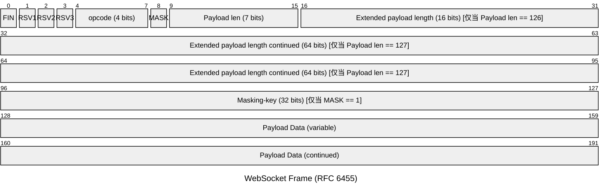

# 什么是 WebSocket 协议

> [!abstract] 一句话定义
> `http`协议是一问一答的，客户端每次发起`http`请求之后，服务端响应之后，这个连接就关闭了。如果服务器有消息要主动推送给客户端是做不到的。
> HTTP/1.1 的**长连接（Keep-Alive）** 虽然复用了 TCP 连接，但**通信模式依然是请求-响应**，服务器无法主动发起消息。这与 WebSocket 的全双工推送能力有本质区别。

> [!important] WebSocket 是一种在单个 TCP 连接上进行**全双工通信**的协议。它于 2011 年被定为标准 RFC 6455，核心价值在于解决了传统 HTTP 协议无法由服务器主动向客户端推送数据的问题。 
> **协议前缀**：`ws://`或者`wss://`
> [WebSocket.org](https://websocket.org/guides/road-to-websockets/)
> [WebSocket-Web API|MDN](https://developer.mozilla.org/zh-CN/docs/Web/API/WebSocket)

## 为什么要弄websocket协议？
在 WebSocket 出现前，要实现“实时更新”，主流方案是**轮询（Polling）**：客户端每隔几秒就发一次 HTTP 请求问服务器“有新数据吗？”。这种方式的问题很明显：
- **开销巨大**：每次 HTTP 请求都携带完整的头部（User-Agent、Cookie 等），而有效数据可能只有几个字节，造成带宽浪费。
- **实时性差**：数据更新有延迟，最长可达一个轮询间隔。
- **服务器无法主动**：本质上仍是“客户端拉取”，服务器没有“推送”的能力

WebSocket 改变了这个模式：**只需一次 HTTP 握手，就能将连接“升级”为全双工通道**，之后服务器和客户端都可以随时主动发送数据，实现了真正的实时双向通信。

## websocket如何连接的？
WebSocket 连接的起点巧妙地借用了 HTTP，以确保能穿过防火墙和代理。过程如下：
1. **客户端发起 HTTP 请求**，但携带特殊的头部，请求“升级”协议：
```http
GET /chat HTTP/1.1
Host: example.com
Upgrade: websocket
Connection: Upgrade
Sec-WebSocket-Key: dGhlIHNhbXBsZSBub25jZQ==
Sec-WebSocket-Version: 13
```
`Sec-WebSocket-Key` 是一个随机值，用于防止缓存代理错误地复用连接。

2. **服务器同意升级**，返回状态码 `101 Switching Protocols`：
```http
HTTP/1.1 101 Switching Protocols
Upgrade: websocket
Connection: Upgrade
Sec-WebSocket-Accept: s3pPLMBiTxaQ9kYGzzhZRbK+xOo=
```
`Sec-WebSocket-Accept` 是根据客户端的 Key 计算得出的，用于确认服务器理解了 WebSocket 协议。

握手完成后，**底层的 TCP 连接保持不变，但通信协议已从 HTTP 切换为 WebSocket**，后续数据便不再遵循 HTTP 的请求-响应模式。

## websocket的数据如何传输的？
WebSocket 传输数据的基本单位是**帧（Frame）**。一个消息可以由一个或多个帧组成。
相比 HTTP，WebSocket 帧的头部开销极小。在**客户端到服务器方向，最小的帧头只有 6 字节**（2 字节基础头 + 4 字节掩码），远小于 HTTP 每次请求的完整头部。这种轻量设计是 WebSocket 适合高频通信的关键。

帧只有两种类型：
- **数据帧**：承载文本（Text）或二进制（Binary）数据
- **控制帧**：用于连接管理，如 Ping、Pong（心跳保活）和 Close（关闭连接）

## 帧格式：协议的最小单位
每一帧结构：



字段：
- **FIN**：1 bit，是否为消息最后一帧。
- **RSV1/RSV2/RSV3**：各 1 bit，默认必须为 0；只有协商了扩展才可按扩展语义使用。
- **opcode**：4 bit：
  - 0x0 continuation，延续帧
  - 0x1 text
  - 0x2 binary
  - 0x8 close
  - 0x9 ping
  - 0xA pong
  - 其他保留
- **MASK**：1 bit。客户端发往服务器必须为 1；服务器发往客户端必须为 0。违反是协议错误。
- **Payload len**：7 bit：
  - 0–125：直接表示长度
  - 126：后面 2 字节无符号整数表示长度
  - 127：后面 8 字节无符号整数表示长度，最高位必须为 0
- **Masking-key**：MASK=1 时存在，4 字节。
- **Payload Data**：实际数据，可能被掩码。

掩码算法：```payload[i] = payload[i] XOR maskingKey[i % 4]```
掩码不是为了加密，主要是防止缓存代理投毒和跨协议攻击。
**客户端到服务器的最小帧头是 6 字节**：2 字节基础头 + 4 字节 mask key。**服务器到客户端最小是 2 字节**。

### 分片规则
一条消息可以拆成多帧：
- 第一帧：opcode 为 0x1 或 0x2，FIN=0。
- 中间帧：opcode=0x0，FIN=0。
- 最后一帧：opcode=0x0，FIN=1。
- 控制帧可以穿插在分片消息之间，但**控制帧不能分片**，且 FIN 必须为 1。
- 控制帧 payload 不能超过 125 字节。
- 文本消息重组后必须是合法 UTF-8，否则关闭码 1007。
- 实现必须限制单条消息总大小，超限通常关闭码 1009。

### 控制帧与关闭握手
- **Ping**：可带 ≤125 字节 payload。收到 Ping 必须尽快回 Pong，Pong 的 payload 应与 Ping 相同。
- **Pong**：可主动发送，也可作为心跳响应。
- **Close**：payload 前 2 字节是状态码，后面可选 UTF-8 reason。

常见关闭码：

| 码   | 含义                                   |
| ---- | -------------------------------------- |
| 1000 | 正常关闭                               |
| 1001 | 端点离开，如页面关闭                   |
| 1002 | 协议错误                               |
| 1003 | 收到不支持的数据类型                   |
| 1007 | 收到无效 UTF-8                         |
| 1008 | 策略违规                               |
| 1009 | 消息过大                               |
| 1010 | 客户端要求服务器协商扩展但服务器未支持 |
| 1011 | 服务器内部错误                         |
| 1012 | 服务重启                               |
| 1013 | 稍后重试                               |
| 1014 | Bad Gateway                            |
注意：
- `1005` 表示“没有状态码”，1006 表示“异常关闭”，这两个不能出现在 Close 帧里。
- `1015` TLS 握手失败，也不能由端点主动发送。
- 收到 Close 后应回一个 Close，然后关闭 TCP；不是直接断 TCP。
- TCP 断开但没有 Close 握手，对应用来说就是异常关闭，通常映射为 `1006`。

### 扩展与子协议
- **扩展**通过 `Sec-WebSocket-Extensions` 协商，可改变 RSV 位含义、帧 payload 处理方式。最常见是 permessage-deflate 压缩。
- **子协议**通过 `Sec-WebSocket-Protocol` 协商，属于应用层语义，例如 `graphql-ws`、`mqtt`、`wamp`。协议本身不定义这些内容。
- 如果没有协商扩展，收到 RSV 非 0 的帧应视为协议错误，关闭 `1002`。

### 协议错误处理
以下情况通常应关闭 1002：
- 客户端帧未掩码，或服务器帧被掩码；
- 未知 opcode；
- 控制帧被分片，或 payload >125；
- 未协商扩展却使用 RSV 位；
- 分片序列不合法，例如 continuation 没有起始帧；
- 收到无效关闭码；
- 文本消息不是合法 UTF-8，通常用 1007。

关闭时尽量发送 Close 帧并带合适状态码，然后关闭 TCP。

### 协议层核心总结
WebSocket 协议本身只提供：
- 一次 HTTP Upgrade 握手；
- 一个全双工 TCP 连接；
- 带 opcode 的帧、分片、控制帧；
- Ping/Pong 心跳原语；
- Close 握手和状态码；
- 扩展与子协议协商机制。

它**不提供**：消息确认、重连、离线消息、请求响应关联、鉴权、路由、背压策略。这些都在应用层或框架层解决。

## 典型的应用场景
WebSocket 适用于**需要服务器主动、高频、低延迟推送数据**的场景：
- **即时通讯与聊天**：消息的实时送达和已读回执。
- **实时协作**：多人文档编辑、在线白板，需要毫秒级同步光标和操作
- **金融与行情**：股票报价、加密货币价格的实时变动推送。
- **在线游戏**：游戏状态和玩家操作的实时同步。
- **直播互动**：弹幕、点赞、礼物等实时互动消息。
- **IoT 与远程监控**：设备状态实时上报和指令下发。
