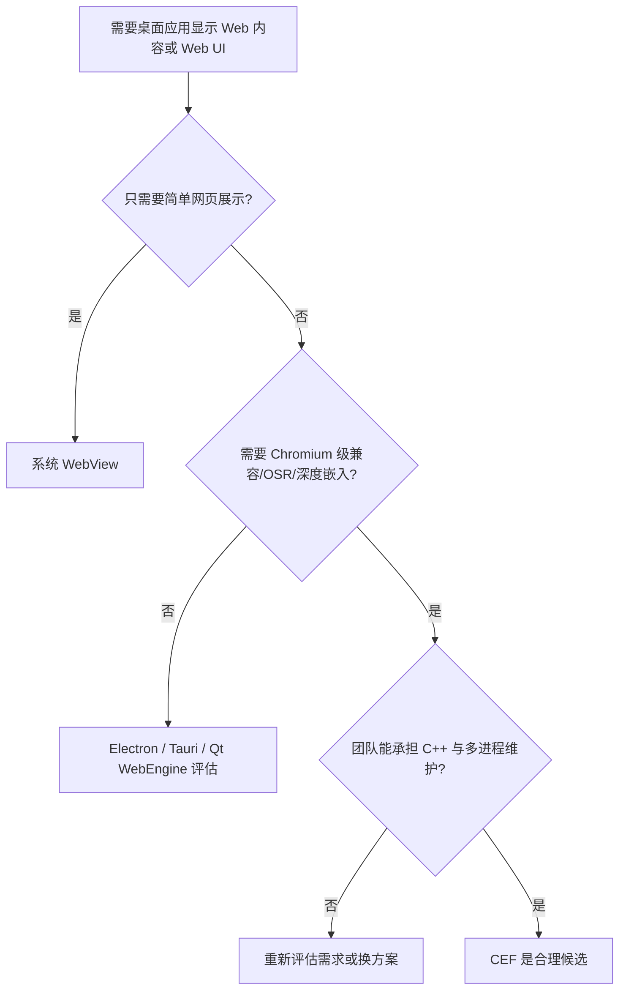
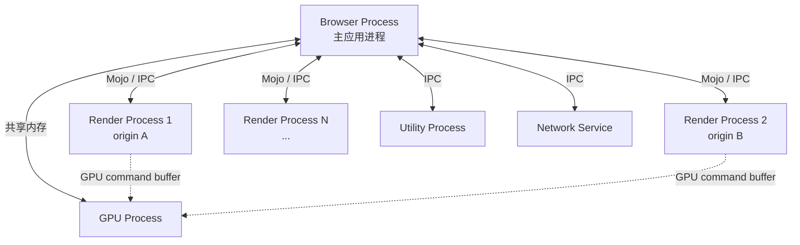
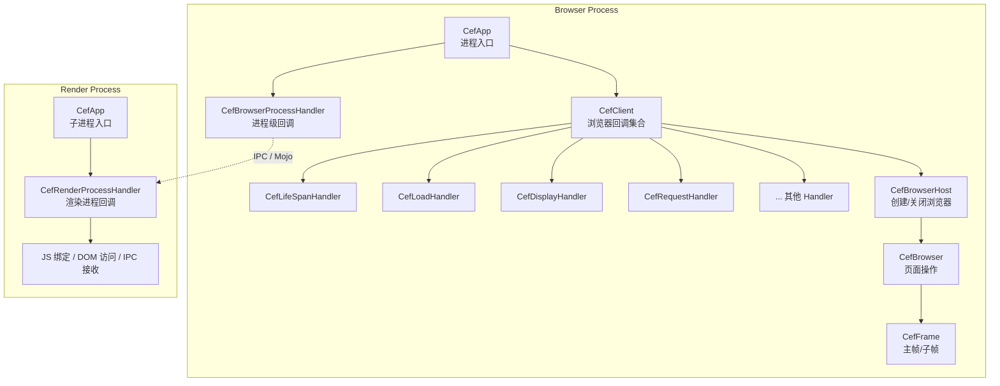

# 什么是 CEF

> [!abstract] 一句话定义
> **CEF** 是 **Chromium Embedded Frame** 的缩写。意思是“Chromium 嵌入式框架”。CEF 是一个**可嵌入的 Chromium 框架**，不是浏览器产品，也不是应用框架。它的价值在于把 Chromium 的渲染、网络、JS 引擎和多进程能力，变成原生应用可以集成的一个组件。
> [CEF Documentation](https://chromiumembedded.github.io/cef/)
> [Chromium Embedded Framework (CEF) Automated Builds](https://cef-builds.spotifycdn.com/index.html#windows64)

> [!info] 本文回答
> - CEF 到底是什么，不是什么
> - 它由哪些进程、线程和核心接口组成
> - 一个 CEF 应用如何启动、运行和退出
> - 构建部署时各平台的关键差异
> - 什么时候该用 CEF，什么时候不该用

## 1. 定义与边界

### 1.1 是什么
**CEF（Chromium Embedded Framework）是一个基于 Google Chromium 的开源框架，用于把 Chromium 浏览器内核嵌入到第三方桌面应用中。**

它的几个关键事实：

| 维度         | 说明                                 |
| ------------ | ------------------------------------ |
| 发起时间     | 2008 年，由 Marshall Greenblatt 创建 |
| 技术基础     | Google Chromium 项目                 |
| 许可证       | BSD，宽松，允许商业闭源使用          |
| 主要 API     | C++，同时提供 C API                  |
| 当前主流版本 | CEF3，多进程架构                     |
| 支持平台     | Windows、Linux、macOS                |

它主要解决两类问题：

1. **在原生应用里嵌入浏览器能力**：比如游戏启动器里显示公告页、IDE 里预览 HTML、桌面工具里打开第三方 Web 应用。
2. **用 Web 技术构建桌面应用界面**：应用的外壳是原生的，但界面由 HTML/CSS/JS 渲染，类似 Electron 的思路，但 CEF 更底层、更可嵌入。

> [!tip] 一句话记忆
> CEF 把“Chromium 浏览器”拆成一个**可以放进你程序里的库**，而不是让你去改 Chromium 源码。

#### 1.1.1 CEF3 的架构特征

CEF3 是目前实际使用的版本，核心特征是**多进程**：

- **Browser Process**：主应用进程，负责窗口、网络、生命周期、应用逻辑。
- **Render Process**：渲染进程，负责页面解析、布局、JS 执行，可存在多个。
- 还有 GPU、Utility 等辅助进程，按平台和功能启用。

这与 Chrome 的进程模型同源，目的是**隔离崩溃、提升稳定性**。一个渲染进程崩溃，通常不会直接拖垮主应用。

> [!note] 版本说明
> 早期的 CEF1 是单进程架构，已废弃。现在说 CEF，默认指 CEF3。

### 1.2 不是什么

定义边界比定义本身更重要。下面这些常见误解需要先排除。

#### 1.2.1 不是浏览器产品

CEF 不提供完整的浏览器 UI。它给你的是内核和框架，**地址栏、标签页、书签、设置页这些产品功能需要你自己实现**，或者基于 `cefclient` 示例去改。

它也不是“装个 CEF 就得到一个 Chrome”。

#### 1.2.2 不是 Electron 的简单替代品

Electron 是**应用级框架**：自带 Chromium、Node.js、打包工具和一套主进程/渲染进程约定，目标是快速做一个跨平台桌面应用。

CEF 是**更底层的嵌入框架**：它不规定你的应用架构，不强制 Node.js，不提供完整打包方案。你可以把它嵌进一个已有的 C++ 大型软件里，也可以用它做一个壳应用。**CEF 更灵活，但需要自己搭更多东西。**

#### 1.2.3 不是 WebView 的简单封装

系统 WebView（如 Windows 的 WebView2、macOS 的 WKWebView）依赖操作系统提供的浏览器组件，通常更轻量，但版本和行为受系统影响。

CEF **自带 Chromium 运行时**，版本由你自己控制，行为更一致，代价是包体积和内存开销更大。它不是“调一个系统控件”那么简单。

#### 1.2.4 不提供应用层业务框架

CEF 不提供路由、状态管理、数据库、自动更新、崩溃上报这些应用层能力。这些需要你在 CEF 之上自己设计，或引入其他库。

> [!warning] 常见误解
> “CEF 嵌入的是一个 iframe” —— 不对。CEF 嵌入的是 Chromium 的内容模块和浏览器能力，渲染、网络、JS 引擎都是真实的 Chromium，不是简单的外链网页。

#### 1.2.5 不是“零 C++ 门槛”

虽然界面可以用 Web 技术写，但 CEF 的集成层、构建配置、进程启动、回调处理都涉及 C++。团队如果没有 C++ 和多进程调试能力，维护成本会很高。

### 1.3 关键术语

下面这些术语会在后续章节反复出现，先建立统一口径。

#### 1.3.1 进程相关

| 术语                | 含义                                                   |
| ------------------- | ------------------------------------------------------ |
| **Browser Process** | 主应用进程，CEF 的入口，管理窗口、网络、浏览器生命周期 |
| **Render Process**  | 渲染进程，执行页面渲染和 JS，可多个，崩溃隔离          |
| **GPU Process**     | 图形加速进程，平台相关                                 |
| **Utility Process** | 辅助任务进程，按需启用                                 |
| **Helper App**      | macOS 上的独立子进程可执行文件，CEF 子进程必须用它     |

#### 1.3.2 核心接口

| 术语               | 含义                                                          |
| ------------------ | ------------------------------------------------------------- |
| **CefApp**         | 进程级应用对象，处理应用初始化、子进程回调                    |
| **CefClient**      | 浏览器级回调集合，把生命周期、加载、请求等 Handler 组织在一起 |
| **CefBrowser**     | 浏览器对象，用于页面操作，如加载 URL、前进后退、执行 JS       |
| **CefBrowserHost** | 浏览器宿主，用于创建浏览器、获取窗口句柄、关闭浏览器          |

#### 1.3.3 渲染与 UI 模式

| 术语                            | 含义                                                           |
| ------------------------------- | -------------------------------------------------------------- |
| **OSR（Off-Screen Rendering）** | 离屏渲染，CEF 把页面渲染到内存缓冲区，由应用自己绘制和处理输入 |
| **Alloy UI**                    | CEF 提供的轻量跨平台 UI 样式，偏传统控件风格                   |
| **Chrome UI**                   | 接近 Chrome 浏览器外观的 UI 样式                               |
| **Views**                       | CEF 的跨平台 UI 框架，可用于构建窗口和控件                     |

#### 1.3.4 构建与运行

| 术语                   | 含义                                                          |
| ---------------------- | ------------------------------------------------------------- |
| **libcef_dll_wrapper** | CEF C++ 接口的封装静态库，应用需要链接它                      |
| **资源文件**           | `.pak`、`.bin`、`.dat` 等 Chromium 运行时资源，必须随应用部署 |
| **sandbox**            | 沙箱机制，限制子进程权限，各平台配置不同                      |
| **消息循环**           | CEF 和平台事件循环的驱动机制，OSR 场景下尤其需要注意          |

> [!tip] 术语使用建议
> 文档里统一用 **Browser Process / Render Process**，不要混用“主进程/渲染进程/子进程”导致歧义。子进程是统称，Render Process 是其中一种。

### 1.4 边界小结

可以用下面这张表快速判断“这是不是 CEF 的职责”：

| 问题                   | 属于 CEF     | 需要自己做 |
| ---------------------- | ------------ | ---------- |
| 页面渲染、JS 执行      | ✅            |            |
| 网络请求、缓存、Cookie | ✅            |            |
| 多进程隔离             | ✅            |            |
| 地址栏、标签页、书签   |              | ✅          |
| 应用路由、状态管理     |              | ✅          |
| 自动更新、安装包       |              | ✅          |
| 业务协议、账号体系     |              | ✅          |
| 打包与分发             | 提供库和资源 | ✅ 整体方案 |

> [!question] 自检
> - [ ] 我能用一句话说清 CEF 和 Electron 的区别吗？
> - [ ] 我知道 CEF 自带 Chromium，而 WebView 依赖系统组件吗？
> - [ ] 我能区分 CefApp、CefClient、CefBrowser 的职责吗？
> - [ ] 我知道 OSR 是渲染模式，不是 UI 样式吗？

> [!info] 下一篇
> [[03-什么是CEF#2. 为什么需要 CEF]]：从原生桌面应用的痛点出发，解释 CEF 的成本收益。

## 2. 为什么需要 CEF

> [!abstract] 本节结论
> CEF 不是“更高级的界面方案”，而是一笔**用包体积、内存和 C++ 复杂度，换取 Chromium 级渲染能力与 Web 生态复用**的交易。值不值得，取决于你的产品是否真的需要那部分能力。

> [!info] 本节回答
> - 原生桌面应用在 UI 和内容呈现上有哪些结构性痛点
> - CEF 具体用什么方式解决这些痛点
> - 这些解法附带哪些真实成本
> - 什么条件下这笔交易划算，什么条件下不划算

### 2.1 原生桌面应用的痛点

先说清楚问题，才能判断 CEF 是不是答案。

#### 2.1.1 复杂 UI 的开发效率低

原生 UI 框架（Win32、MFC、WPF、Qt Widgets、Cocoa）在构建**复杂、动态、富交互**的界面时，成本明显偏高：

- 布局系统相对笨重，复杂界面需要大量手写代码。
- 动画、过渡、自定义绘制需要额外框架或自绘。
- 样式与主题系统通常不如 CSS 灵活。
- 每次 UI 调整都可能涉及编译、链接、重新部署。

对于**表单密集、列表复杂、需要频繁迭代视觉**的产品，原生 UI 的开发效率会成为瓶颈。

#### 2.1.2 跨平台一致性差

原生方案要做到 Windows、Linux、macOS 行为一致，通常有三条路：

| 路径                      | 问题                               |
| ------------------------- | ---------------------------------- |
| 每个平台各写一套原生 UI   | 成本翻倍，行为难以对齐             |
| 用跨平台 UI 框架（如 Qt） | 仍有平台差异，复杂控件定制成本高   |
| 自绘统一 UI               | 工作量大，可访问性和输入法处理复杂 |

结果往往是：**功能一致，但视觉、交互、字体渲染、滚动行为仍有差异**。

#### 2.1.3 现代 Web 生态难以复用

大量现成能力沉淀在 Web 生态里：

- 富文本编辑器、图表库、地图、PDF 预览、视频播放器。
- 设计系统和组件库（Material、Ant Design 等）。
- 前端工程化工具链：构建、热更新、调试、测试。

原生应用如果完全不用 Web 技术，这些能力要么重写，要么找替代品，**复用成本很高**。

#### 2.1.4 富内容呈现能力弱

原生控件对以下内容的支持通常不如浏览器：

- 复杂 HTML/CSS 排版。
- 内嵌网页、第三方 Web 应用。
- 在线文档、Markdown 渲染、代码高亮。
- 音视频与 WebGL/Canvas 内容。

如果产品需要**稳定地显示“网页级”内容**，自己实现渲染引擎基本不现实。

#### 2.1.5 迭代速度受制于原生发布链路

原生应用的 UI 改动通常需要重新编译、打包、发版。相比之下，Web 内容可以**热更新、灰度、快速回滚**。对于内容频繁变化的模块（公告、帮助中心、运营页），原生方案的迭代节奏明显更慢。

> [!warning] 痛点归纳
> 这些痛点可以归结为一句话：**原生应用擅长系统集成和性能敏感场景，但不擅长复杂 UI 的快速构建与 Web 内容呈现。**

### 2.2 CEF 提供的解法

CEF 的解法不是“一个功能”，而是一组能力的组合。

#### 2.2.1 用 HTML/CSS/JS 构建界面

CEF 可以把 Chromium 的渲染能力嵌入应用，让界面由 Web 技术驱动：

- 布局用 CSS，动画用 CSS/JS，组件用现成前端库。
- 复用前端工程化：构建、热更新、调试工具。
- 设计与开发可以用同一套 Web 设计系统。

这类似 Electron 的思路，但 CEF **不强制应用架构**，可以只把某个区域做成 Web UI，其余保持原生。

#### 2.2.2 在原生应用中嵌入完整浏览器能力

CEF 嵌入的是真实的 Chromium 内容模块，不是简单外链：

| 能力             | 说明                                  |
| ---------------- | ------------------------------------- |
| 页面渲染         | 完整 Chromium 渲染管线                |
| JS 执行          | V8 引擎                               |
| 网络栈           | Chromium 网络层，含缓存、Cookie、代理 |
| 第三方网页兼容性 | 与 Chrome 高度接近                    |
| DevTools         | 可接入调试工具                        |

适合场景：IDE 内预览、游戏启动器内嵌公告/商城、桌面工具内打开第三方 Web 应用。

#### 2.2.3 复用 Chromium 的渲染、网络与 JS 引擎

自己维护一个浏览器内核不现实。CEF 让你直接复用 Chromium 的：

- 渲染与排版。
- 网络请求、缓存、Cookie、代理。
- JavaScript 引擎与 Web API。
- 安全更新（跟随 Chromium 版本）。

这是 CEF 相对“自研 UI 渲染”最大的杠杆。

#### 2.2.4 支持离屏渲染与深度定制

CEF 提供 **OSR（Off-Screen Rendering）**：页面渲染到内存缓冲区，由应用自己绘制、自己处理输入。这打开了这些场景：

- 把网页渲染结果合成到 3D 场景或游戏引擎。
- 自定义窗口形态、透明、异形窗口。
- 远程桌面、录屏、自动化测试中的页面捕获。
- 与原生绘制体系深度混合。

> [!tip] 关键区别
> 窗口内渲染是“CEF 管窗口，你管业务”；OSR 是“CEF 给像素，你管一切”。后者更灵活，但输入、焦点、刷新都要自己处理。

#### 2.2.5 与原生代码双向通信

CEF 提供 JS 与原生代码的桥接机制：

- 原生调用 JS：`CefBrowser::ExecuteJavaScript` 等。
- JS 调用原生：通过 `CefMessageRouter` 或自定义绑定。
- 请求拦截、自定义协议、资源加载钩子。

这让“Web 界面 + 原生能力”可以组合，而不是二选一。

### 2.3 代价

CEF 的收益真实，成本也真实。下面这些必须在选型时摆到桌面上。

#### 2.3.1 包体积大

CEF 自带 Chromium 运行时，发布包通常会增加**数十到上百 MB**，具体取决于平台、是否包含调试符号、资源裁剪程度。

| 对比对象          | 体积感受                  |
| ----------------- | ------------------------- |
| 系统 WebView 方案 | 明显更小                  |
| Electron          | 同一量级，都自带 Chromium |
| 纯原生应用        | 差距显著                  |

对“下载体积敏感”的产品（如小工具、移动端伴生应用），这是硬约束。

#### 2.3.2 内存占用高

多进程架构意味着：

- 每个 Render Process 有独立内存开销。
- GPU、Utility 进程额外占用。
- 页面复杂时内存增长明显。

对于低配设备、嵌入式设备、需要常驻后台的工具，内存预算要提前评估。

#### 2.3.3 多进程与线程模型复杂

CEF 的很多接口**只能在特定进程或线程调用**：

- 回调在哪个进程触发，取决于它属于 Browser 还是 Render。
- UI 线程、IO 线程、Render 线程职责不同。
- 跨进程通信需要按 CEF 的机制来，不能直接共享内存对象。

这带来实实在在的调试成本。团队需要理解进程模型，否则容易写出“本地能跑、打包就崩”的代码。

> [!danger] 高频坑
> 把只能在 Browser Process 使用的接口放到 Render Process 调用，或者忽略线程约束直接跨线程访问 UI，是 CEF 集成中最常见的一类问题。

#### 2.3.4 版本升级与安全跟进成本

CEF 跟随 Chromium 更新。Chromium 版本迭代快，安全修复频繁。选择 CEF 意味着：

- 需要定期升级 CEF 版本。
- 升级可能带来 API 变化、行为变化、构建配置变化。
- 不升级则积累安全风险。

这是一项**持续性维护成本**，不是一次性集成成本。

#### 2.3.5 C++ 门槛与构建复杂度

CEF 的集成层是 C++：

- 需要编译 `libcef_dll_wrapper`。
- 需要处理各平台资源文件、动态库、Helper App。
- 需要理解消息循环、沙箱、子进程启动参数。

团队如果没有 C++ 和多进程调试能力，维护成本会显著上升。

#### 2.3.6 不是“Web 开发团队可以独立完成”的方案

虽然界面是 Web 技术，但**集成、构建、进程通信、发布**仍然需要原生侧深度参与。把 CEF 项目当成纯前端项目来管，通常会出问题。

### 2.4 成本收益判断

#### 2.4.1 收益侧：什么时候值得

| 条件                                | 说明                               |
| ----------------------------------- | ---------------------------------- |
| 需要 Chromium 级渲染与兼容性        | 第三方网页、复杂 CSS、现代 Web API |
| 需要嵌入完整浏览器能力              | 不只是显示一个网页                 |
| 需要 OSR 或深度定制                 | 游戏引擎合成、异形窗口、远程渲染   |
| 已有大型原生应用，想增量引入 Web UI | CEF 可嵌入，不必重写整个应用       |
| 团队有 C++ 能力                     | 能承担集成与维护                   |

#### 2.4.2 成本侧：什么时候不值得

| 条件                   | 更合适的方向                         |
| ---------------------- | ------------------------------------ |
| 只需要显示简单网页     | 系统 WebView（WebView2 / WKWebView） |
| 包体积和内存极度敏感   | 原生 UI 或系统 WebView               |
| 团队没有 C++ 维护能力  | Electron / Tauri 等更高层方案        |
| 只需要一个跨平台壳应用 | Electron 更省事                      |
| 不需要 Chromium 特性   | 不必为用不到的能力付成本             |

#### 2.4.3 一个简化决策流程

> [!note] 选型不是“谁更强”
> 是“谁的成本结构匹配你的产品约束”。CEF 的能力上限高，但它的成本也更高，且是持续成本。

#### 2.4.4 和相邻方案的一句话对比
| 方案         | 一句话定位                                        |
| ------------ | ------------------------------------------------- |
| CEF          | 可嵌入的 Chromium 框架，灵活但底层，适合深度集成  |
| Electron     | 应用级桌面壳，自带 Chromium + Node，开发快但更重  |
| Tauri        | Rust + 系统 WebView，包小，渲染能力依赖系统       |
| WebView2     | Windows 系统 WebView 控件，轻量，依赖 Edge 运行时 |
| Qt WebEngine | Qt 生态内的 Chromium 集成，绑定 Qt 技术栈         |

## 3. 核心架构

> [!abstract] 本节结论
> CEF 的架构可以概括为一句话：**用多进程隔离风险，用多线程划分职责，用消息循环驱动一切，用 IPC 连接进程**。理解这四条线，就理解了 CEF 为什么这样设计，以及为什么很多坑来自“在错误的地方做正确的事”。

> [!info] 本节回答
> - CEF 为什么采用多进程，而不是单进程
> - Browser Process 和 Render Process 各自负责什么，不负责什么
> - 进程内有哪些关键线程，哪些接口有线程约束
> - CEF 消息循环的三种集成方式，以及如何选择
> - 进程之间如何通信，应用层最常用的 IPC 抽象是什么
> - 沙箱在架构中的位置

### 3.1 设计动因：为什么是多进程

CEF3 继承 Chromium 的多进程模型，每个进程类型运行在**独立的操作系统进程**中，目的是**安全、稳定和并行**。

三个动因分别对应三个问题：

| 动因       | 解决的问题                         | 机制                                    |
| ---------- | ---------------------------------- | --------------------------------------- |
| **稳定性** | 渲染崩溃或 JS 死循环不应拖垮主应用 | Render Process 独立，崩溃可被感知和恢复 |
| **安全性** | 不可信网页内容不应拥有完整系统权限 | 沙箱按进程类型限制资源访问[reference:1] |
| **并行性** | 渲染、网络、GPU 不应互相阻塞       | 不同进程独立调度，互不抢占事件循环      |

> [!important] 架构选择的前提
> 多进程不是“为了先进而先进”。它带来的隔离收益，是以**进程管理复杂度、内存开销和 IPC 成本**换来的。CEF 的很多工程约束，根源都在这里。

### 3.2 进程类型与职责

CEF3 不是“一个主进程加一个渲染进程”这么简单。一个运行中的 CEF 应用可能同时存在多种进程。

#### 3.2.1 进程全景

#### 3.2.2 Browser Process
Browser Process 是宿主应用的主进程，也是 CEF 的“控制平面”。

| 职责                                    | 说明                          |
| --------------------------------------- | ----------------------------- |
| 窗口创建与管理                          | 原生窗口、浏览器宿主窗口      |
| UI 线程主事件循环                       | TID_UI                        |
| IO 线程                                 | IPC、网络事件，TID_IO         |
| 文件线程                                | TID_FILE_*，文件系统操作      |
| 网络栈管理                              | 通过 Network Service          |
| Cookie、认证、证书处理                  | 浏览器级状态                  |
| CefClient 全部 Handler 回调             | Display、LifeSpan、Request 等 |
| CefApp::GetBrowserProcessHandler() 回调 | 进程级初始化与调度            |

> [!note] 关键认知
> Browser Process 的“绘制”指的是承载网页内容的窗体壳，不是 HTML 内容本身的渲染。HTML 渲染发生在 Render Process。

#### 3.2.3 Render Process
Render Process 是内容平面，运行 Blink 和 V8。

| 职责                                   | 说明                         |
| -------------------------------------- | ---------------------------- |
| HTML 解析、CSS 布局、绘制              | Blink 引擎                   |
| JavaScript 执行                        | V8 引擎                      |
| DOM 访问与操作                         | 页面级                       |
| 自定义 JS 绑定                         | 通过 CefRenderProcessHandler |
| CefApp::GetRenderProcessHandler() 回调 | 渲染进程级初始化             |

进程分配策略：默认进程模型为每个唯一源（scheme + domain）启动一个新的 Render Process。这意味着同一站点的多个页面可能共享进程，不同站点之间隔离。

> [!warning] 易混淆点
> Render Process 不负责创建原生窗口。它只负责“页面内容”的渲染和 JS 执行。窗口壳在 Browser Process。

#### 3.2.4 GPU Process
GPU Process 承担加速合成与最终绘制：
- 通过 Viz display compositor 做加速合成。
- ANGLE 将 GL ES 翻译为平台原生图形 API（D3D / Vulkan / Metal）。
- 将 display list 光栅化为 GPU 纹理瓦片。
- 聚合来自所有 Render Process 和 Browser Process 的帧，最终绘制到屏幕。
- WebGL 执行。
Render Process 通过共享内存中的 GPU command buffer 与 GPU Process 通信。

#### 3.2.5 Utility Process 与 Network Service
Utility Process 是短生命周期或辅助型任务的载体：数据解码、音频服务等。Network Service 负责 HTTP/HTTPS 栈、DNS 解析、Cookie 存储等。它们通常也被沙箱化。

#### 3.2.6 子进程是如何启动的
CEF 支持两种子进程启动模型：

- 单可执行文件模型（Windows / Linux 默认）：主应用可执行文件被重新启动，通过 --type=renderer、--type=gpu-process 等命令行参数区分角色。入口点调用 CefExecuteProcess() 检测子进程身份。
- 独立子进程可执行文件：通过 CefSettings.browser_subprocess_path 指定单独的 helper 可执行文件，只调用 CefExecuteProcess()。主应用很大或启动很慢时更合适。
- macOS 的特殊性：子进程必须使用独立的 Helper App Bundle，不能照搬 Windows / Linux 的单可执行文件思路。这是平台约束，不是可选项。
- Linux Zygote：Chromium 在 Linux 上使用 Zygote 进程（--type=zygote）fork 出 Renderer，分为沙箱化和非沙箱化两个 Zygote。

### 3.3 线程模型与约束
进程划分了“大边界”，线程划分了“小边界”。CEF 中很多接口只能在特定进程的特定线程调用，这是集成阶段最高频的坑之一。

#### 3.3.1 关键线程
| 线程         | 所在进程 | 职责                                               |
| ------------ | -------- | -------------------------------------------------- |
| TID_UI       | Browser  | 浏览器主线程，UI 与大多数 CefClient 回调           |
| TID_IO       | Browser  | 处理 IPC 和网络消息                                |
| TID_FILE_*   | Browser  | 文件系统操作，阻塞任务                             |
| TID_RENDERER | Render   | Renderer 主线程，所有 Blink 和 V8 交互必须在此线程 |

> [!danger] 线程铁律
> 所有 WebKit / V8 交互必须在 TID_RENDERER 上执行。所有 UI / Render 相关 API 必须在 Browser Process 的 UI 线程中调用。违反线程约束是 CEF 崩溃的常见根因之一。

#### 3.3.2 回调不一定在“你期望的线程”
一个真实案例：CefLoadHandler::OnLoadingStateChange 在部分版本中可能在 IO 线程而非 UI 线程触发，如果在这个回调里直接调用 UI API，可能崩溃。正确做法是先确认线程亲和性，再决定是否需要 CefPostTask 转发到 UI 线程。

> [!tip] 防御性写法
> 在可能跨线程的回调里，不要假设当前线程身份。用 CefCurrentlyOn(TID_UI) 判断，用 CefPostTask(TID_UI, ...) 转发。宁可多一次转发，不要赌线程。

#### 3.3.3 跨线程任务投递
CEF 提供 CefPostTask() 将任务异步投递到指定线程，这是线程间协作的标准方式。不要用平台原生线程同步原语直接操作 CEF 对象。

### 3.4 消息循环
CEF 需要消息循环来驱动浏览器事件、IPC 和渲染调度。消息循环的集成方式是 CEF 架构中必须尽早决定的问题，因为它决定了主应用的控制流结构。

#### 3.4.1 三种集成方式

| 方式                   | 适用场景                                | 关键 API / 设置                                |
| ---------------------- | --------------------------------------- | ---------------------------------------------- |
| CEF 自有消息循环       | 应用没有自己的主循环，或可以让 CEF 接管 | CefRunMessageLoop()                            |
| 外部消息泵（手动驱动） | 应用已有自己的消息循环，需要精细控制    | 定期调用 CefDoMessageLoopWork()                |
| 多线程消息循环         | 希望 CEF UI 线程独立于主应用线程        | CefSettings.multi_threaded_message_loop = true |

#### 3.4.2 CefRunMessageLoop() 与 CefDoMessageLoopWork()
CefRunMessageLoop() 让 CEF 运行自己的完整消息循环，阻塞直到 CefQuitMessageLoop() 被调用。

CefDoMessageLoopWork() 只执行一次迭代。每次调用处理一轮 CEF 消息。它适合集成到已有消息循环中，但频率需要谨慎控制：调用太少会导致 CEF 消息循环饥饿，浏览器性能下降；调用太多会推高 CPU 占用。

> [!important] 互斥关系
> CefDoMessageLoopWork() 和 CefRunMessageLoop() 互斥，不能混用。要么让 CEF 自己跑循环，要么你手动驱动，不能两者同时使用。

#### 3.4.3 多线程消息循环
设置 CefSettings.multi_threaded_message_loop = true（Windows / Linux）会让 CEF 在独立于主应用线程的线程上运行浏览器 UI 线程。此时既不需要调用 CefDoMessageLoopWork()，也不需要 CefRunMessageLoop()，但 CefInitialize() 和 CefShutdown() 仍然必须在主应用线程调用，并且你需要自己提供与 CEF UI 线程通信的机制。

> [!note] OSR 场景的特殊性
> 离屏渲染（OSR）通常不依赖原生窗口消息驱动，但 CEF 的消息循环仍然需要被驱动。OSR 下输入事件、渲染调度和帧提交都依赖消息循环，不能因为没有窗口就跳过循环。

#### 3.4.4 选择建议
| 你的情况                         | 建议                                               |
| -------------------------------- | -------------------------------------------------- |
| 新项目，没有既有主循环           | CefRunMessageLoop() 或 multi_threaded_message_loop |
| 已有 Win32 / Qt / 游戏引擎主循环 | CefDoMessageLoopWork() 定期调用                    |
| 需要 CEF 与主线程彻底解耦        | multi_threaded_message_loop = true（仅 Win/Linux） |
| OSR + 自绘引擎                   | 根据引擎主循环选择外部消息泵或独立线程             |

### 3.5 进程间通信（IPC）
多进程意味着不能直接共享 C++ 对象。Browser 和 Render 之间的所有数据交换都走 IPC，且默认是异步的。

#### 3.5.1 IPC 分层
| 层          | 机制                                         | 使用者              |
| ----------- | -------------------------------------------- | ------------------- |
| 底层        | Mojo（现代 IPC，Mojom IDL，消息管道）        | Chromium / CEF 内部 |
| 底层        | Legacy IPC（逐步淘汰）                       | 内部兼容            |
| 底层        | 共享内存（纹理、缓冲区、GPU command buffer） | 大数据传输          |
| CEF 应用层  | CefProcessMessage                            | 你的应用代码        |
| JS ↔ C++ 桥 | CefMessageRouter                             | 前端与原生通信      |

Mojo 是 Chromium 的现代 IPC 系统，提供双向类型化通信，比 legacy IPC 更快、上下文切换更少。但**应用开发者通常不需要直接接触 Mojo**，CEF 暴露的 CefProcessMessage 才是应用层的标准抽象。

#### 3.5.2 CefProcessMessage：应用级进程消息
Browser 和 Render 之间通过 CefProcessMessage 传递消息：
- 从 Browser 发往 Renderer：browser->GetMainFrame()->SendProcessMessage(PID_RENDERER, message)
- 在 Renderer 侧接收：CefRenderProcessHandler::OnProcessMessageReceived()
- 从 Renderer 发回 Browser：frame->SendProcessMessage(PID_BROWSER, message)
- 在 Browser 侧接收：CefClient::OnProcessMessageReceived()

消息携带 CefListValue 参数列表，支持字符串、整数、浮点数、布尔、二进制、字典和嵌套列表。

> [!warning] 异步默认
> CefProcessMessage 是异步的。Browser 发出一条消息后，不会阻塞等待 Renderer 回复。如果需要“请求-响应”语义，要么在应用层维护消息 ID 和回调映射，要么使用 CefMessageRouter。

#### 3.5.3 CefMessageRouter：JS 与 C++ 的异步桥
CefMessageRouter 是 CEF 内置的高层抽象，专门用于 JavaScript 与 C++ 的异步通信：

- Browser 侧创建 CefMessageRouterBrowserSide，Renderer 侧创建 CefMessageRouterRendererSide。
- JS 调用 window.cefQuery({request, onSuccess, onFailure})。
- 消息经 IPC 到达 Browser 进程，路由到注册的 Handler::OnQuery()。
- Handler 调用 Callback::Success() / Failure()，响应回到 JS 回调。
- 大消息（超过配置阈值）会自动走共享内存传输。

> [!tip] 选择原则
> 如果通信发生在 JS 和 C++ 之间，优先用 CefMessageRouter，它已经处理了路由、回调和取消。如果通信发生在 Browser 和 Renderer 的 C++ 代码之间，用 CefProcessMessage。不要为了“简单”在 JS 侧手写裸 CefProcessMessage。

### 3.6 沙箱与进程隔离
沙箱是进程模型的安全延伸，不是独立架构层。

Chromium/CEF 的多进程模型允许按子进程类型限制系统资源访问。例如，执行 JavaScript 的 Renderer 子进程不需要直接访问文件系统或网络栈。如果该子进程被恶意网页内容攻破，沙箱会在造成实质危害之前终止它。

各平台沙箱要求不同，但核心逻辑一致：进程越不可信，权限越少。

| 平台    | 关键要求                                                                                                                   |
| ------- | -------------------------------------------------------------------------------------------------------------------------- |
| Windows | 同一可执行文件用于 Browser 和子进程（与 browser_subprocess_path 互斥）；链接 cef_sandbox 静态库；M138 起对工具链有额外约束 |
| Linux   | 通过 Zygote 和 namespace 限制                                                                                              |
| macOS   | Helper App Bundle 内配置沙箱                                                                                               |
> [!note] 架构位置
> 沙箱不是“可选加固”。它和多进程是同一个设计决策的两面：隔离进程是为了限制风险，沙箱是为了让隔离真正有意义。关闭沙箱等于放弃 Renderer 侧的安全边界。

### 3.7 架构小结
可以用下面这张表把本节压缩成可引用的判断依据：

| 问题                     | 答案                                                                                                |
| ------------------------ | --------------------------------------------------------------------------------------------------- |
| 为什么多进程？           | 稳定性、安全性、并行性，以复杂度和内存为代价                                                        |
| Browser Process 做什么？ | 窗口、网络、生命周期、CefClient 回调、IPC 控制面                                                    |
| Render Process 做什么？  | Blink 渲染、V8 执行、DOM、JS 绑定                                                                   |
| 最关键的线程约束？       | V8/Blink 只在 TID_RENDERER；UI 相关只在 Browser UI 线程                                             |
| 消息循环怎么选？         | 无主循环用 CefRunMessageLoop；有主循环用 CefDoMessageLoopWork；要解耦用 multi_threaded_message_loop |
| 应用层 IPC 用什么？      | CefProcessMessage（C++ 之间）；CefMessageRouter（JS ↔ C++）                                         |
| 沙箱的位置？             | 多进程的安全延伸，按进程类型限制权限                                                                |

> [!question] 自检
> - [ ] 我能解释为什么 Render Process 不创建窗口吗？
> - [ ] 我知道 CefDoMessageLoopWork() 和 CefRunMessageLoop() 为什么不能混用吗？
> - [ ] 如果 OnLoadingStateChange 在 IO 线程触发，我会怎么处理？
> - [ ] 我能区分 CefProcessMessage 和 CefMessageRouter 的使用场景吗？
> - [ ] 我知道 macOS 的子进程启动方式和 Windows/Linux 有什么不同吗？

> [!info] 下一篇
> [[03-什么是CEF#4. 关键接口与对象]]：在进程和线程的骨架之上，逐个展开 CefApp、CefClient、CefBrowser、Handler 的职责与关系。

## 4. 关键接口与对象

> [!abstract] 本节结论
> CEF 的接口设计可以理解为三层：**进程入口（CefApp）→ 浏览器回调集合（CefClient + Handler）→ 页面操作对象（CefBrowser / CefBrowserHost）**。理解这三层的职责边界，比记住每个方法名更重要。很多集成问题——回调用错线程、对象生命周期管理混乱、Handler 职责重叠——根源都是没有把这三层分清。

> [!info] 本节回答
> - CefApp 在 Browser 和 Render 进程中分别扮演什么角色
> - CefClient 为什么是“回调集合”，而不是“浏览器对象”
> - CefBrowser 和 CefBrowserHost 的分工是什么，创建浏览器走哪个入口
> - 常用 Handler 各自负责什么，不负责什么
> - cefsimple 如何把这三层串成一个可运行的骨架

### 4.1 三层结构总览

先建立整体视图，再逐层展开。

这张图的核心信息：
- **CefApp 在两侧都存在**，但提供的 Handler 不同：Browser 侧给 `CefBrowserProcessHandler`，Render 侧给 `CefRenderProcessHandler`。
- **CefClient 只在 Browser 侧**，它是浏览器级别回调的**分发中心**，通过 `GetXxxHandler()` 把事件路由到具体 Handler。
- **CefBrowserHost 是创建浏览器的入口**，CefBrowser 是操作页面的句柄。两者容易混淆，但职责不同。

### 4.2 浏览器级：CefClient
**CefApp 是 CEF 的应用级对象，每个进程都有一个实例。** 它不直接处理浏览器事件，而是负责提供进程级别的 Handler 和初始化回调。

#### 4.2.1 关键方法
| 方法                              | 所在进程         | 用途                                                                                |
| --------------------------------- | ---------------- | ----------------------------------------------------------------------------------- |
| `OnBeforeCommandLineProcessing()` | Browser / Render | 在命令行解析前修改 CEF 启动参数                                                     |
| `OnRegisterCustomSchemes()`       | Browser / Render | 注册自定义 scheme（如 app://）                                                      |
| `GetBrowserProcessHandler()`      | Browser          | 返回 CefBrowserProcessHandler，提供 OnContextInitialized() 等进程级回调             |
| `GetRenderProcessHandler()`       | Render           | 返回 CefRenderProcessHandler，提供 JS 绑定、OnProcessMessageReceived 等渲染进程回调 |

`OnContextInitialized()` 是 Browser 侧最常用的入口：CEF 初始化完成、可以创建浏览器时触发。cefsimple 就是在 |SimpleApp::OnContextInitialized() 中创建第一个浏览器窗口的。

> [!important] CefApp 不是“应用逻辑容器”
> 不要把业务逻辑塞进 CefApp。它的职责是进程级初始化与 Handler 提供。浏览器级逻辑应该放在 CefClient 和对应的 Handler 中。

#### 4.2.2 Browser 侧 vs Render 侧
同一个 CefApp 子类在两个进程中都会被创建，但调用的方法不同：
- Browser 侧：GetBrowserProcessHandler() 被调用，返回进程级 Handler。
- Render 侧：GetRenderProcessHandler() 被调用，返回渲染进程 Handler。

**不要假设 CefApp 的方法只在 Browser 进程执行**。`OnBeforeCommandLineProcessing` 和 `OnRegisterCustomSchemes` 会在多个进程中触发。

### 4.3 浏览器回调集合：CefClient

**CefClient 是浏览器级别的回调分发器，不是浏览器对象本身。** 它把生命周期、加载、显示、请求、键盘、下载等各类事件，通过 `GetXxxHandler()` 暴露给具体的 Handler 实现。

#### 4.3.1 为什么是“集合”

CefClient 本身不定义大量事件方法，而是持有一组 Handler 的引用。可以把它理解成一个分发中心：

| CefClient 的方法          | 返回的 Handler          | 负责的事件域       |
| ------------------------- | ----------------------- | ------------------ |
| `GetLifeSpanHandler()`    | `CefLifeSpanHandler`    | 创建、关闭、弹窗   |
| `GetLoadHandler()`        | `CefLoadHandler`        | 页面加载状态       |
| `GetDisplayHandler()`     | `CefDisplayHandler`     | 标题、地址、控制台 |
| `GetRequestHandler()`     | `CefRequestHandler`     | 网络请求拦截       |
| `GetContextMenuHandler()` | `CefContextMenuHandler` | 右键菜单           |
| `GetDialogHandler()`      | `CefDialogHandler`      | 原生对话框         |
| `GetDownloadHandler()`    | `CefDownloadHandler`    | 下载               |

这种设计的好处是**关注点分离**：你不需要实现一个包含几十个虚函数的巨型类，而是按需返回具体的 Handler。

cefsimple 中的 `SimpleHandler` 就同时继承了 `CefClient`、`CefLifeSpanHandler`、`CefLoadHandler` 和 `CefDisplayHandler`，用一个类实现了多个 Handler 接口。这是最小示例的写法，不是强制模式。

#### 4.3.2 CefClient 自身的唯一关键回调

除了分发 Handler，CefClient 自身最重要的方法是 `OnProcessMessageReceived()`：**接收来自 Render 进程的 `CefProcessMessage`**。

这是 Browser 侧处理进程间通信的落点。Render 侧对应的方法在 `CefRenderProcessHandler::OnProcessMessageReceived()` 中。

> [!warning] 一个 CefClient 可以服务多个浏览器
> CefClient 的生命周期通常跨越多个浏览器实例。如果每个浏览器需要不同的回调行为，可以在 Handler 中根据 `CefBrowser` 参数区分，或者为不同浏览器提供不同的 CefClient 实例。cefsimple 选择所有浏览器共享同一个 `SimpleHandler`，这是最小实现的简化，不是强制模式。

### 4.4 页面操作与宿主：CefBrowser / CefBrowserHost

这两个对象最容易混淆，但分工清晰。

#### 4.4.1 CefBrowser：页面句柄

**CefBrowser 代表一个浏览器实例的页面侧**，用于操作页面内容：

| 方法                       | 用途                          |
| -------------------------- | ----------------------------- |
| `GetMainFrame()`           | 获取主 frame，返回 `CefFrame` |
| `GetFocusedFrame()`        | 获取当前焦点 frame            |
| `GoBack()` / `GoForward()` | 导航                          |
| `Reload()` / `StopLoad()`  | 加载控制                      |
| `GetHost()`                | 获取对应的 `CefBrowserHost`   |
| `IsLoading()`              | 加载状态                      |

执行 JavaScript 的典型路径是：先 `browser->GetMainFrame()` 拿到主帧，再调用该帧的 `ExecuteJavaScript(...)`。

#### 4.4.2 CefBrowserHost：创建与宿主控制

**CefBrowserHost 是浏览器的宿主控制接口**，负责创建、关闭和窗口级操作：

| 方法                        | 用途                                                      |
| --------------------------- | --------------------------------------------------------- |
| `CreateBrowser()`           | **异步创建浏览器**，任意 Browser 进程线程可调用，立即返回 |
| `CreateBrowserSync()`       | **同步创建浏览器**，仅 UI 线程，阻塞并返回 `CefBrowser`   |
| `CloseBrowser(force_close)` | 请求关闭浏览器，可触发 JS unload 或强制关闭               |
| `TryCloseBrowser()`         | 窗口关闭处理器中的推荐方法，返回是否立即关闭              |
| `IsReadyToBeClosed()`       | 判断关闭是否已不可取消                                    |

> [!tip] 创建浏览器走哪个入口
> 日常集成优先用 **`CefBrowserHost::CreateBrowser()`**：异步、不阻塞调用线程，创建完成后通过 `CefLifeSpanHandler::OnAfterCreated()` 拿到浏览器实例。`CreateBrowserSync()` 只在确实需要同步拿到浏览器对象且当前在 UI 线程时使用。

#### 4.4.3 关系一句话

**CefBrowserHost 是“造浏览器的人”，CefBrowser 是“造出来的浏览器”。** 创建完成后，页面操作通过 CefBrowser，关闭和宿主级控制通过 `browser->GetHost()` 回到 CefBrowserHost。

### 4.5 常用 Handler 职责表

Handler 是 CefClient 暴露的具体回调接口。下面五个是集成中最常打交道的。

| Handler                     | 所在进程   | 核心职责                                    | 关键回调                                                               |
| --------------------------- | ---------- | ------------------------------------------- | ---------------------------------------------------------------------- |
| **CefLifeSpanHandler**      | Browser    | 浏览器生命周期：创建、关闭、弹窗拦截        | `OnAfterCreated`、`OnBeforeClose`、`OnBeforePopup`、`DoClose`（Alloy） |
| **CefLoadHandler**          | Browser    | 页面加载状态                                | `OnLoadStart`、`OnLoadEnd`、`OnLoadError`、`OnLoadingStateChange`      |
| **CefDisplayHandler**       | Browser    | 显示状态：标题、地址、控制台消息            | `OnTitleChange`、`OnAddressChange`、`OnConsoleMessage`                 |
| **CefRequestHandler**       | Browser    | 网络请求拦截与自定义处理                    | `OnBeforeBrowse`、`OnResourceRequest` 等                               |
| **CefRenderProcessHandler** | **Render** | 渲染进程级回调：JS 绑定、DOM 访问、IPC 接收 | `OnContextCreated`、`OnProcessMessageReceived`                         |

#### 4.5.1 CefLifeSpanHandler：生命周期

这是**必须实现**的 Handler。`OnAfterCreated()` 是拿到 `CefBrowser` 引用的第一个安全时机，可以在这里保存引用、设置窗口标题等。`OnBeforeClose()` 是最后一个清理机会，之后 `CefBrowser` 对象失效，必须释放所有引用。

所有生命周期回调都在 **UI 线程**执行。

#### 4.5.2 CefLoadHandler：加载状态

用于感知页面加载的进度和结果。`OnLoadStart` 在导航开始时触发，`OnLoadEnd` 在加载完成时触发，`OnLoadError` 处理加载失败。

> [!warning] 线程注意
> `OnLoadingStateChange` 在部分 CEF 版本中**可能在 IO 线程触发**。如果在这个回调里直接操作 UI，需要先用 `CefCurrentlyOn(TID_UI)` 判断，否则用 `CefPostTask` 转发到 UI 线程。

#### 4.5.3 CefDisplayHandler：显示状态

处理标题变化、地址栏变化、控制台消息等“显示层”事件。它不是渲染 Handler，不参与页面内容绘制。离屏渲染的绘制回调在 `CefRenderHandler`，与 `CefDisplayHandler` 是不同接口。

#### 4.5.4 CefRequestHandler：请求拦截

用于在 Browser 侧拦截或观察网络请求：导航前的 `OnBeforeBrowse`、资源请求阶段的 `OnResourceRequest` 等。请求拦截的完整机制涉及 `CefResourceRequestHandler` 和 `CefSchemeHandler`，本节只定位职责，不展开实现。

#### 4.5.5 CefRenderProcessHandler：渲染进程侧

这是唯一运行在 **Render 进程**的常用 Handler，所有方法在 **TID_RENDERER** 上执行。它的职责包括：

- `OnContextCreated()`：为页面创建 JS 绑定的入口。
- `OnProcessMessageReceived()`：接收 Browser 进程发来的 `CefProcessMessage`。
- DOM 访问和 V8 交互的初始化。

> [!important] 进程边界
> 不要把 `CefRenderProcessHandler` 和 Browser 侧的 Handler 混在同一个类里。它们在**不同进程**中运行，共享内存对象不可直接传递。需要跨进程的数据，走 `CefProcessMessage` 或 `CefMessageRouter`。

### 4.6 对象关系：以 cefsimple 为骨架

cefsimple 是最小可运行示例，它的文件划分直接反映了上面的三层结构。

| 文件                  | 实现                                                                                          | 对应层级                      |
| --------------------- | --------------------------------------------------------------------------------------------- | ----------------------------- |
| `simple_app.h/cc`     | `SimpleApp` 继承 `CefApp`                                                                     | 进程入口                      |
| `simple_handler.h/cc` | `SimpleHandler` 继承 `CefClient`、`CefLifeSpanHandler`、`CefLoadHandler`、`CefDisplayHandler` | 浏览器回调集合 + 具体 Handler |
| `main` / 入口         | 初始化 CEF、创建 `SimpleApp`、运行消息循环                                                    | 启动骨架                      |

执行路径可以按步骤描述为：

1. 入口函数调用 `CefInitialize(...)`，并把 `SimpleApp` 传进去。
2. CEF 初始化完成后，回调 `SimpleApp::OnContextInitialized()`。
3. 在 `OnContextInitialized()` 中创建 `SimpleHandler`，它作为 `CefClient`。
4. 调用 `CefBrowserHost::CreateBrowser(windowInfo, handler, url, ...)` 创建浏览器。
5. 创建完成后，回调 `CefLifeSpanHandler::OnAfterCreated(browser)`。
6. 在 `OnAfterCreated()` 中保存 `CefBrowser` 引用，进入运行期。

退出路径按步骤描述为：

1. 窗口关闭，触发 `CefLifeSpanHandler::OnBeforeClose(browser)`。
2. 在 `OnBeforeClose()` 中释放 `CefBrowser` 引用。
3. 所有浏览器关闭后，退出消息循环。
4. 调用 `CefShutdown()` 完成清理。

> [!note] cefsimple 的简化之处
> `SimpleHandler` 一个类同时实现了 `CefClient` 和多个 Handler 接口，这是最小示例的写法。生产代码中可以把不同 Handler 拆成独立类，让 `CefClient::GetXxxHandler()` 返回各自的实例，职责更清晰。

### 4.7 接口层小结

| 问题                                  | 答案                                                                                          |
| ------------------------------------- | --------------------------------------------------------------------------------------------- |
| CefApp 和 CefClient 的区别？          | CefApp 是**进程级入口**，提供进程 Handler；CefClient 是**浏览器级回调集合**，分发具体 Handler |
| CefBrowserHost 和 CefBrowser 的区别？ | Host 负责**创建和关闭**，Browser 负责**页面操作**                                             |
| 创建浏览器用什么？                    | 优先 `CefBrowserHost::CreateBrowser()`（异步），创建完成走 `OnAfterCreated`                   |
| 哪个 Handler 必须在 Render 进程？     | `CefRenderProcessHandler`                                                                     |
| 页面加载完成用哪个 Handler？          | `CefLoadHandler::OnLoadEnd`                                                                   |
| 拿到浏览器引用最安全的时机？          | `CefLifeSpanHandler::OnAfterCreated()`                                                        |
| 释放浏览器引用的时机？                | `CefLifeSpanHandler::OnBeforeClose()`                                                         |

> [!question] 自检
> - [ ] 我能解释为什么 CefClient 不是浏览器对象吗？
> - [ ] 我知道 `CreateBrowser()` 和 `CreateBrowserSync()` 的线程与阻塞差异吗？
> - [ ] 我能说出至少三个 Handler 的职责和所在进程吗？
> - [ ] 我知道 `OnAfterCreated` 和 `OnBeforeClose` 分别对应什么生命周期节点吗？
> - [ ] 我能按步骤说出 cefsimple 从入口到创建浏览器的调用链吗？

## 5. 启动与生命周期：以 cefsimple 为线索

### 5.1 启动流程

- 平台入口函数
- 初始化 CEF
- 创建 SimpleApp
- `OnContextInitialized()` 中创建浏览器
- 进入消息循环

### 5.2 运行期

- SimpleHandler 处理浏览器回调
- 加载、标题、关闭等事件
- 多浏览器共享或独立 Handler

### 5.3 退出流程

- 窗口关闭
- `OnBeforeClose()`
- 退出消息循环
- 释放 CEF

> [!tip] 对照阅读
> 官方教程的 60 秒架构和源码流程，适合和本节并排看。

## 6. 浏览器样式与渲染模式

### 6.1 UI 样式

- Chrome 风格
- Alloy 风格
- 跨平台 Views / 原生 UI

### 6.2 渲染模式

- 窗口内渲染
- 离屏渲染 OSR
- OSR 的适用场景与代价

### 6.3 选择建议

| 场景                     | 建议               |
| ------------------------ | ------------------ |
| 嵌入完整浏览器           | 窗口内渲染         |
| 自定义绘制/游戏/远程桌面 | OSR                |
| 需要原生控件融合         | 原生 UI + 仔细评估 |

## 7. 构建与部署

### 7.1 通用步骤

- 编译 `libcef_dll_wrapper`
- 编译应用并链接 CEF
- 复制 `.pak`、`.bin`、`.dat` 等资源
- 确保运行时能找到动态库

### 7.2 平台差异

| 平台    | 关键点                                      |
| ------- | ------------------------------------------- |
| Windows | 链接系统库、sandbox 库、VS 版本要求         |
| Linux   | rpath / LD_LIBRARY_PATH                     |
| macOS   | 独立 Helper App、App Bundle、Framework 嵌入 |

> [!warning] macOS 特别注意
> 子进程必须使用独立可执行文件和 App Bundle，不能照搬 Windows/Linux 的单可执行文件思路。

## 8. 最小示例拆解：cefsimple

### 8.1 文件职责表

| 文件           | 职责                   |
| -------------- | ---------------------- |
| simple_app     | CefApp 实现            |
| simple_handler | CefClient 实现         |
| main           | 入口、初始化、消息循环 |

### 8.2 为什么它是最小骨架

- 只保留启动、创建浏览器、关闭
- 不包含 JS 绑定、请求拦截、OSR
- 适合作为架构参照，不是功能大全

### 8.3 从 cefsimple 到 cefclient

- cefclient 演示 OSR、JS 绑定、自定义协议、请求拦截
- 学习路径：先骨架，再功能

## 9. 适用与不适用

### 9.1 适合

- 原生应用嵌入浏览器
- 桌面应用用 Web 技术做 UI
- 需要 Chromium 级渲染和兼容性
- 需要离屏渲染或深度定制

### 9.2 不适合

- 只需要简单网页展示
- 团队没有 C++/多进程调试能力
- 包体积和内存极度敏感
- 只需要轻量跨平台壳应用

### 9.3 决策清单

- [ ] 是否需要 Chromium 完整能力？
- [ ] 是否能接受包体积和内存成本？
- [ ] 是否需要 C++ 深度集成？
- [ ] 是否有跨平台构建维护能力？
- [ ] 是否评估过 WebView2 / Electron / Tauri？

## 10. 与相邻技术对比

| 技术         | 定位                          | 与 CEF 的差异              |
| ------------ | ----------------------------- | -------------------------- |
| Electron     | 自带 Chromium + Node 的桌面壳 | 更应用级，CEF 更底层可嵌入 |
| WebView2     | 系统 WebView 控件             | 轻量，但依赖系统 Edge      |
| Tauri        | Rust + 系统 WebView           | 包小，但渲染能力依赖系统   |
| Qt WebEngine | Qt 的 Chromium 集成           | 绑定 Qt 生态               |
| CEF          | 可嵌入 Chromium 框架          | 灵活、底层、C++ 集成强     |

> [!note] 选型不是“谁更好”
> 是“谁的成本结构更适合你的产品”。

## 11. 常见坑与检查清单

### 11.1 进程与线程

- 回调线程限制
- 跨进程通信
- 子进程启动参数

### 11.2 构建部署

- 资源文件缺失
- 动态库找不到
- macOS Helper 配置
- sandbox 库版本

### 11.3 运行期

- 消息循环未跑
- 浏览器关闭未释放
- OSR 刷新与输入处理
- 版本升级兼容

### 11.4 上线前检查

- [ ] 各平台资源完整
- [ ] 子进程可启动
- [ ] 崩溃隔离验证
- [ ] 内存和包体积评估
- [ ] 安全更新策略

## 12. 参考资料

- 官方教程：CEF Architecture Tutorial
- cefsimple 与 cefclient 示例
- CEF API 头文件注释

关联笔记：[[04-CEF进程模型]]、[[05-CEF线程与消息循环]]、[[06-CEF构建部署]]
