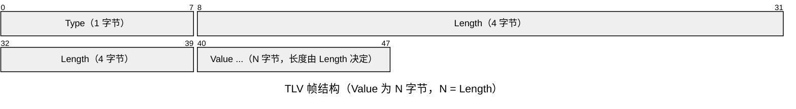
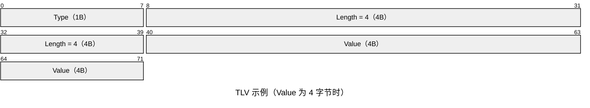
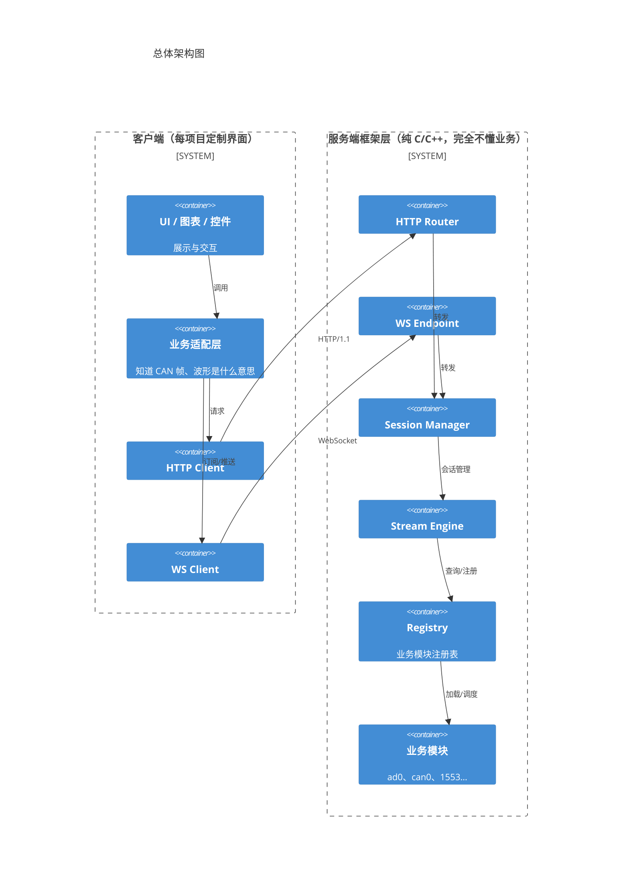
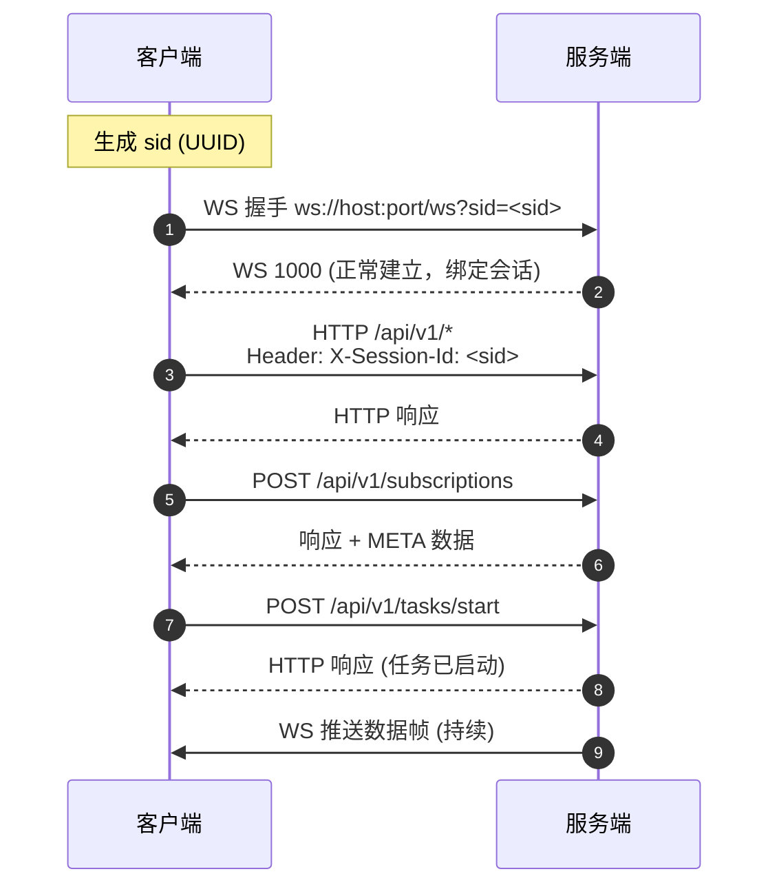
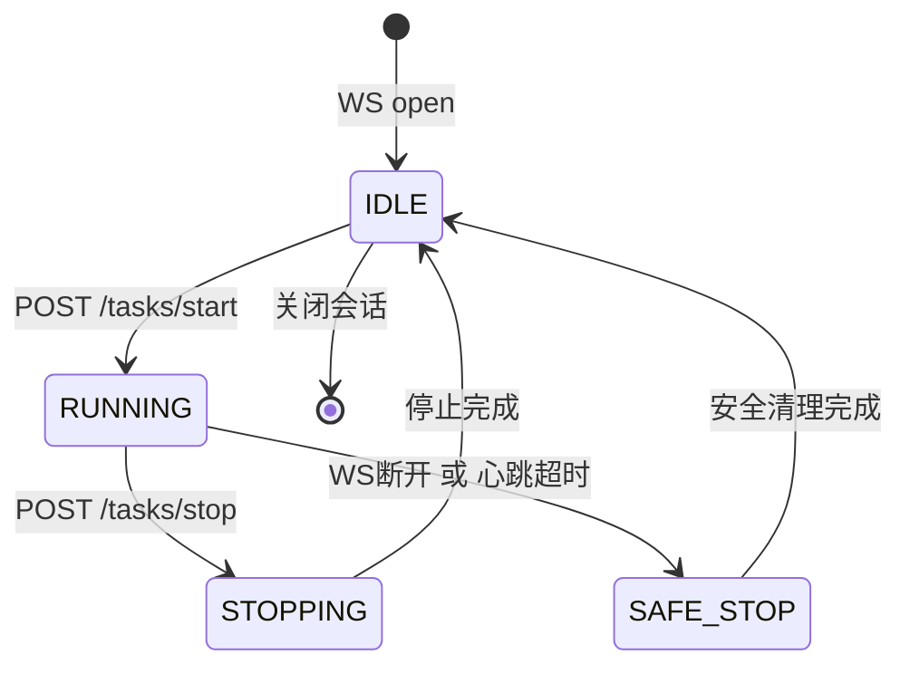
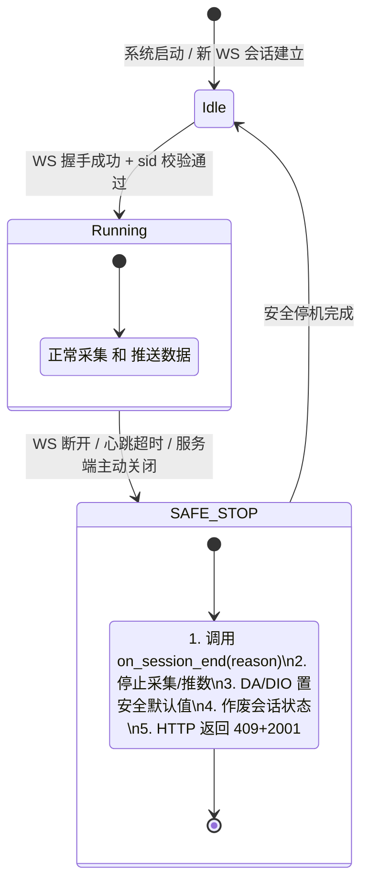
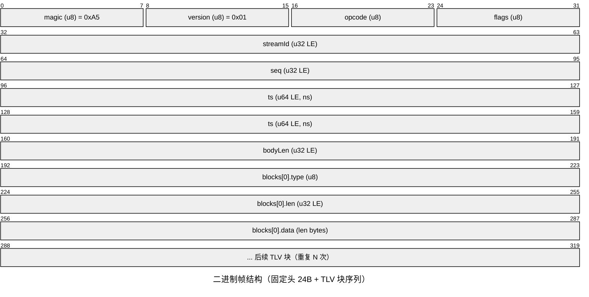

# 工控通讯模型 v1：HTTP REST + WebSocket 推送

> 定位：一套**通用底层框架**。只规定"怎么连、怎么订、怎么送、怎么停"，
> 不规定 AD/DA/DIO/CAN/1553B/ARINC429/FlexRay/AFDX 这些数据分别是什么意思。
> 具体业务靠"注册数据流 + 注册命令"挂进来，框架层自己完全不涉及业务逻辑。
>
> 传输方式：HTTP/1.1 REST（Representational State Transfer，一套"用网址指向
> 资源、用 HTTP 动词增删改查"的约定；客户端问、服务端答）
> + RFC 6455 WebSocket（服务端主动推）。
>
> 状态：设计稿（v1），取代 `docs/spec/01-ws-protocol.md`（下面称"v0 demo 规范"）。

---

## 0. 一页摘要

**两种传输方式，各自有各自的职责：**

| 传输方式  | 负责什么                                                             | 方向                   |
| --------- | -------------------------------------------------------------------- | ---------------------- |
| HTTP REST | 服务端的能力与流的查询、订阅、改参数、任务的启停、下业务命令、查状态 | 客户端发起，服务端回答 |
| WebSocket | 二进制遥测数据帧、JSON 事件通知                                      | 服务端主动推           |

WS 只干它最擅长的一件事：服务端主动往外推数据。凡是"客户端发起、要拿一个明确结果"
的操作，一律走 HTTP。用 HTTP 自带的方法、状态码和路径含义来表达，不再自己定义一套
"命令 / 确认 / 错误"报文。

四个核心概念：

| 概念          | 英文        | 一句话说明                                                                           |
| ------------- | ----------- | ------------------------------------------------------------------------------------ |
| **会话**      | **Session** | 一条 WS 连接 = 一个会话，一一对应；WS 一断，服务端必须立刻停机                       |
| **流**        | **Stream**  | 一个可单独订阅的数据源，有自己的编号、序号、时间基准；数据含义由业务定义，框架层不懂 |
| **帧**        | **Frame**   | WS 上发的一种二进制数据包，自带说明书：24 字节头 + TLV 块                            |
| **事件**      | **Event**   | WS 上发的 JSON 文本消息，由服务端主动通知客户端                                      |
| **下发/下行** |             | 服务器到客户端                                                                       |
| **上传/上行** |             | 客户端到服务端                                                                       |

其中 **TLV** 指 `Type-Length-Value（类型-长度-值）`，一种通用的二进制打包格式：
1 字节说这块是什么，4 字节说数据有多长，后面跟数据本身。
大致示意图如下：




五条不能违反的底线：

1. **通讯框架层不懂业务**：协议不认识 CAN，也不认识波形；它只负责搬 `streamId` + 字节
   + META（metadata 的缩写，元数据：随流下发的 JSON，说明这批字节怎么排版）。
2. **WS 只用来推送**：客户端在 WS 上只被允许发"配额"消息和协议级的 Pong，其它操作全走 HTTP。
3. **默认不丢数据、不乱序**：真要丢数据，必须明确发一条通知告诉客户端，绝不能悄悄少。
4. **采集线程绝不能被网络拖住**：业务和采集线程只往固定容量的缓冲区里写，绝不等待网络发送完成。
5. **控制通道一断就停机**：WS 连接断开或超时判定掉线，服务端必须把设备停在安全状态，不自动重试、不自动续跑。

---

## 1. 目标与非目标

### 1.1 目标

- **最核心的愿景**：借助Web技术来做GUI。彻底摆脱 Qt(QWidget、QML)、C#(WinForm、Avalonia、WPF)等传统的桌面GUI框架。核心基于标准C++构建。
- **一套通讯层，所有项目复用**：AD、DA、DIO、CAN、RS232/485/422、1553B、
  ARINC429、FlexRay、AFDX 等，在协议看来都只是"一个数据流"和"一个 HTTP 命令"的例子。
- **服务端只提供通用的通讯层**：
  - 会话管理
  - 流注册
  - 命令分发
  - 流量控制
  - 启停流程；
  业务通过模块注册进来，不混进协议层里。
- **同一份实现两种部署**：
  - 一种是把**浏览器内核嵌进桌面程序**（**CEF**，Chromium
  Embedded Framework），服务和界面都跑在本机 `127.0.0.1`，对外看起来仍是一套客户端 / 服务端分离的系统；
  - 另一种是**局域网**里一台机器采集、另一台机器控制和显示。这也是开发过程中方便的调试手段。
- **客户端由业务决定，自行做**：每个项目自己的界面和交互；通讯层只保证 REST + WS 这两套接口长期稳定。
- **可以长期演进**：以后加新流、加新命令、加新块类型，不会让老客户端崩掉。

### 1.2 非目标（明确不做，防止范围失控）

| 不做的事                     | 原因                                                 |
| ---------------------------- | ---------------------------------------------------- |
| 定义任何总线报文格式         | 属于业务含义，写在业务模块和 META 里                 |
| 多客户端 / 多操作员          | 实际场景是一对一；接口没写死，但 v1 不做多人权限判断 |
| 跨总线时间对齐               | 实际场景各总线独立处理，不做统一时间基准             |
| 服务端录制 / 回放 / 补发     | WS 一断就停机，重连后从空闲状态重新来                |
| 由服务端描述驱动前端动态渲染 | 客户端是换技术栈重写的定制上位机，不是低代码平台     |
| 文件 / 固件传输              | v1 的配置是结构化参数，不是搬文件                    |
| **视频 / 媒体传输**          | **v1 完全不做；后续靠其它方案来增强**（见 §16）      |
| 压缩、加密、鉴权体系         | 局域网/本机部署；预留扩展位置，v1 不强制             |

### 1.3 成功标准

- 新项目接一种总线，只需要新增业务模块和前端界面，**不改协议、不改框架层**。
- CEF 本机部署和局域网跨机部署，用的是同一套协议和同一份服务端代码。
- 拔网线、杀掉客户端进程之后，服务端能在心跳超时时间内进入安全状态，且输出端不留残留。
- 客户端处理不过来导致缓冲区被写满时，客户端能收到明确的"数据缺口"通知，
  而不是"数据悄悄少了没人知道"。
- 所有控制操作都能用 curl / Postman 直接验证，不需要私有调试工具。

---

## 2. 术语

| 术语       | 含义                                                          |
| ---------- | ------------------------------------------------------------- |
| Session    | 一次"客户端-服务端"配对关系；对应一条 WS 连接，带一个 `sid`   |
| Stream     | 业务注册进来的一个数据源；有 `streamId`、类型、序号、时间基准 |
| Frame      | WS 上的一条二进制消息                                         |
| Block      | 帧内的 TLV 单元：`[type u8][len u32][data]`                   |
| Record     | RECORD 类流里的一条带时间戳的记录；内容含义由业务定义         |
| META       | UTF-8 JSON，用来描述这个流的类型和数据怎么排                  |
| Timebase   | 这个流用什么时间基准；**不同流之间的时间戳不保证能直接比较**  |
| Capability | 能力标记，通过 HTTP 和 WS 协商服务端支持哪些特性              |
| Sink       | 指代数据流的终点或写入端                                      |

---

## 3. 总体架构

```text
┌────────────────────────── 客户端（每项目定制界面） ─────────────────────────┐
│  UI / 图表 / 控件           业务适配层（知道 CAN 帧、波形是什么意思）        │
│        └──────────┬────────────────────────┬──────────────────────────────┘
│             HTTP Client                WS Client
└───────────────────┼────────────────────────┼──────────────────────────────┘
                    │ HTTP/1.1               │ WebSocket
┌───────────────────┴────────────────────────┴──────────────────────────────┐
│                   服务端框架层（纯 C/C++，完全不懂业务）                     │
│  HTTP Router ─┐   WS Endpoint ─┐                                           │
│               └─ Session Manager ── Stream Engine ── Registry               │
│                                        │                  │                 │
│                                业务模块注册表（命令 / 流源 / 参数 provider）  │
│                                        │                  │                 │
│                                业务模块：ad0、can0、1553…                    │
└────────────────────────────────────────────────────────────────────────────┘
```



框架层只做五件事：接收 HTTP 请求、维护 WS 会话、分发命令、管理流的订阅、搬运二进制帧。
业务模块通过注册接口挂上来；框架层不知道也不关心模块内部在干什么。

---

## 4. 连接与会话

### 4.1 地址

| 端点     | URL                               | 用途             |
| -------- | --------------------------------- | ---------------- |
| HTTP API | `http://<host>:<port>/api/v1/...` | 控制、配置、查询 |
| WS       | `ws://<host>:<port>/ws?sid=<sid>` | 服务端推送       |

同一个端口、同一个源；如果前端页面也由这个服务端提供，就不存在跨域问题。
如果页面单独部署在别处，服务端要按 §6.10 配置 **CORS**（Cross-Origin Resource
Sharing，跨域资源共享：浏览器默认不许 A 站点的页面调 B 站点的接口，CORS 是
B 站点主动声明"我允许谁来调"的那套约定）。

### 4.2 建连顺序

```text
1. 客户端生成 sid（建议用 UUID，Universally Unique Identifier，一串 128 位
   随机数，用来当全局唯一的编号，不用查重也不会撞），打开
   ws://host:port/ws?sid=<sid>
2. 服务端检查 sid 格式是否合法、是否已被占用，绑定会话，返回 WS 1000（正常建立）
3. 客户端用 HTTP 带上 X-Session-Id: <sid> 调用 /api/v1/*
4. POST /api/v1/subscriptions 订阅数据流，响应里把 META 一起带回来
5. POST /api/v1/tasks/start 开始任务，WS 上开始推数据帧
```



- **WS 连接就代表会话**：没有活动的 WS 连接时，所有需要会话的 HTTP 请求都返回
  `409 Conflict` + `code 2001`。
- 同一个 `sid` 再次建连：旧连接被关闭（关闭码 `4100`，表示被新会话顶替），新连接生效。
  同一时刻依旧只有一条活动连接。这是给客户端崩溃后快速恢复用的，见 5.5。
- 已经有活动会话时，用**不同** `sid` 建 WS：握手阶段就拒绝，返回 HTTP `409` + `code 2001`。
  连接都没建立起来，所以这时没有 WS 关闭码可用。
- `sid` 由客户端生成，长度 8–64，字符集 `[A-Za-z0-9_-]`；服务端只检查格式是否合法、是否唯一。

### 4.3 两种传输方式的关系

- HTTP 的响应**算数**（以此为准）；WS 上的事件**只是提醒**。
- 同一条 WS 内部的消息保证先后顺序；HTTP 和 WS 之间**不保证顺序**。
- 客户端必须用 HTTP 的响应来更新自己的状态，WS 事件用来刷新界面和处理异步变化。
- 服务端不能假设客户端"一定先收到了事件才发请求"。

### 4.4 部署形态

| 形态     | 地址                                                   | 说明                           |
| -------- | ------------------------------------------------------ | ------------------------------ |
| CEF 嵌入 | `http://127.0.0.1:<port>` + `ws://127.0.0.1:<port>/ws` | 同一台机器，零配置             |
| 局域网   | `http://<采集机IP>:<port>` + 对应的 WS                 | 服务端绑定指定网卡，防火墙放行 |

v1 默认不加密。需要加密时整体换成 `https://` + `wss://`，协议内容不变。

---

## 5. 会话生命周期与断线停机

### 5.1 状态机

```text
服务端视角:

  WS open ──► IDLE
                 │ POST /tasks/start
                 ▼
              RUNNING ──POST /tasks/stop──► STOPPING ──► IDLE
                 │
        WS 断开/心跳超时
                 ▼
             SAFE_STOP ──► IDLE ──► 关闭会话
```



- `IDLE`：WS 已连上，业务还没跑；可以改参数、可以订阅。
- `RUNNING`：`start` 成功之后；采集和推数据正在进行。
- `STOPPING`：收到明确的 `stop` 请求，等业务把自己收尾完。
- `SAFE_STOP`：控制端失联触发的**强制停机**，比 `STOPPING` 更硬性：
  立刻停止采集、把输出设成安全默认值、**不再等业务"自己正常收尾"**。

`关闭会话`（销毁会话对象、释放订阅与参数）由三个事件之一触发：WS 连接关闭、心跳判死、
`DELETE /api/v1/session`。会话一旦销毁，用同一个 `sid` 重新建连等于新建一个会话，
不继承任何状态，见 5.2。

停机与销毁是连着做的，中间没有过渡态：同一个回调里先 `SAFE_STOP`（停采集、输出回安全值、
发 `core.session.ending`），再销毁会话对象。图里 `SAFE_STOP` 后面那个 `IDLE` 说的是
设备侧回到空闲，不是会话对象还多活了一段。顺序也不能反过来——`core.session.ending`
还得靠这个会话带着 `sid` 发出去，先销毁就发不成了。

### 5.2 断线 = 立刻停机

**WS 断开、心跳超时、或服务端主动关闭时，服务端必须：**

1. 立刻进入 `SAFE_STOP`；
2. 调用所有业务模块的 `on_session_end(reason)`；
3. 停止采集、停止推数据、把 DA/DIO 等输出设成业务定义的安全默认值；
4. 作废这次会话的状态；带着这个 `sid` 的 HTTP 请求此后返回 `409` + `code 2001`；
5. 回到空闲状态，等新的 WS 会话建立。


**明确不做的事**：自动重连、任务续跑、把断线期间的数据缓存后补发。客户端重连建立的是
**一个全新会话**，只能从 IDLE 重新开始。

**`sid` 可以再用，但不继承任何东西。** 客户端重连时沿用原来那个 `sid` 是允许的（只要格式合法，
见 4.2），服务端把它当新会话处理：订阅要重新建、参数回到默认值或上次 `PUT` 持久下来的值、
`revision` 重新计数。协议不设"宽限期"，也不保留断线期间的会话快照。理由是断线后设备已经回到
安全值，操作员必须重新确认才能继续，自动恢复订阅等于把风险带回现场。

### 5.3 心跳与超时判定掉线

- 服务端每 5 秒在 WS 上发一次 Ping；**15 秒内没收到客户端的任何消息**（Pong、`credit`
  或其它任何消息）→ 判定为掉线。
- 唯一的宽限条件：这 15 秒里我们的**发送缓冲在向前推进**（已排队字节数在减少）。
  它说明链路是通的、只是慢，把期限顺延到 **30 秒**；30 秒一到仍无消息，照样判死。
  发送缓冲**没有推进**（已排队字节数一寸未减）时不享受任何顺延，15 秒即判死。
- 判死有绝对上界：无论积压多少、链路多慢，**30 秒收不到客户端的任何消息一律判死**。
  这条上界保证"控制通道一断就停机"（见 0 章底线 5）不会被数据流量掩护掉。
- v1 只用 WS 的 Ping/Pong 判断连接是否还活着；浏览器会自动回 Pong，客户端不需要写额外代码。
- 判定掉线等同于断线，触发上面的立刻停机。
- 判死之后必须真的把连接关掉：先发 `core.session.ending`（`reason` 写明是心跳超时），
  再用 `4100` 关闭帧关闭这条 WS，然后断开 socket。只把会话标记成失效、留着半开的连接，
  对端会以为还能用，下次进来又撞上 409，现象是"重连一直失败、日志里却看不出原因"。
- 原因：TCP 半开时对方收不到 FIN，光看 socket 状态发现不了已经失联。
- HTTP 的 keep-alive 不参与存活判定，避免出现"HTTP 还能通但 WS 其实已经死了"这种说不清的状态。

> **为什么不用"有积压就不判死"：** 拔掉网线之后发送缓冲同样非零，而且会一直增长——
> 最需要判死的时刻，恰恰就是"有积压"的时刻。拿积压当免死条件，等于把安全阀交给数据量决定。
> 积压只能影响判死的**期限**（按推进情况顺延），不能取消判死。
>
> **怎么判断"推进"：** 在 15 秒窗口内每 5 秒采一次已排队字节数，并记下期间的最小值。
> 最小值比窗口开始时的字节数小，说明缓冲确实往外走了一部分，算推进。
> 不要拿相邻两次采样直接相减——一边发一边收的链路里，积压可能"排空之后又被填满"，
> 逐点比较会把有推进误判成没推进。这个量可以直接从传输层的发送缓冲读到，不需要自己记账。

**这个机制测不到什么。** Ping/Pong 由浏览器协议栈自动应答，只能证明"对端网络栈活着"，
证明不了"对端应用还在干活"：客户端界面线程被大帧渲染堵死时，Pong 照样准时回来。
要检测应用卡死，只能靠应用层自己发消息——服务端已经把来自客户端的任何消息（含 `credit`）
都算作存活，所以客户端正常归还配额就相当于在做应用层心跳。v1 不额外定义心跳消息，
需要更强保证的场景放到 v1.1。

### 5.4 明确请求停机

- `POST /api/v1/tasks/stop` 触发 `STOPPING`；
- 业务必须在有限时间内把自己收尾完（建议 ≤ 5 秒）；超时就由服务端强制把输出设成安全默认值并记一条告警；
- 停机后 WS 保持连接，会话仍在 IDLE，可以再次 start。

### 5.5 只允许一个会话

- 同一时刻只允许一个活动会话。
- 同一个 `sid` 重复打开 WS → 旧连接收到 `4100` 被关闭，新连接生效（方便客户端崩溃后快速恢复）。顶替属于断开，先 SAFE_STOP 再让新连接生效。
- 已经有活动会话时，用不同 `sid` 来连 → 握手阶段返回 `409` + `code 2001`。

---

## 6. HTTP REST API

### 6.1 通用约定

- 前缀 `/api/v1`，资源名用复数，动作做成子资源或 `:action`。
- 请求/响应体是 UTF-8 JSON；时间字段用毫秒整数（和 WS 保持一致）。
- 需要会话的请求必须带 `X-Session-Id: <sid>`，而且这个会话的 WS 必须还活着。
- 幂等（同一个请求重复发几次，结果和发一次一样）：`GET/PUT/DELETE` 天然幂等；`POST` 命令建议带
  `Idempotency-Key`（同一个 key 在 60 秒内重复提交，直接返回第一次的结果）。
- 所有响应都带 `X-Request-Id`；错误响应见 6.9。

### 6.2 资源总表

| 方法与路径                                | 用途                           | 需要会话 |
| ----------------------------------------- | ------------------------------ | -------- |
| `GET /api/v1/capabilities`                | 协议版本、支持的能力、各项限制 | 否       |
| `GET /api/v1/state`                       | 当前会话状态                   | 是       |
| `GET /api/v1/streams`                     | 流列表（概要）                 | 是       |
| `GET /api/v1/streams/{id}`                | 单个流的详情（含 META）        | 是       |
| `POST /api/v1/subscriptions`              | 订阅流，返回 META              | 是       |
| `DELETE /api/v1/subscriptions/{streamId}` | 取消订阅                       | 是       |
| `GET /api/v1/params/{scope}`              | 读参数                         | 是       |
| `PATCH /api/v1/params/{scope}`            | 只改传上来的几项（合并）       | 是       |
| `PUT /api/v1/params/{scope}`              | 整个作用域一次性全部替换       | 是       |
| `POST /api/v1/tasks/start`                | 开始任务                       | 是       |
| `POST /api/v1/tasks/stop`                 | 停止任务                       | 是       |
| `POST /api/v1/commands/{ns}/{action}`     | 业务命令                       | 是       |
| `GET /api/v1/commands`                    | 可用的业务命令列表             | 是       |
| `DELETE /api/v1/session`                  | 主动结束会话（会触发立刻停机） | 是       |

> 媒体/视频相关端点不在 v1 范围内（见 §16）。

### 6.3 capabilities

```http
GET /api/v1/capabilities
```

```json
{
  "proto": 1,
  "server": "daqd/1.0.0",
  "caps": ["credit", "frag", "describe-full"],
  "limits": {
    "max_data_frame": 1048576,
    "default_window": 1048576,
    "buffer_bytes": {"sample": 4194304, "record": 8388608},
    "send_queue_bytes": 67108864,
    "frag_timeout_ms": 5000,
    "ring_total_bytes": 67108864,
    "max_control_bytes": 1048576
  }
}
```

- 不需要会话，可以用来检查服务是否在线、以及版本对不对。
- `caps` 是服务端声明自己支持的能力；客户端能力不用在 WS 建连的 `Sec-WebSocket-Protocol`
  或第一条配额消息里重复声明 —— v1 只有服务端能力，客户端必须全部支持。

### 6.4 流的查询与订阅

```http
GET /api/v1/streams
→ 200 [{"id":1,"name":"ad0.ch0","class":"sample","timebase":"device",
        "rateHz":1000,"bufferBytes":4194304,"maxFrameBytes":16384}]
```

```http
GET /api/v1/streams/1
→ 200 {"id":1,"name":"ad0.ch0","class":"sample","timebase":"device",
       "rateHz":1000,"bufferBytes":4194304,"maxFrameBytes":16384,
       "meta":{...完整 META...}}
```

- `maxFrameBytes` 是这个流单帧负载的上限，用来给客户端估算该给多少 `window`（见 8.2）。
  它小于全局的 `limits.max_data_frame`，后者只是协议硬上限。

```http
POST /api/v1/subscriptions
Content-Type: application/json
X-Session-Id: s-7f3a2c

{"streams":[{"id":1,"window":1048576},{"id":2,"window":0}]}
```

```json
200 OK
{
  "subscriptions": [
    {"streamId":1,"window":1048576,"bufferBytes":4194304,"meta":{...}},
    {"streamId":2,"window":0,"bufferBytes":8388608,"meta":{...}}
  ]
}
```

- **订阅的响应里就带完整 META**，客户端不用等 WS 上的数据帧就能把解析器建好。
- `window` 不传就用 `default_window`；传 `0` 表示"先把订阅登记上，暂时不要推数据"，
  之后客户端再用 WS 的 credit 消息把配额加上去，开始推数据。
- 订阅是**要么全部成功、要么一条都不生效**：只要有任意一个流不存在 → `404` + `code 2002`，
  这次订阅一个都不生效。
- 重复订阅同一个流是幂等的，不会重复返回错误；`window` 以最后一次设置为准。
- 取消订阅：`DELETE /api/v1/subscriptions/1` → `204`；本来就没订阅 → `404` + `code 2003`。

### 6.5 参数

```http
GET  /api/v1/params/can0
PUT  /api/v1/params/can0
PATCH /api/v1/params/can0
```

```json
PUT /api/v1/params/can0
{"values":{"bitrate":500000,"samplePoint":0.875}}
```

```json
200 OK
{"scope":"can0","revision":7,"values":{"bitrate":500000,"samplePoint":0.875}}
```

- `PUT` = 整体替换该作用域，`PATCH` = 按 key 合并（只改你传上来的项）。
- `values` 里有什么完全由业务决定，框架层不懂它的含义、也不检查它对不对。
- `revision` 每个作用域自己单独单调递增，只有写成功才 +1；写失败时参数值和 `revision` 都不变。
- 参数默认**只放在内存里**，会话结束就丢掉；要跨重启保留由业务模块自己去做持久化。
- 在 RUNNING 状态下允许读写，业务可以拒绝（返回 `422` + 3xxx）。

### 6.6 任务的启停

```http
POST /api/v1/tasks/start
X-Session-Id: s-7f3a2c

{"task":"rail-brake-test","params":{"pressure":0.6}}
```

```json
200 OK
{"state":"running","task":"rail-brake-test","startedAt":1731234567890}
```

- `params` 先按合并方式写进 `session` 作用域并做校验，**校验通过后才调用业务模块的 `on_start`**；
  校验失败就整体不生效，会话留在 `IDLE`。
- 只要有任一模块启动失败 → 把已经启动的模块回滚掉，返回 `500` + `code 2007`（带 `detail.module`）。
- `POST /api/v1/tasks/stop` → `{"reason":"operator"}` → `200 {"state":"idle"}`。
- 如果业务声明自己的收尾可能超过 10 秒，服务端返回 `202 Accepted` + `{"state":"stopping"}`，
  最终状态通过 WS 事件 `core.state` 通知。

### 6.7 业务命令

```http
POST /api/v1/commands/can0/send
{"channel":0,"id":291,"ext":false,"data":"0102030405060708"}
```

```json
200 OK
{"ok":true,"result":{...}}
```

- `{ns}` 必须对应一个已注册的模块；命名空间或动作不认识 → `404` + `code 2004`。
- 业务自己校验失败 → `422` + 3xxx + `detail`。
- 命令在事件循环线程上同步执行，业务必须很快返回；耗时长的任务要自己转到工作线程，然后立刻应答。

### 6.8 状态查询

```http
GET /api/v1/state
→ 200 {"state":"running","task":"rail-brake-test","session":"s-7f3a2c",
        "streams":2,"startedAt":1731234567890}
```

### 6.9 状态码与错误体

| HTTP | 含义                           | 典型 code                                                          |
| ---- | ------------------------------ | ------------------------------------------------------------------ |
| 200  | 成功                           | —                                                                  |
| 202  | 已接受，稍后异步完成           | —                                                                  |
| 204  | 成功但没有返回内容（取消订阅） | —                                                                  |
| 400  | 请求格式不对                   | 1001 JSON 不合法、1003 缺字段、1004 版本不支持                     |
| 401  | 会话凭据缺失或无效             | 4001 未授权                                                        |
| 404  | 资源不存在                     | 2002 流不存在、2003 未订阅、2004 命令不存在                        |
| 409  | 会话或状态冲突                 | 2001 会话被占用/没有会话、2005 配额数值不合法、2006 当前状态不允许 |
| 413  | 请求体太大                     | 2008 describe 返回内容过大                                         |
| 422  | 业务校验失败                   | 3xxx                                                               |
| 500  | 内部或模块错误                 | 2007 模块启动失败、4004 内部异常                                   |
| 503  | 服务暂时不可用                 | 4005                                                               |

错误体：

```json
{"code":3001,"msg":"bitrate out of range","retryable":false,
 "detail":{"field":"bitrate","min":10000,"max":1000000}}
```

- `retryable` 默认为 `false`。
- 业务错误码必须落在 3xxx 段；`detail` 里是什么含义由业务定，框架层不懂、不做处理。
- 响应同时带 `X-Request-Id`，方便和服务端日志对应起来。

### 6.10 CORS （Cross-Origin ResourceSharing，跨域资源共享）

页面和服务端同源时不用配置。单独部署时服务端必须：

- 允许 `Origin` 白名单（默认只允许同源和本机）；
- 允许 `OPTIONS` 预检，返回 `Access-Control-Allow-Methods` 和
  `Access-Control-Allow-Headers: Content-Type, X-Session-Id, Idempotency-Key`；
- 不返回 `Access-Control-Allow-Credentials`，v1 不使用 Cookie。

---

## 7. WebSocket 推送协议

### 7.1 连接与上行消息

- 地址：`ws://host:port/ws?sid=<sid>`。
- 服务端 → 客户端：二进制帧（§7.2）+ JSON 事件（§7.9）。
- 客户端 → 服务端：**只允许**下面这一类业务消息，其它一律忽略并记日志：

```json
{"v":1,"type":"credit","streams":[{"id":1,"bytes":262144}]}
```

- credit（把发送配额加回来）是唯一允许客户端在 WS 上发的业务消息；服务端不做确认回复，
  出错通过事件 `core.error` 通知。
- 协议级的 Pong 浏览器会自动回复，客户端不需要处理。

### 7.2 二进制帧结构

固定头 **24 字节**，所有多字节整数都是小端（LE）：

| 偏移 | 字段     | 类型 | 说明                                       |
| ---- | -------- | ---- | ------------------------------------------ |
| 0    | magic    | u8   | 固定 `0xA5`                                |
| 1    | version  | u8   | 帧格式版本，当前 `0x01`                    |
| 2    | opcode   | u8   | 帧类型，见 7.3                             |
| 3    | flags    | u8   | 帧级标志，见 7.3                           |
| 4    | streamId | u32  | 流 ID，0 保留不用                          |
| 8    | seq      | u32  | 该流内递增的序号，转圈之后继续累加         |
| 12   | ts       | u64  | 帧时间戳，纳秒，按这个流的 timebase 来解释 |
| 20   | bodyLen  | u32  | 后面块区域的总字节数                       |
| 24   | blocks   | —    | TLV 块序列                                 |

块的格式：

```text
[type: u8][len: u32 LE][data: len bytes]
```



- 接收端必须核对 `bodyLen` 和各个块长度加起来是否一致；不一致 → 整个帧丢弃并上报。
- `type` 不认识的块必须直接跳过，不能报错（这是为了向前兼容，以后加新块类型老客户端不会崩）。
- `len` 为 0 表示这个块存在但是空的，接收端跳过。
- `bodyLen` 永远只描述**这一帧自己的块区域**，不代表一条完整数据的总长度；
  一条完整数据的边界由 `flags.LAST` 决定（见 7.8）。

### 7.3 枚举

**opcode（帧类型）**

| 值   | 名称      | 含义                                                     |
| ---- | --------- | -------------------------------------------------------- |
| 0x01 | SNAPSHOT  | 订阅之后或流描述变了之后的第一帧，必须带 META            |
| 0x02 | DELTA     | 常规的增量数据帧                                         |
| 0x03 | EVENT     | 某个流上的事件（开始/结束/错误）                         |
| 0x04 | ERROR     | 这个流或这个通道出错了，内容是 JSON                      |
| 0x05 | HEARTBEAT | **保留不用**；保活一律用 WS 的 Ping/Pong，收到就静默忽略 |

**flags（帧标志）**

| bit  | 名称 | 含义                       |
| ---- | ---- | -------------------------- |
| 0    | FRAG | 这一帧是拆开发送的其中一片 |
| 1    | LAST | 拆开发送的最后一片         |
| 2..7 | 保留 | 必须为 0，接收端忽略       |

两个位只有四种组合，含义是定死的：

| FRAG | LAST | 含义                             |
| ---- | ---- | -------------------------------- |
| 0    | 0    | 完整帧：这一帧就是一条完整数据   |
| 1    | 0    | 中间片：后面还有片               |
| 1    | 1    | 末片：拆开发送的最后一帧         |
| 0    | 1    | 保留，没有定义；接收端丢弃并上报 |

没拆分的帧一律是 `FRAG=0` + `LAST=0`，**不要求**置 `LAST`。接收端判断一条数据结束，
看的是"收到了 `LAST=1` 的片，或者收到一个 `FRAG=0` 的帧"，不要只认其中一个。

**块类型（core 保留段）**

| 值        | 名称     | 内容                                                   |
| --------- | -------- | ------------------------------------------------------ |
| 0x01      | DATA     | 主数据块，SAMPLE/STATE 类用；怎么排由 META 描述        |
| 0x02      | META     | UTF-8 JSON；只在 SNAPSHOT 或流描述变化时出现           |
| 0x03      | RECORDS  | 标准的记录容器，见 7.6                                 |
| 0x04      | AUX      | 辅助数据（校准、索引、业务自定义），框架层不懂它的含义 |
| 0x80–0xFE | 业务扩展 | 由业务模块定义，必须在 META 里声明                     |
| 0xFF      | 保留     | 禁止使用                                               |

### 7.4 流的类型（class）

| class    | 含义                                     | 典型用途                                        | 可靠性                                                 |
| -------- | ---------------------------------------- | ----------------------------------------------- | ------------------------------------------------------ |
| `sample` | 等间隔的采样数组                         | AD 波形、DA 回读、DIO 电平快照                  | 不丢数据                                               |
| `record` | 长度不定的记录序列，每条带自己的时间戳   | CAN、1553B、ARINC429、FlexRay、AFDX、DIO 跳变沿 | 不丢数据                                               |
| `state`  | 只关心最新值；订阅时给全量，变化时给增量 | 设备状态、温度、连接状态                        | 只保证最终一致：每次变化不一定送达，但拿到的总是最新值 |

v1 **不定义媒体类**。视频/音频走后续的 HTTP 方案（§16）。

框架层只实现这三类"该不该丢、顺序怎么保证"的规则；每类里面数据具体怎么排由 META 描述，
含义由业务解释。

### 7.5 META 约定

META 就是一个流的自述说明书：

- 订阅响应里必须带完整 META；WS 上的 SNAPSHOT 也会再带一次，作为双重保险。
- 流的描述信息变了，服务端发一个新的 SNAPSHOT（带新 META），客户端把缓存里的旧的替换掉。
- 客户端在拿到 META 之前，不能去解析这个流的数据块。
- 遇到不认识的字段必须忽略。

公共字段：

| 字段      | 必填     | 说明                                       |
| --------- | -------- | ------------------------------------------ |
| kind      | 是       | 业务数据类型名，如 `waveform`、`can_frame` |
| class     | 是       | `sample` / `record` / `state`              |
| schemaVer | 是       | 数据布局的版本号，由业务自己递增           |
| timebase  | 是       | `unix_ns` / `monotonic_ns` / `device`      |
| layout    | 看 class | 数据怎么排的描述，见下                     |

`sample` 的 layout：

```json
{"dataType":"float32","components":1,"count":1024,"rateHz":1000,"unit":"V"}
```

`record` 的 layout：

```json
{"record":{"fields":[
  {"name":"id","type":"u32"},
  {"name":"flags","type":"u8"},
  {"name":"data","type":"bytes"}
]}}
```

> 框架层只要求上面这些字段存在且类型正确，不检查业务字段本身的意思。

### 7.6 记录容器（RECORDS）

`record` 类流统一使用块类型 `0x03`：

```text
repeat:
  [ts: u64 LE]      这条记录的时间戳，纳秒（时间基准由 META 声明）
  [len: u32 LE]     这条记录内容的字节数
  [payload: len]    由业务定义，按 META.layout 来解释
```

一帧可以装 0 到 N 条记录；`bodyLen` 负责边界校验。业务只需要定义 `payload` 里字段的布局，
时间戳、拆包发送、序号这些通用事情由框架层统一处理。

### 7.7 序号与时间

**seq 怎么分配：**

- `seq` 每个流单独递增，在**生产端把数据写进缓冲区的那一刻**分配一次；
  拆成几片发送的仍然共用同一个 `seq`，不各自占号。
- 分配时机必须是"进缓冲区"，不能是"进发送队列"：被缓冲区覆盖掉的帧已经占过号，
  客户端才能从序号断档看出真的丢了数据。等发送时才分配的话，被覆盖的帧根本没占到号，
  缺口永远看不见。
- `state` 的合并发生在**分配 seq 之前**（只保留最新值），这样不会凭空造出"序号断档"的假告警。
- 缓冲区写满被覆盖掉的帧会留下真实的序号断档，由 `core.overrun` 里的 `firstSeq/lastSeq`
  指出丢了哪一段。
- `SNAPSHOT` **不会把** `seq` **清零**；客户端把订阅之后收到的第一帧当作基准。
- 运行中因为流描述变化而补发的那次 `SNAPSHOT`，照常占用该流的下一个序号，不跳号也不重置。
  客户端收到它只更新 META 缓存，**不要把它当成一次序号跳变去重建缺口判定**。
- `core.overrun` 里的 `firstSeq/lastSeq` 用的是同一个计数器。

- `ts` 是帧级别的时间；`record` 里每条记录另外带自己的 `ts`。
- **不保证不同流之间的时间可以互相比较**。每个流独立使用自己的时间基准；
  确实需要对齐的，由业务在自己的 payload 里把基准信息带上。

### 7.8 分片（一条数据太大时拆开传）

- 单条 WS 消息的上限由 `limits.max_data_frame` 声明（默认 1 MiB，见 8.4）。
- 分片是按**字节**把一条完整数据的块区域切开，允许在任意字节位置切，
  甚至可以把一个 TLV 块切成两半；接收端不能拿着半片就去解析 TLV。
- 每一片本身都是完整的帧：24 字节头 + 这一片的字节；同一条数据的所有片共用 `streamId`、`seq`、`ts`。
- `flags.FRAG=1` 表示属于某个拆开发送的序列，`flags.LAST=1` 表示这条完整数据到此结束。
- `bodyLen` 是这一片自己的字节数；协议**不带**总长度和偏移量，
  拼回去的办法就是按顺序把各片的 body 接起来，直到收到 `LAST`。
- 同一条完整数据的各片必须连续发送；不同流之间可以交替发，但同一个流的片序列中间
  不能插入别的帧。
- 任意一片丢失或被丢弃 → 整条完整数据作废，禁止只把收到的一半交给上层。
  接收端要能自己收尾：同一条数据的各片共用 `seq`，所以看到同流来了新的 `seq` 就知道上一条
  没希望了，直接丢弃重组缓冲；流从此不再出数据时，超过 `limits.frag_timeout_ms`
  （默认 5000 毫秒）也丢弃。
- 单片负载上限 = `max_data_frame - 24`。
- **只有 `AUX` 块允许分片**；`sample` / `record` 必须一帧发完，
  业务应该通过拆成多个流或控制帧大小来适配。

### 7.9 事件（JSON 文本帧）

服务端通过 WS 的文本消息推送事件：

```json
{"v":1,"type":"evt","name":"core.state","payload":{"state":"running"},
 "ts":1731234567890}
```

| 事件名                | payload                                                                            | 说明                               |
| --------------------- | ---------------------------------------------------------------------------------- | ---------------------------------- |
| `core.state`          | `{"state":"idle\|running\|stopping"}`                                              | 会话状态变了                       |
| `core.stream.added`   | `{"stream":{...}}`                                                                 | 运行中新注册了一个流               |
| `core.stream.removed` | `{"streamId":7}`                                                                   | 某个流被移除了                     |
| `core.overrun`        | `{"streamId":1,"droppedFrames":3,"droppedBytes":12288,"firstSeq":40,"lastSeq":42}` | 缓冲区写满，有数据被覆盖掉了       |
| `core.error`          | `{"code":2005,"msg":"invalid credit","streamId":1}`                                | 客户端发来的消息有问题，或异步出错 |
| `core.session.ending` | `{"reason":"..."}`                                                                 | 开始执行立刻停机流程，随后关闭连接 |
| `biz.*`               | 业务定义                                                                           | 告警、进度、模块状态               |

- 事件不带 `id`；客户端不能指望不同流的事件之间有什么先后关系。
- `core.overrun` 每个流在 500 毫秒内的多次溢出会**合并成一条通知**，避免刷屏。
- 事件和二进制帧走同一条 WS。事件属于控制帧，可以插到排队的数据帧前面（见 8.5），
  所以至多被"当前正在发送的那一帧"挡一下，不会排在整条队列后面。
  控制操作的结果以 HTTP 响应为准，事件只用来刷新界面和处理异步状态变化。

### 7.10 WS 关闭码

WebSocket 规范把 4000–4999 留作应用自定义，本协议固定从 4100 开始用。
和 9.1 的 HTTP 错误码（也是四位数）刻意错开：同一份日志里出现 `4001` 时，
不应该有两种解释。

| 码   | 含义                                     |
| ---- | ---------------------------------------- |
| 4100 | 会话结束（立刻停机完成，或被新会话顶替） |
| 4101 | 协议错误                                 |
| 4102 | 未授权 / 会话无效                        |

这里**没有**"会话被占用"这一档：不同 `sid` 在握手阶段就被 `409` 挡掉（见 4.2），
连接根本没升级成 WebSocket，发不出关闭码。留一个永远发不出去的码，只会让实现者
以为它可达。

---

## 8. 流量控制（客户端跟不上时怎么办）

### 8.1 不能违反的规则

```text
业务/采集线程 ──写入──► 每个流一个固定容量的缓冲区 ──按配额取出──► 发送队列 ──► TCP
      （绝不等待）            （写满就覆盖旧数据）          （队列满就暂停从这里取数）
```

1. 业务线程往缓冲区里写**不允许被卡住**，也不能因为网络慢就停止采集。
2. 每个流一个循环覆盖的缓冲区，容量由 `limits` 或业务配置决定；淘汰时**按完整帧淘汰**，
   不允许只覆盖半帧（否则 `droppedFrames` 就算不出来）。缓冲的具体形态与内存口径见 8.6。
3. 客户端订阅时声明 `window`（字节数）作为配额上限，之后通过 WS 的 `credit` 消息把用掉的配额还回去。
4. 服务端只在"已获准的配额"范围内发数据；配额用完就暂停这个流的发送，**不丢数据**。
5. 缓冲区被写满 → 覆盖最旧的**完整帧**，并**立刻**发一条 `core.overrun` 通知。
   同一段持续溢出时，后续通知按 500 毫秒合并（见 8.3）——第一声必须是即时的，
   否则操作员会在最关键的窗口里看到"一切正常"。
6. `state` 类流**不参与配额机制**，只保留最新值，不会出现溢出覆盖。但它还有另一道闸：
   服务端每个发送周期（约 10 毫秒）对**所有 state 流合计**限帧数与字节数，超出的推迟到下一
   周期。推迟不违反任何承诺——state 只保证最终一致，推迟出去的自然是最新值。
7. **没有人订阅时，就没有"必须送达"的责任**：`sample/record` 不入队、不占序号、不报溢出；
   `state` 直接丢掉。这样"没人看"不会把缓冲区撑爆。

### 8.2 配额的具体规则

- `window` 和 `credit.bytes` 的单位都是**负载字节数**，不含帧头和块头。
- 服务端发出某个流的一帧后，从该流的配额里扣掉 `payloadLen`。
- 单帧的负载比剩余配额还大时，**允许超发这一帧**，前提是这一刻没有任何欠账
  （已发未归还为 0）；已经欠着就继续等配额。这样即使单帧大于 `window`，整条流也不会卡死，
  而欠账的上界被压在 `window` 加一帧。
- `window` **不设最小值强制校验**，取小了只影响吞吐（退化成一个归还周期发一帧），
  服务端不会拒绝订阅——`default_window` 必须能直接跑通。建议客户端按
  `GET /streams` 里的 `maxFrameBytes` 的两倍来设。
- 配额可以多次累加；把 `window` 上限加超了的部分**直接截断**。这不算错误，服务端照常接收，
  只发一条 `core.error`（`code 2009`）说明截掉了多少，方便发现客户端记账的 bug。
- credit 只对 `sample` / `record` 有效；对 `state` 发 credit 等于什么都没做，
  服务端会忽略它并发一条 `core.error`（`code 2005`，这个提示可以关掉）。
- 两个码不要混：`2005` 表示**数值不合法**（负数、非数字、超过单次上限），这条 credit 一条都不生效；
  `2009` 表示**数值合法但超出窗口**，超出部分截断，合法部分照常生效。
- `window:0` 时只登记订阅、不推数据；客户端拿到订阅响应里的 META 之后，再把配额加上去开始推数据。

### 8.3 数据丢了要能被看见

- `core.overrun`：`{streamId, droppedFrames, droppedBytes, firstSeq, lastSeq}`；
  第一次溢出立刻发，同一段持续溢出才按 500 毫秒合并成一条（首声不许拖，见 8.1 第 5 条）；
- WS 上另外发一帧 `opcode=ERROR`，内容是同样信息的 JSON，保证即使事件通道拥挤也一定能看到。
  这一帧的约定：
  - `streamId` = 出问题的那个流（不是保留值 0）；
  - `seq` = 该流当前的序号，**不占号、不推进**；
  - `ts` = 事件发生的时刻；
  - JSON 放在 `DATA` 块（类型 0x01），长度 ≤ 512 B；
  - 不占用配额。
- 服务端日志必须记录溢出的是哪个流、持续多久、丢了多少；
- 客户端界面必须明确提示"这里有数据缺口"，不允许悄悄接着画。

### 8.4 容量默认值（可以被覆盖）

| 项                    | 默认值   | 说明                                                                                     |
| --------------------- | -------- | ---------------------------------------------------------------------------------------- |
| `max_data_frame`      | 1 MiB    | 单条 WS 二进制消息的上限                                                                 |
| `default_window`      | 1 MiB    | 订阅时没写 window 就用这个配额                                                           |
| `buffer_bytes.sample` | 4 MiB/流 | 缓冲区容量                                                                               |
| `buffer_bytes.record` | 8 MiB/流 | 缓冲区容量                                                                               |
| `frag_timeout_ms`     | 5000 ms  | 分片重组超过这么久没收齐就丢弃，见 7.8                                                   |
| `ring_total_bytes`    | 64 MiB   | 一条会话里所有流缓冲的合计上限（字节区 + 描述符）；超出就拒绝新订阅，返回 `409` + `2006` |
| 发送队列              | 64 MiB   | 硬上限；另外按预计排空时间算，超过 10 秒也算链路跟不上，见 8.5                           |

**为什么单帧上限和默认窗口取同一个值（都是 1 MiB）：** 单帧大于窗口时，每一帧都只能靠
"超发一帧"才发得出去（见 8.2），配额就失去了约束力；单帧远小于窗口则一帧发完还剩大量配额，
限速粒度变粗。取同一个值最省心：一帧恰好能装满一次额度。另外，单帧越小，
控制帧被它挡住的时间越短（见 8.5）。

规划建议：总吞吐不要超过链路速率的 60%；单个流不要超过 20 MB/s；
超过这个量级的场景应该拆成多个流。这些默认值不是协议硬性约束，真实数值以
`GET /capabilities` 返回的 `limits` 为准。

### 8.5 控制帧的延迟上界与两条停机路径

**先明确一个物理事实：已经开始传输的帧无法被打断。**
WS 的每一帧在链路上是原子的——控制帧不能插进一个数据帧的内部；已经交给内核的字节也收不回来。
所以控制帧的**最小**额外延迟，等于"排在它前面的字节 ÷ 链路速率"。实现再聪明也绕不过这一条。

**可观测要求（本节只规定结果，不规定实现方式）：**

1. 控制帧（Ping、`EVENT`、`ERROR`）的额外延迟不得超过"排在它前面的字节 ÷ 链路速率"，
   而且实现必须把这个字节数压到最小，理想情况是**一帧**。验收按注入的已知积压量测（见 15 章）。
2. 发送队列的上限要同时卡两个维度：**字节数**与**预计排空时间**（积压字节 ÷ 链路速率）。
   只看字节数时，慢链路上 64 MiB 可能写十几分钟；只看时间时，快速链路上一次突发就能吃光内存。
3. 积压超过上限时按"过载"停机（见下表），不允许无限堆积。

> **当前参考实现尚未落实第 1 条。** 它把整帧直接交给传输库（mongoose）的单条发送缓冲，
> 没有独立控制队列；缓冲非空时控制帧仍排在数据之后。这是已知缺口，不改变上面的可观测要求——
> 队列为空时它满足要求，队列有积压时它不满足。

**帧大小与传输时间的关系**（默认 `max_data_frame` 为 1 MiB）：

| 链路速率 | 一帧 1 MiB 的传输时间 | 含义                             |
| -------- | --------------------- | -------------------------------- |
| 4 MB/s   | 0.26 秒               | 单帧不会明显拖慢控制帧           |
| 1 MB/s   | 1.05 秒               | 与心跳周期相比仍然可接受         |
| 100 KB/s | 10.5 秒               | 超过半个心跳周期，链路已不适配默认帧长 |

所以"控制帧 1 秒内发出"不是任何链路都成立的承诺，它取决于帧大小与速率之比。
部署到窄带链路时，实现应当把单帧压到"速率 × 1 秒"以内；业务侧建议单帧控制在 256 KiB 量级。

**两条停机路径要分清：**

| 触发              | 含义                     | 收尾                                                                                  |
| ----------------- | ------------------------ | ------------------------------------------------------------------------------------- |
| WS 断开、心跳超时 | 控制端失联               | 立刻进入 `SAFE_STOP`：双方都不知道对方状态，设备必须回安全值                          |
| 发送队列持续溢出  | 链路带宽不够，连接还活着 | 先发 `core.session.ending`（`reason` 写明带宽不足）并回 `4100` 关闭，再进 `SAFE_STOP` |

两条路最后都到 `SAFE_STOP`。区别在第二条要先告诉客户端原因，让操作员知道是网络问题，
不是设备出了问题——否则现场第一反应会是"设备坏了"。

### 8.6 缓冲层

#### 8.6.1 每个流一个环形缓冲

**环形缓冲**（ring buffer，也叫循环缓冲）是一段固定长度的连续内存：写指针走到末尾就回到开头，
覆盖掉最旧的数据。用它做缓冲的意义在于容量在分配时就定死，运行期不再申请内存，
写入路径不会因为内存分配而出现延迟抖动。

对缓冲层的要求：

- 每个订阅流一个环形缓冲，容量取 `limits.buffer_bytes`（见 8.4）；
- 写入以**整帧**为单位，淘汰也以整帧为单位，不允许出现半帧（见 8.1 第 2 条）；
- 序号在写入缓冲时分配，不在发送时分配（见 7.7）；
- 缓冲随会话销毁，不跨会话复用。

> **为什么序号必须在写入时分配：** 被淘汰的帧必须已经占过号，客户端才能从序号断档
> 判断出"确实丢了数据"。若等到发送时才编号，被淘汰的帧从未占号，
> 缺口在协议层面就是不可见的——数据悄悄少了，而所有序号连续。

#### 8.6.2 读写位置与跨环尾写入

实现上建议用两个单调递增的计数器表示读、写位置，取实际地址时对容量取模。
单调计数器的好处是「已用字节 = 写位置 − 读位置」恒成立，不必单独维护长度，
也不会出现"写位置等于读位置"时分不清是满还是空的经典歧义。

一帧的数据可能被分成环尾和环首两段，这种情况称为**跨环尾**（wrap-around）。
写入和读取各需要两段连续内存拷贝。它不是异常路径，而是常态，必须按正常流程处理。

#### 8.6.3 帧描述符及其上限

环形缓冲只保存字节，还需要一份元数据说明"环里哪一段字节是一帧、序号和时间戳是多少"。
这条元数据称为**帧描述符**（descriptor）。典型布局：

| 字段     | 长度   | 含义                         |
| -------- | ------ | ---------------------------- |
| 起始位置 | 8 字节 | 单调写位置，访问时对容量取模 |
| 长度     | 4 字节 | 这一帧的负载字节数           |
| 序号     | 4 字节 | 写入时分配                   |
| 时间戳   | 8 字节 | 这一帧的产生时刻             |

描述符本身要占内存，而且它与字节区**不在同一个量级**：帧越小，环里能装的帧越多，
描述符就越费。8 MiB 的缓冲配 32 字节的极小帧，可以装进约 26 万条描述符，
合计约 6 MiB，比很多流的整个字节区还大。

因此描述符必须单独封顶：**每个流最多 65536 条**（约 1.5 MiB）。
达到上限时按"淘汰最旧一帧"处理，并计入 `core.overrun` 的统计。
这不违背任何语义：小帧多到连描述符都记不下时，旧帧本来就应该丢弃。

#### 8.6.4 内存预算

一条会话里所有流的缓冲合计不得超过 `limits.ring_total_bytes`（默认 64 MiB）。
**这个数额统计的是"字节区 + 描述符上限"，不只是字节区**：

```text
单个流占用 = buffer_bytes[class] + 65536 × 24 字节
```

订阅时服务端先算"当前已用 + 本次申请"，超过上限即拒绝，返回 `409` + `2006`，
`msg` 中说明是缓冲预算不足；`GET /capabilities` 的 `limits` 同时给出
`ring_total_bytes`，客户端据此判断还能订阅几个流。

> **为什么 v1 就要设这道上限：** 缓冲容量是客户端可以间接影响的东西
> （订阅哪个流、订阅几个）。没有上限时，一个行为异常的客户端反复订阅退订，
> 或者某个模块一次性声明大量流，内存会在无人察觉的情况下持续增长。

---

## 9. 错误模型

### 9.1 错误码分段

| 段   | 类别           | 例子                                                                                                                                                                                  |
| ---- | -------------- | ------------------------------------------------------------------------------------------------------------------------------------------------------------------------------------- |
| 1xxx | 请求本身的问题 | 1001 JSON 不合法、1003 缺字段、1004 版本不支持                                                                                                                                        |
| 2xxx | 会话与传输     | 2001 会话被占用或没有会话、2002 流不存在、2003 未订阅、2004 命令不存在、2005 配额数值不合法、2006 当前状态不允许、2007 模块启动失败、2008 请求过大、2009 配额超出窗口已截断（仅提示） |
| 3xxx | 业务           | 由业务模块定义，如 3001 参数超出范围                                                                                                                                                  |
| 4xxx | 系统与安全     | 4001 未授权、4002 协议错误、4003 会话令牌无效、4004 内部异常、4005 服务不可用                                                                                                         |

### 9.2 错误体（HTTP）

```json
{"code":3001,"msg":"bitrate out of range","retryable":false,
 "detail":{"field":"bitrate","min":10000,"max":1000000}}
```

- 同时带 HTTP 状态码（对应关系见 6.9）与 `X-Request-Id`。
- `retryable` 默认为 `false`。
- 业务错误码必须落在 3xxx 段；`detail` 的含义框架层不懂，原样透传。

### 9.3 WS 上的错误

- 客户端发来的 credit 数值不合法、流级错误 → 用事件 `core.error`；
- 数据帧级别的错误 → 用 `opcode=ERROR` 帧；
- 会话级致命错误 → 先发 `core.session.ending`，再用 `4101/4102` 关闭连接。

---

## 10. 版本与扩展

- HTTP 的版本写在 URL 里：`/api/v1`；出现不兼容的改动就升到 `/api/v2`。
- WS 帧格式的版本写在帧头 `version` 里；控制事件的版本写在 `v` 里。
- 新增 HTTP 资源、新增 WS opcode、新增块类型、新增事件，都算兼容改动。
- 客户端必须做到：忽略不认识的事件、忽略不认识的块、跳过 opcode 不认识的帧。
- 服务端必须做到：不认识的 HTTP 路径回 404，不认识的业务命令回 2004，不允许悄悄不理。
- 能力通过 `/capabilities` 的 `caps` 声明；用了没声明过的能力就算协议错误。
- 业务 META 的 `schemaVer` 和协议版本无关，由业务自己演进；客户端按
  `schemaVer` 选对应的解析器，遇到不认识的版本应该停止渲染这个流并提示升级。

**v1 能力标记表：**

| cap             | 含义                              | 不支持时的行为                                 |
| --------------- | --------------------------------- | ---------------------------------------------- |
| `credit`        | 支持流量控制（核心，必须实现）    | 不适用；v1 客户端必须支持                      |
| `frag`          | 支持拆片发送                      | 服务端不能发送超过 `max_data_frame` 的完整数据 |
| `describe-full` | `GET /streams/{id}` 返回完整 META | 只返回概要信息                                 |

---

## 11. 安全与部署

- v1 默认不加密（明文 HTTP/WS），适用于本机 CEF 和可控的局域网。
- 局域网部署：服务端只绑定指定网卡；防火墙只放行控制网段。
- 会话凭据就是 `sid`；可选加一层服务端令牌：HTTP 带 `Authorization: Bearer <token>`，
  WS 用 query 参数或首条消息携带。令牌不能写进日志。
- 可选 TLS：整体换成 `https://` + `wss://`，协议内容不变。
- CORS 默认只允许同源和本机（见 6.10）。
- 协议本身不做用户/角色/权限；需要的话由业务在命令或参数层自己判断。
- **宁可停机也不要失控**：只要无法确认控制端还活着，一律停机。

---

## 12. 服务端框架层契约（参考实现）

框架层只开放四类注册入口，业务模块完全不碰网络细节：

```cpp
// 0) 模块生命周期：框架层只认这一个入口
struct Module {
  virtual ~Module() = default;
  virtual const char *ns() const = 0;              // "ad0" / "can0" / "1553"
  // 在事件循环线程上调用；不许卡住。失败返回 false 并填 err。
  virtual bool on_start(const Json &params, Error &err) = 0;
  virtual bool on_stop(const char *reason, Error &err) = 0;
  virtual void on_session_end(const char *reason) = 0;  // 强制停机时调用，不许卡住
  // 框架层在注册时把推送口交给模块；不实现就不产生数据，其余功能照常
  virtual void AttachSink(StreamSink *sink) {}
};

// 1) 推送口：框架层注册模块时交给业务，业务在自己的采集线程里调用
class StreamSink {
 public:
  // sample 类：一次调用写一帧
  bool PushSample(uint32_t stream_id, const void *data, size_t len);
  // record 类：一批记录打成一帧，帧时间戳取第一条记录的时间
  bool PushRecords(uint32_t stream_id, const std::vector<Record> &records);
  // state 类：只保留最新值，不占序号
  void SetState(uint32_t stream_id, const void *data, size_t len);
};
// 三个方法都线程安全、不会因为网络慢而阻塞。返回 false 表示这次数据没被接收
// （没人订阅、流不存在、单帧超过容量），业务可以计数，但不许重试、不许反压采集。

// 2) 命令处理器：对应 POST /commands/{ns}/{action}
struct CommandHandler {
  virtual ~CommandHandler() = default;
  virtual const char *ns() const = 0;
  virtual bool handle(const std::string &action,
                      const Json &payload, Json &result,
                      Error &err) = 0;           // 在事件循环线程上调用，不许卡住
  virtual void list_actions(Json &out) const {}  // 可选：GET /commands
};

// 3) 参数 provider：对应 /params/{scope}
struct ParamProvider {
  virtual ~ParamProvider() = default;
  virtual bool get(const std::string &scope, Json &values) = 0;
  virtual bool set(const std::string &scope, const Json &values,
                   bool replace, Json &applied, Error &err) = 0;
  virtual void describe_schema(Json &out) const {}  // 可选
};
```

**运行约定（所有业务模块必须遵守）：**

| 项               | 约定                                                                                                                        |
| ---------------- | --------------------------------------------------------------------------------------------------------------------------- |
| 调用线程         | `Module::on_*`、`CommandHandler::handle`、`ParamProvider::*` 全部在事件循环线程上执行，必须快速返回；耗时任务自己转工作线程 |
| 采集线程         | 由业务模块自己创建；数据一律经 `StreamSink` 写入缓冲，不许直接操作网络                                                      |
| 推送口的行为     | 线程安全；不等待网络；返回 false 表示没人订阅、流不存在或单帧超过容量。业务可以计数，不许重试、不许反压采集                 |
| 缓冲区满了怎么办 | 框架层按整帧淘汰最旧的帧并上报 `core.overrun`（8.1、8.3），业务不需要也不应该自己丢数据                                     |
| 启动失败         | `on_start` 返回 false → 框架层把已启动的模块回滚，返回 2007，会话留在 IDLE                                                  |
| 停止的两种情况   | `POST /tasks/stop` → 调 `on_stop`；断线触发强制停机 → 调 `on_session_end`（不保证 `on_stop` 会先执行）                      |
| 顺序             | `start` 按注册顺序调用，`stop` 反过来；HTTP 响应在全部模块返回之后才发出                                                    |
| 异常             | 框架层不捕获 C++ 异常；业务不能让异常穿过模块边界                                                                           |

**并发与锁的边界。** 生产者只有一类：业务模块的采集线程；消费者只有一类：事件循环线程。
两者共享同一条流的缓冲，用一把互斥锁串行化即可，不必追求无锁结构——每帧只有几 KB，
锁的持有时间是微秒级，不是瓶颈所在。

一条硬约束：**持锁期间只做内存拷贝和队列操作，不做网络发送、不做 JSON 编码、
不调用任何业务回调。** 要发帧时先拷出来、放锁、再发。否则一次网络抖动会顺着锁
把采集线程一起拖住，违背 8.1 第 1 条"写缓冲不被卡住"。

**会话结束时的销毁顺序。** 缓冲随会话存在，释放必须"先断生产、再放内存"，顺序不能颠倒：

1. 标记推送口失效：此后的 `Push*` 立即返回 false，不再触碰缓冲；
2. 停止业务模块，等采集线程退出；
3. 释放缓冲，尚未上报的溢出统计一并丢弃。

第 1 步与第 2 步之间会丢弃少量在途数据，这是有意为之：会话已经结束，这些数据发不出去，
保留下来只会让"谁还持有缓冲"变得难以判断。

**HTTP 路由约定：** 框架层只实现 `/api/v1` 下的核心资源；业务命令统一走
`/api/v1/commands/{ns}/{action}`，不要往框架层里塞新路由。这样框架层的路由表是固定的，
业务扩展只发生在注册表里。

---

## 13. 附录 A：业务扩展示例（非规范）

> 下面只是"业务可以怎么用这套框架"的例子，**不属于 v1 的强制规定**。

### A.1 AD 波形（sample）

```json
META: {"kind":"waveform","class":"sample","schemaVer":1,"timebase":"device",
       "layout":{"dataType":"float32","components":1,"count":1024,
                 "rateHz":1000,"unit":"V"}}
帧:   SNAPSHOT, DATA=4096B, META, ts=采集起始时刻
```

### A.2 CAN 报文（record）

```json
META: {"kind":"can_frame","class":"record","schemaVer":1,"timebase":"device",
       "layout":{"record":{"fields":[
         {"name":"canId","type":"u32"},
         {"name":"ext","type":"u8"},
         {"name":"rtr","type":"u8"},
         {"name":"dlc","type":"u8"},
         {"name":"data","type":"bytes"}]}}}
帧:   DELTA, RECORDS=[{ts, len, payload}...]
```

发送一条 CAN 帧（业务命令）：

```http
POST /api/v1/commands/can0/send
{"channel":0,"canId":291,"ext":false,"data":"0102030405060708"}
```

### A.3 DIO 跳变沿（record）与输出控制

```json
META layout.record.fields = [{"name":"channel","type":"u16"},
                             {"name":"level","type":"u8"}]
```

```http
POST /api/v1/commands/dio0/set
{"channel":3,"level":1}
```

### A.4 1553B / ARINC429 / FlexRay / AFDX

同一套做法：一条或一组记录，把字段换成 RT/SA、label/SDI、slot/cycle、VL/seq。
字段布局写在 META 里，框架层不知道这些字段是什么意思。

### A.5 参数包

```http
PUT /api/v1/params/ad0
{"values":{"channels":[{"id":0,"range":"±10V","enabled":true}]}}
```

---

## 14. 附录 B：与 v0 demo 规范的差异

| 项       | v0（demo）                       | v1                                              |
| -------- | -------------------------------- | ----------------------------------------------- |
| 传输     | 两条 WS（stream/control）        | HTTP REST + 一条 WS                             |
| 控制     | 自定义的 命令/确认/错误 报文格式 | HTTP 方法/状态码/资源语义                       |
| 通道划分 | 按数据流动方向拆                 | 按"一问一答 vs 主动推送"拆                      |
| 块编码   | flags 位掩码，最多 8 种          | TLV，类型字节 + 长度，可以扩展                  |
| 帧头     | 12 字节                          | 24 字节（增加 bodyLen、帧级 ts）                |
| 流量控制 | 无                               | 配额 credit + 固定容量缓冲区 + 溢出通知 overrun |
| 多流     | streamId 含义单一                | 完整流表 + 注册 + 运行时动态增删                |
| 参数     | 单 key/value                     | scope + PUT/PATCH + revision                    |
| 安全     | 断开连接后不强制停机             | WS 断开 = 立刻停机                              |
| 时间     | 只有帧级 ts                      | 帧 ts + 记录 ts + timebase 声明                 |
| 媒体     | 无                               | v1 不做，以后走 HTTP                            |
| 发现     | 无                               | `/capabilities`、`/streams`                     |
| 错误     | 3 段区间                         | 4 段 + HTTP 状态码映射 + retryable + detail     |
| 调试     | 私有前端                         | curl / Postman / OpenAPI 可直接验证             |

v0 的正文在 `docs/spec/01-ws-protocol.md`，已归档，留着只为对照历史；
v1 落地后 demo 代码按 v1 重构。

---

## 15. 验收清单（实现前先写测试）

| #   | 用例           | 通过标准                                                                            |
| --- | -------------- | ----------------------------------------------------------------------------------- |
| 1   | 连接代表会话   | 没有活动 WS 时调用 `/subscriptions` → 409 + 2001                                    |
| 2   | 只允许一个会话 | 不同 sid 建 WS → 409 + 2001；同 sid 重连时旧连接收 4100、新连接生效                 |
| 3   | 断线立刻停机   | 拔掉 WS 后 15 秒内进入 SAFE_STOP，业务钩子被调用，输出设成安全默认值                |
| 4   | 订阅           | 订阅响应带完整 META；取消订阅后不再推帧                                             |
| 5   | 不丢数据       | 1 小时连续采样，seq 无缺口；客户端消费慢时数据暂存缓冲区不丢                        |
| 6   | 流量控制       | window=0 时只登记不推数据；加了配额就开始推；缓冲区写满时按完整帧淘汰并收到溢出通知 |
| 7   | 记录容器       | 多条 record 装在一帧里，逐条 ts 正确；字段按 META 解析                              |
| 8   | 分片           | 超过 max_data_frame 的 AUX 能正确拼回；丢一片时整条作废；5 秒未收齐也作废           |
| 9   | 兼容           | 注入不认识的块类型/不认识的事件，客户端不崩、不误读                                 |
| 10  | REST 语义      | 404/409/422 与 code 对应关系正确；错误体带 X-Request-Id                             |
| 11  | 状态机         | RUNNING 时下发 start → 409 + 2006；IDLE 时下发 stop → 409 + 2006                    |
| 12  | 启动回滚       | 模块 A 成功、模块 B 失败 → 500 + 2007，A 被 stop，会话留在 IDLE                     |
| 13  | 参数的原子性   | `tasks/start` 带的 params 校验失败 → 不进入 RUNNING，参数与 revision 都不变         |
| 14  | CORS           | 独立源的页面能完成 OPTIONS 预检和带 X-Session-Id 的请求                             |
| 15  | 部署           | CEF 本机与局域网跨机两种部署都通过 1~14                                             |
| 16  | 心跳判死       | 拔线后发送缓冲不推进 → 15 秒内进入 SAFE_STOP；缓冲缓慢推进但无回应 → 最迟 30 秒判死 |
| 17  | 两条停机路径   | 断网 → SAFE_STOP；队列持续溢出 → 先收到 core.session.ending 和 4100，再 SAFE_STOP   |
| 18  | 缓冲淘汰       | 写满后淘汰最旧的整帧；客户端看到序号断档，并收到区间一致的 core.overrun             |
| 19  | 跨环尾写入     | 持续写入使某一帧跨越缓冲末尾，读出的内容逐字节一致                                  |
| 20  | 描述符上限     | 用极小帧灌满一个流，描述符数量停在上限，进程内存不再增长                            |
| 21  | 缓冲预算       | 订阅总量超过 `ring_total_bytes` 时返回 409 + 2006，已订阅的流不受影响               |
| 22  | 控制帧延迟     | 注入 N 字节积压，控制帧的额外延迟 ≤ N ÷ 链路速率 + 一帧传输时间                      |

---

## 15.1 附录 C：定稿取舍（需要评审确认）

以下是评审问题中**没有用户输入、由协议设计侧自己定下来**的条目，
集中列出方便一次性推翻或确认：

| #   | 决定                                                               | 理由                                                             |
| --- | ------------------------------------------------------------------ | ---------------------------------------------------------------- |
| 1   | WS 连接就代表会话；HTTP 请求全部带 `X-Session-Id`                  | 只留一个"是否还活着"的判据，避免"HTTP 通但 WS 已死"说不清        |
| 2   | 订阅走 HTTP，响应里直接带完整 META                                 | 解决 `window:0` 时拿不到解析信息的死结，也省掉只发 META 的那种帧 |
| 3   | credit 是 WS 上唯一允许客户端发的业务消息                          | 频率高但极小，走 HTTP 会产生大量没意义的请求                     |
| 4   | seq 在写进缓冲区时分配；state 的合并放在分配之前                   | 只有真丢了帧才会出现序号断档，避免假告警                         |
| 5   | 分片 = 各片 body 按顺序拼接，共用 seq/ts，不带偏移和总长           | 实现最简单，而且能复用 TLV 解析器；只允许 AUX 这样做             |
| 6   | credit 只作用于 sample/record；state 不参与                        | state 本来就允许合并，做流量控制没意义                           |
| 7   | 参数默认放内存，持久化交给业务                                     | 框架层不懂业务；断电后要不要保留属于业务的安全决策               |
| 8   | 视频从 v1 移除，以后用 HTTP 单独定义                               | 编码格式还没定，MJPEG/fMP4+MSE 的选择不会影响主协议              |
| 9   | 业务命令统一走 `/commands/{ns}/{action}`                           | 框架层路由表固定，业务扩展只动注册表                             |
| 10  | 容量默认值 1 MiB 帧 / 1 MiB 配额 / 4、8 MiB 流缓冲区 / 64 MiB 队列 | 给实现一个共同基线，可用 limits 覆盖                             |
| 11  | 控制帧优先；队列按预计排空时间封顶，不只看字节数                   | 慢链路上 Ping 排在数据后面，会把活着的连接判死                   |
| 12  | WS 关闭码从 4100 起，与 HTTP 错误码错开                            | 同为四位数，同一份日志里 4001 有两种含义必然看错                 |
| 13  | 断线后不设宽限期、不继承订阅与参数                                 | 设备已回安全值，自动恢复订阅等于把风险带回现场                   |

---

## 16. 后续版本候选（v1 不做）

- **视频/音频**：走 HTTP。预览优先 MJPEG（`multipart/x-mixed-replace`，
  `` 原生显示）；如果源是 H.264/H.265，再考虑 fMP4 + MSE 或 WebRTC。
  具体格式与端点由后续文档定义，v1 只保证不和主协议冲突。
- 多客户端与主从/旁观角色；
- 跨总线时间同步（PTP/IRIG-B）与统一时间轴；
- 服务端录制与断线补发/回放；
- 文件与固件传输（HTTP 天然适合，以后加资源就行）；
- 压缩、TLS 强制启用、鉴权与审计；
- 流量控制升级为按流优先级和带宽分配。
