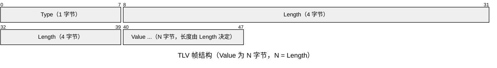
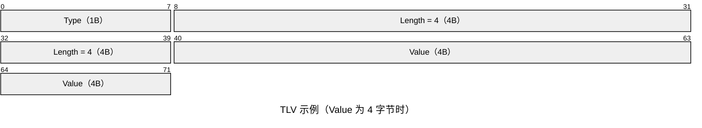
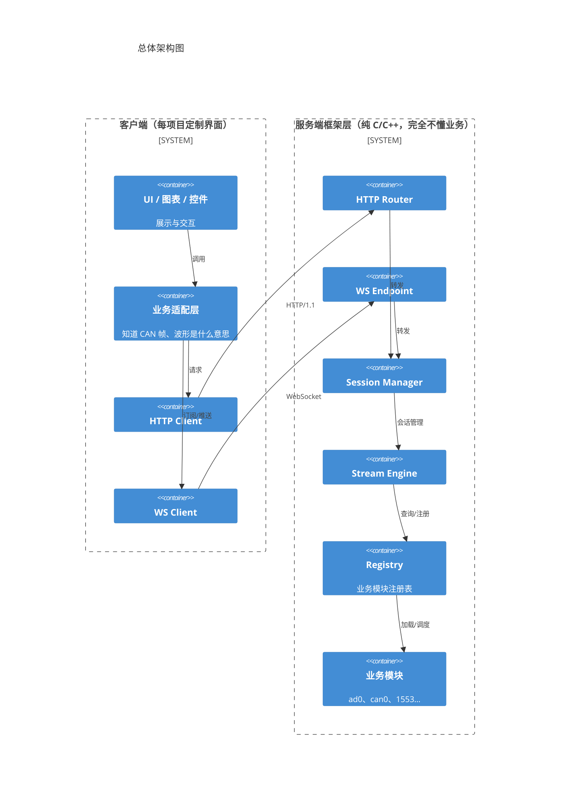
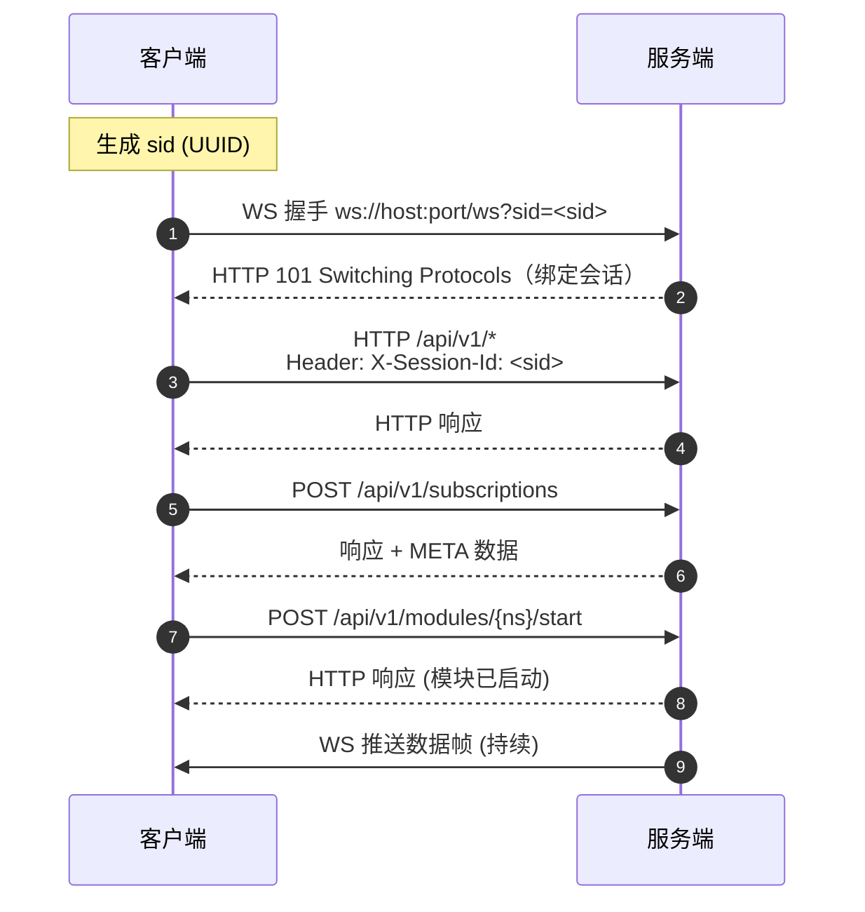
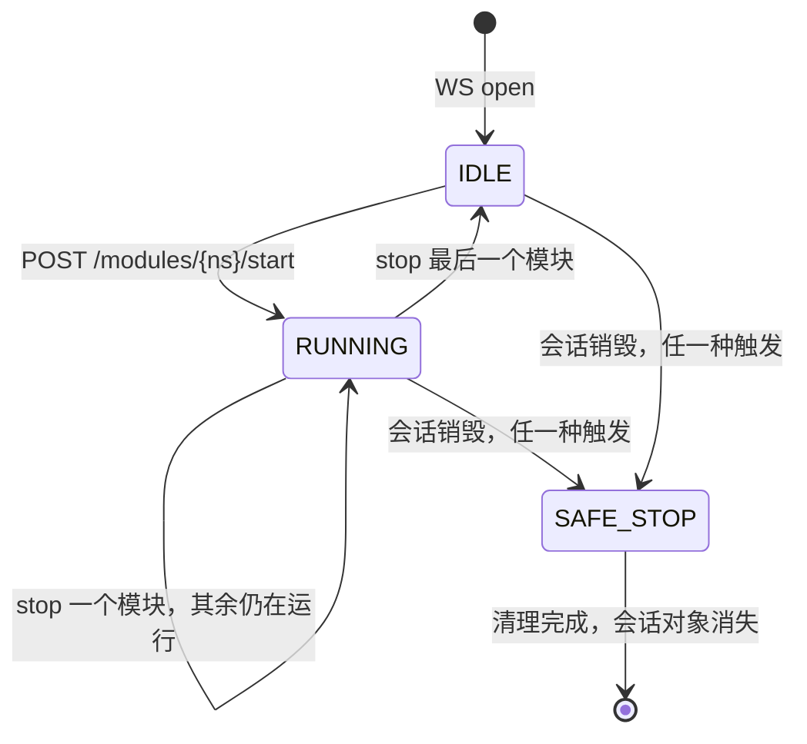
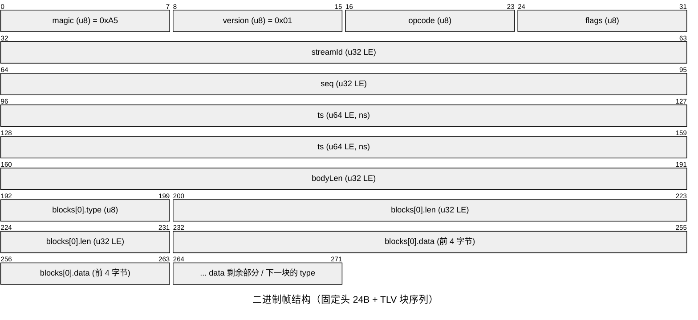

# 工控通讯模型 v1：HTTP REST + WebSocket 推送

> 定位：一套**通用底层框架**。只规定"怎么连、怎么订、怎么送、怎么停"，
> 不规定 AD/DA/DIO/CAN/1553B/ARINC429/FlexRay/AFDX 这些数据分别是什么意思。
> 具体业务靠"注册数据流 + 注册命令"挂进来，框架层自己完全不涉及业务逻辑。
>
> 传输方式：HTTP/1.1 REST（Representational State Transfer，一套"用网址指向
> 资源、用 HTTP 动词增删改查"的约定；客户端问、服务端答）
> + RFC 6455 WebSocket（服务端主动推）。
>
> 状态：设计稿（v1），取代 `docs/spec/01-ws-protocol.md`（下面称"v0 demo 规范"）。

---

## 0. 一页摘要

**两种传输方式，各自有各自的职责：**

| 传输方式  | 负责什么                                                             | 方向                   |
| --------- | -------------------------------------------------------------------- | ---------------------- |
| HTTP REST | 服务端的能力与流的查询、订阅、改参数、模块启停、下业务命令、查状态 | 客户端发起，服务端回答 |
| WebSocket | 二进制遥测数据帧、JSON 事件通知                                      | 服务端主动推           |

WS 只干它最擅长的一件事：服务端主动往外推数据。凡是"客户端发起、要拿一个明确结果"
的操作，一律走 HTTP。用 HTTP 自带的方法、状态码和路径含义来表达，不再自己定义一套
"命令 / 确认 / 错误"报文。

四个核心概念（表中前四行；后两行是传输方向）：

| 概念          | 英文        | 一句话说明                                                                           |
| ------------- | ----------- | ------------------------------------------------------------------------------------ |
| **会话**      | **Session** | 一条 WS 连接 = 一个会话，一一对应；WS 一断，服务端必须立刻停机                       |
| **流**        | **Stream**  | 一个可单独订阅的数据源，有自己的编号、序号、时间基准；数据含义由业务定义，框架层不懂 |
| **帧**        | **Frame**   | WS 上发的一种二进制数据包，自带说明书：24 字节头 + TLV 块                            |
| **事件**      | **Event**   | WS 上发的 JSON 文本消息，由服务端主动通知客户端                                      |
| **下发/下行** |             | 服务器到客户端                                                                       |
| **上传/上行** |             | 客户端到服务端                                                                       |

其中 **TLV** 指 `Type-Length-Value（类型-长度-值）`，一种通用的二进制打包格式：
1 字节说这块是什么，4 字节说数据有多长，后面跟数据本身。
大致示意图如下：




五条不能违反的底线：

1. **通讯框架层不懂业务**：协议不认识 CAN，也不认识波形；它只负责搬 `streamId` + 字节
   + META（metadata 的缩写，元数据：订阅时下发的 JSON，说明这批字节怎么排版）。
2. **WS 只用来推送**：客户端在 WS 上只被允许发"配额"消息和协议级的 Pong，其它操作全走 HTTP。
3. **默认不丢数据；同一流的数据帧不乱序**：真要丢数据，必须明确发一条通知告诉客户端，绝不能悄悄少。
   唯一的例外是 `state` 类流——它只承诺最终一致，中间值会被合并，因此不触发缺口通知（见 7.4）。
4. **采集线程绝不能被网络拖住**：业务和采集线程只往固定容量的缓冲区里写，绝不等待网络发送完成。
5. **控制通道一断就停机**：WS 连接断开或超时判定掉线，服务端必须把设备停在安全状态，不自动重试、不自动续跑。

---

## 1. 目标与非目标

### 1.1 目标

- **最核心的愿景**：借助Web技术来做GUI。彻底摆脱 Qt(QWidget、QML)、C#(WinForm、Avalonia、WPF)等传统的桌面GUI框架。核心基于标准C++构建。
- **一套通讯层，所有项目复用**：AD、DA、DIO、CAN、RS232/485/422、1553B、
  ARINC429、FlexRay、AFDX 等，在协议看来都只是"一个数据流"和"一个 HTTP 命令"的例子。
- **服务端只提供通用的通讯层**：
  - 会话管理
  - 流注册
  - 命令分发
  - 流量控制
  - 启停流程；
  业务通过模块注册进来，不混进协议层里。
- **同一份实现两种部署**：
  - 一种是把**浏览器内核嵌进桌面程序**（**CEF**，Chromium
  Embedded Framework），服务和界面都跑在本机 `127.0.0.1`，对外看起来仍是一套客户端 / 服务端分离的系统；
  - 另一种是**局域网**里一台机器采集、另一台机器控制和显示。这也是开发过程中方便的调试手段。
- **客户端由业务决定，自行做**：每个项目自己的界面和交互；通讯层只保证 REST + WS 这两套接口长期稳定。
- **可以长期演进**：以后加新流、加新命令、加新块类型，不会让老客户端崩掉。

### 1.2 非目标（明确不做，防止范围失控）

| 不做的事                     | 原因                                                 |
| ---------------------------- | ---------------------------------------------------- |
| 定义任何总线报文格式         | 属于业务含义，写在业务模块和 META 里                 |
| 多客户端 / 多操作员          | 实际场景是一对一；接口没写死，但 v1 不做多人权限判断 |
| 跨总线时间对齐               | 实际场景各总线独立处理，不做统一时间基准             |
| 服务端录制 / 回放 / 补发     | WS 一断就停机，重连后从空闲状态重新来                |
| 由服务端描述驱动前端动态渲染 | 客户端是换技术栈重写的定制上位机，不是低代码平台     |
| 文件 / 固件传输              | v1 的配置是结构化参数，不是搬文件                    |
| **视频 / 媒体传输**          | **v1 完全不做；后续靠其它方案来增强**（见 §16）      |
| 压缩、加密、鉴权体系         | 局域网/本机部署；预留扩展位置，v1 不强制             |

### 1.3 成功标准

- 新项目接一种总线，只需要新增业务模块和前端界面，**不改协议、不改框架层**。
- CEF 本机部署和局域网跨机部署，用的是同一套协议和同一份服务端代码。
- 拔网线、杀掉客户端进程之后，服务端能在心跳超时时间内进入安全状态，且输出端不留残留。
- 客户端处理不过来导致缓冲区被写满时，客户端能收到明确的"数据缺口"通知，
  而不是"数据悄悄少了没人知道"。
- 所有控制操作都能用 curl / Postman 直接验证，不需要私有调试工具。

---

## 2. 术语

| 术语       | 含义                                                          |
| ---------- | ------------------------------------------------------------- |
| Session    | 一次"客户端-服务端"配对关系；对应一条 WS 连接，带一个 `sid`   |
| Stream     | 业务注册进来的一个数据源；有 `streamId`、类型、序号、时间基准 |
| Frame      | WS 上的一条二进制消息                                         |
| Block      | 帧内的 TLV 单元：`[type u8][len u32][data]`                   |
| Record     | RECORD 类流里的一条带时间戳的记录；内容含义由业务定义         |
| META       | UTF-8 JSON，用来描述这个流的类型和数据怎么排                  |
| Timebase   | 这个流用什么时间基准；**不同流之间的时间戳不保证能直接比较**  |
| Capability | 能力标记，通过 `GET /capabilities` 由服务端声明              |
| Sink       | 数据流的写入端（`StreamSink`，见 12 章）                       |
| state（一词多义） | 文中四种含义：会话状态（`IDLE`/`RUNNING`）、`state` 流类型、`GET /state` 资源、`Module::State()` 的返回值 |

---

## 3. 总体架构

```text
┌────────────────────────── 客户端（每项目定制界面） ─────────────────────────┐
│  UI / 图表 / 控件           业务适配层（知道 CAN 帧、波形是什么意思）        │
│        └──────────┬────────────────────────┬──────────────────────────────┘
│             HTTP Client                WS Client
└───────────────────┼────────────────────────┼──────────────────────────────┘
                    │ HTTP/1.1               │ WebSocket
┌───────────────────┴────────────────────────┴──────────────────────────────┐
│                   服务端框架层（纯 C/C++，完全不懂业务）                     │
│  HTTP Router ─┐   WS Endpoint ─┐                                           │
│               └─ Session Manager ── Stream Engine ── Registry               │
│                                        │                  │                 │
│                                业务模块注册表（命令 / 流源 / 参数 provider）  │
│                                        │                  │                 │
│                                业务模块：ad0、can0、1553…                    │
└────────────────────────────────────────────────────────────────────────────┘
```



框架层只做五件事：接收 HTTP 请求、维护 WS 会话、分发命令、管理流的订阅、搬运二进制帧。
业务模块通过注册接口挂上来；框架层不知道也不关心模块内部在干什么。

---

## 4. 连接与会话

### 4.1 地址

| 端点     | URL                               | 用途             |
| -------- | --------------------------------- | ---------------- |
| HTTP API | `http://<host>:<port>/api/v1/...` | 控制、配置、查询 |
| WS       | `ws://<host>:<port>/ws?sid=<sid>` | 服务端推送       |

同一个端口、同一个源；如果前端页面也由这个服务端提供，就不存在跨域问题。
如果页面单独部署在别处，服务端要按 §6.10 配置 **CORS**（Cross-Origin Resource
Sharing，跨域资源共享：浏览器默认不许 A 站点的页面调 B 站点的接口，CORS 是
B 站点主动声明"我允许谁来调"的那套约定）。

### 4.2 建连顺序

```text
1. 客户端生成 sid（建议用 UUID，Universally Unique Identifier，一串 128 位
   随机数，用来当全局唯一的编号，不用查重也不会撞），打开
   ws://host:port/ws?sid=<sid>
2. 服务端检查 sid 格式与唯一性，绑定会话，完成握手：返回 HTTP `101 Switching Protocols`
3. 客户端用 HTTP 带上 X-Session-Id: <sid> 调用 /api/v1/*
4. POST /api/v1/subscriptions 订阅数据流，响应里把 META 一起带回来
5. POST /api/v1/modules/{ns}/start 启动模块，WS 上开始推数据帧
```



- **WS 连接就代表会话**：没有活动的 WS 连接时，所有需要会话的 HTTP 请求都返回
  `409 Conflict` + `code 2001`。
- 同一个 `sid` 再次建连：**一律拒绝**（`409` + `code 2001`），不踢旧连接。
  旧会话对象销毁完成之后才能重连，见 5.5。
- 已经有活动会话时，用**不同** `sid` 建 WS：握手阶段就拒绝，返回 HTTP `409` + `code 2001`。
  连接都没建立起来，所以这时没有 WS 关闭码可用。
- `sid` 由客户端生成，长度 8–64，字符集 `[A-Za-z0-9_-]`。缺失或格式非法 → 握手阶段 `400` + `code 1003`；
  已被另一条活动会话占用 → `409` + `code 2001`（不顶替，见 5.5）。

### 4.3 两种传输方式的关系

- **同步操作**的权威结果是 HTTP 响应；WS 事件只是提醒，不用它更新状态。
- **v1 没有异步受理**：所有控制操作都在 HTTP 响应里给出结果。长任务由业务在自己的响应里
  返回一个句柄，进度用 `biz.*` 事件推送，句柄由业务定义、框架不解释。
- 同一条流的**数据帧**之间保证先后顺序；控制帧（Ping、JSON 事件）可以插到排队的数据帧前面，
  因此事件与数据帧之间不承诺顺序。HTTP 和 WS 之间同样**不保证顺序**。
- 客户端必须用 HTTP 的响应来更新自己的状态，WS 事件用来刷新界面和处理异步变化。
- 服务端不能假设客户端"一定先收到了事件才发请求"。

### 4.4 部署形态

| 形态     | 地址                                                   | 说明                           |
| -------- | ------------------------------------------------------ | ------------------------------ |
| CEF 嵌入 | `http://127.0.0.1:<port>` + `ws://127.0.0.1:<port>/ws` | 同一台机器，零配置             |
| 局域网   | `http://<采集机IP>:<port>` + 对应的 WS                 | 服务端绑定指定网卡，防火墙放行 |

v1 默认不加密。需要加密时整体换成 `https://` + `wss://`，协议内容不变。

---

## 5. 会话生命周期与断线停机

### 5.1 状态机



> 图上没有 `STOPPING`：它是模块内部的瞬态，不是会话状态，见本节末尾。

- `IDLE`：WS 已连上，没有模块在运行；可以改参数、可以订阅。
- 会话状态是**各模块状态的聚合**，不是独立状态：没有模块运行 = `IDLE`，
  任一模块在运行 = `RUNNING`。`STOPPING` 只是某个模块内部的一瞬间（`Stop` 在收尾线程上同步完成），
  不作为会话状态上报。
- `RUNNING`：`start` 成功之后；采集和推数据正在进行。
- 会话销毁的触发有**六种**，处置方式相同（断推送口 → 尽力发 ending/4100 → 调 Stop → 释放缓冲）：
  WS 连接关闭、心跳判死、`DELETE /api/v1/session`、显式 `stop` 超时、发送队列过载、服务端进程退出。
- `STOPPING`：某个模块收到 `stop` 请求后、`Stop` 返回前的内部瞬态。它不进入会话状态，
  也不通过 `core.state` 上报——`Stop` 期间事件循环照常跑，会话状态维持 `RUNNING`，
  直到该模块停下后重新聚合。
  这期间对**同一个模块**再发 `start` 或第二次 `stop`，一律 `409` + `code 2006`，不排队：
  客户端看不到 `STOPPING`，能发出的只有"状态不允许"，让它过一会儿重试即可。
- `SAFE_STOP`：会话销毁时走的**强制停机**。它照样调 `Stop`、照样受 `stop_timeout_ms`
  预算约束，但**不采信 `Stop` 的返回值**：返回 false 或超时都一律销毁会话、释放缓冲
  （见 5.4）。和显式 `stop` 的差别在"结果不被采信"，不在"不等"。

`关闭会话`（销毁会话对象、释放订阅与参数）的触发见本节开头的清单。会话一旦销毁，
用同一个 `sid` 重新建连等于新建一个会话，
不继承任何状态，见 5.2。

停机与销毁的顺序见 5.2：事件循环只负责派发收尾任务，`Stop` 本身跑在收尾线程上，
销毁发生在它返回（或超时）之后。顺序不能反过来——`core.session.ending`
还得靠这个会话带着 `sid` 发出去，先销毁就发不成了。

### 5.2 断线 = 立刻停机

**六种销毁触发中的任意一种发生时，服务端必须按下面这个顺序收尾。**
顺序不能调换：先断生产、再停模块、最后释放缓冲（与 12 章的约定一致）。

1. 立刻进入 `SAFE_STOP`：先把数据推送口标记为失效（此后的 `Push*` 立即返回 false）；
   再**尽力**发最后一条事件 `core.session.ending`（带枚举原因）和 `4100` 关闭帧。
   链路已断时这两条发不出去，跳过不算违约——那正是最常见的一条路径；
2. 对每个正在运行的模块调用 `Stop`。业务在自己的 `Stop` 里停掉采集线程，
   把 DA/DIO 等输出设成业务定义的安全默认值；
3. 作废这次会话的状态；带着这个 `sid` 的 HTTP 请求此后返回 `409` + `code 2001`；
4. 释放这个会话的缓冲，尚未上报的溢出统计一并丢弃；
5. 会话对象销毁完成。**到这里这个 `sid` 才算真正失效**，新的 WS 连接此后才被接受（见 5.5）。

状态迁移图见 5.1（只有一张，避免同一件事两种画法）。上面这五条是顺序，不是状态：
`SAFE_STOP` 在其中从头贯穿到尾，结束时会话对象直接消失，没有"停机后再回 IDLE 待一会儿"这一步。

**"失效"只有一种定义：会话对象销毁完成。** 不是"WS 断了"，也不是"判死了"。
判死到销毁之间还有一段收尾（调 `Stop`，最多 `stop_timeout_ms`），这期间：

- 推送口保持失效，业务线程的 `Push*` 一律返回 false，不会把旧模块的数据灌进下一个会话；
- 新连接一律拒绝（`409` + `code 2001`），因为设备可能还没停稳；
- 崩溃重启的客户端按 1 秒间隔重试即可，最坏要等"判死 + 收尾"两段，见 5.5。

**明确不做的事**：自动重连、采集续跑、把断线期间的数据缓存后补发。客户端重连建立的是
**一个全新会话**，只能从 IDLE 重新开始。

**`sid` 可以再用，但不继承任何东西。** 客户端重连时沿用原来那个 `sid` 是允许的（只要格式合法，
见 4.2），服务端把它当新会话处理：订阅要重新建、参数回到默认值或上次 `PUT` 持久下来的值、
`revision` 重新计数。协议不设"宽限期"，也不保留断线期间的会话快照。理由是断线后设备已经回到
安全值，操作员必须重新确认才能继续，自动恢复订阅等于把风险带回现场。

### 5.3 心跳与超时判定掉线

- 服务端每 5 秒在 WS 上发一次 Ping；**15 秒内没收到客户端的任何消息**（Pong、`credit`
  或其它任何消息）→ 判定为掉线。
- 唯一的宽限条件：这 15 秒里我们的**发送队列在向前推进**（已排队字节数在减少）。
  它说明链路是通的、只是慢，把期限顺延到 **30 秒**；30 秒一到仍无消息，照样判死。
  发送队列**没有推进**（已排队字节数一寸未减）时不享受任何顺延，15 秒即判死。
- 判死有绝对上界：无论积压多少、链路多慢，**30 秒收不到客户端的任何消息一律判死**。
  这条上界保证"控制通道一断就停机"（见 0 章底线 5）不会被数据流量掩护掉。
- v1 只用 WS 的 Ping/Pong 判断连接是否还活着。浏览器和主流 WS 库会自动回 Pong；
  自研的 WS 栈必须自己实现这个应答。
- 判定掉线等同于断线，触发上面的立刻停机。
- 判死之后必须真的把连接关掉：先发 `core.session.ending`（`reason` 写明是心跳超时），
  再用 `4100` 关闭帧关闭这条 WS，然后断开 socket。只把会话标记成失效、留着半开的连接，
  对端会以为还能用，下次进来又撞上 409，现象是"重连一直失败、日志里却看不出原因"。
- 原因：TCP 半开时对方收不到 FIN，光看 socket 状态发现不了已经失联。
- HTTP 的 keep-alive 不参与存活判定，避免出现"HTTP 还能通但 WS 其实已经死了"这种说不清的状态。

> **为什么不用"有积压就不判死"：** 拔掉网线之后发送队列同样非零，而且会一直增长——
> 最需要判死的时刻，恰恰就是"有积压"的时刻。拿积压当免死条件，等于把安全阀交给数据量决定。
> 积压只能影响判死的**期限**（按推进情况顺延），不能取消判死。
>
> **怎么判断"推进"：** 在 15 秒窗口内每 5 秒采一次已排队字节数，并记下期间的最小值。
> 最小值比窗口开始时的字节数小，说明缓冲确实往外走了一部分，算推进。
> 不要拿相邻两次采样直接相减——一边发一边收的链路里，积压可能"排空之后又被填满"，
> 逐点比较会把有推进误判成没推进。这个量就是 8.5 里那个发送队列的长度，直接读即可。

**这个机制测不到什么。** Ping/Pong 由浏览器协议栈自动应答，只能证明"对端网络栈活着"，
证明不了"对端应用还在干活"：客户端界面线程被大帧渲染堵死时，Pong 照样准时回来。
要检测应用卡死，只能靠应用层自己发消息——服务端已经把来自客户端的任何消息（含 `credit`）
都算作存活，所以客户端正常归还配额就相当于在做应用层心跳。v1 不额外定义心跳消息，
需要更强保证的场景放到 v1.1。

### 5.4 明确请求停机

- `POST /api/v1/modules/{ns}/stop` 让该模块进入 `STOPPING`；
- **`Stop` 在框架的收尾线程上调用，不占事件循环**：它必须把采集线程停掉、
  把 DA/DIO 等输出设成安全默认值。事件循环在此期间继续处理心跳与其它请求；
- 框架等 `limits.stop_timeout_ms`（默认 5000）。**这个预算是"一个阶段一份"**：同一阶段里
  多个模块并行调用、共用这一份；不是每个模块各领一份。显式 stop 分两个阶段：

  | 阶段 | 什么时候 | 等谁 | 预算 |
  | ---- | -------- | ---- | ---- |
  | 1 | 每次 `POST .../stop` | 只等被请求的那个模块 | 一份 `stop_timeout_ms` |
  | 2 | 仅当阶段 1 超时 | 其余所有运行中的模块，并行 | 再给一份 `stop_timeout_ms` |

  阶段 1 超时就把问题升级为会话级安全停机（见 6.6）：该次 `POST` 返回 `409` + `code 2007`，
  然后进入阶段 2，**到点无论结果如何都销毁会话**，不再等业务——设备是否真的停在安全值
  由业务负责，框架没有能力替它写硬件。
- 所以显式 stop 最坏要等 `2 × stop_timeout_ms`（默认 10 秒），而普通成功路径只等一次 `Stop` 的耗时。
- 这是"设备一定会停"与"业务卡死会拖垮框架"之间的取舍：v1 选择后者不拖垮，前者由业务保证；
- `Stop` 返回 false（业务自己报的失败）→ 模块保持运行，HTTP 返回 `409` + `code 2006`，`msg` 带业务文本；
  客户端可以重试 `stop`；
- **断线路径不看 `Stop` 的返回值，也没有两个阶段。** 断线、心跳判死、过载停机、服务端退出时，
  所有运行中的模块**在同一阶段**并行调 `Stop`、共用一份 `stop_timeout_ms`。无论返回 false 还是
  超时，会话都照样销毁、缓冲照样释放，否则"拔线必停"就会被一个卡死的 `Stop` 挡住。
  只额外记一条严重日志，日志的 `reason` 按成因分档：返回 false 记 `stop_failed`，
  超时记 `stop_timeout`。**这两档只是日志字段，不会出现在 `core.session.ending` 里**——
  那条事件在调 `Stop` 之前就发完了，不可能带上它的结果（见 7.8）；
- 停机成功后 WS 保持连接，会话状态按 5.1 的聚合规则重算（还有别的模块在跑就仍是 `RUNNING`），
  可以再次 start。

### 5.5 只允许一个会话

- 同一时刻只允许一个活动会话。
- **任何**第二条 WS 连接都在握手阶段拒绝：`409` + `code 2001`。同一个 `sid` 也好、
  不同 `sid` 也好，一律不顶替、不踢旧连接。
- 旧会话**对象销毁完成**之后，新连接才能进来。这里的"失效"按 5.2 的定义取，不是"WS 断开"。
  客户端崩溃重启最坏要等两段：判死周期（≤ 30 秒，见 5.3）+ 收尾（≤ `stop_timeout_ms`，
  默认 5 秒），合计 **≤ 35 秒**。期间的建连请求一律 `409` + `2001`，客户端每 1 秒重试一次。

> **为什么没有「顶替」：** 会话号由客户端生成、没有额外凭据，允许顶替就等于
> 「知道会话号的人可以把操作员踢下线并触发停机」。而崩溃恢复并不需要复用会话号，
> 重启后重新建会话即可，代价只是等旧连接被判死。

---

## 6. HTTP REST API

### 6.1 通用约定

- 前缀 `/api/v1`，资源名用复数，动作做成子资源或 `:action`。
- 请求/响应体是 UTF-8 JSON；**HTTP 里的时间字段一律用毫秒整数**。
  全文共有三处时间单位，互不通用，不要互相赋值：
  HTTP 时间字段 = 毫秒；WS 事件信封的 `ts` = 毫秒（见 7.8）；
  二进制帧头与 `record` 的 `ts` = 纳秒（见 7.2、7.6）。
- 需要会话的请求必须带 `X-Session-Id: <sid>`，四种情形分开处理：
  - 缺这个头 → `400` + `code 1003`；
  - 值格式非法（不符合 4.2 的长度与字符集）→ `400` + `code 1003`；
  - 格式合法但当前没有活动会话 → `409` + `code 2001`；
  - 格式合法但不是当前活动会话 → `409` + `code 2001`。
- **资源状态幂等**：同一个请求重复发几次，资源的最终状态和发一次一样。
  注意 `revision` 每次成功都会递增，所以"响应"可能不同；重复 `DELETE` 订阅的第二次返回 404 + 2003。
  `POST` 命令由业务自己保证可重复执行，框架不提供去重机制。
- 所有响应都带 `X-Request-Id`；错误响应见 6.9。

### 6.2 资源总表

| 方法与路径                                | 用途                           | 需要会话 |
| ----------------------------------------- | ------------------------------ | -------- |
| `GET /api/v1/capabilities`                | 协议版本、支持的能力、各项限制 | 否       |
| `GET /api/v1/state`                       | 当前会话状态                   | 是       |
| `GET /api/v1/streams`                     | 流列表（概要）                 | 是       |
| `GET /api/v1/streams/{streamId}`                | 单个流的详情（含 META）        | 是       |
| `POST /api/v1/subscriptions`              | 订阅流，返回 META              | 是       |
| `DELETE /api/v1/subscriptions/{streamId}` | 取消订阅                       | 是       |
| `GET /api/v1/params/{scope}`              | 读参数                         | 是       |
| `PATCH /api/v1/params/{scope}`            | 只改传上来的几项（合并）       | 是       |
| `PUT /api/v1/params/{scope}`              | 整个作用域一次性全部替换       | 是       |
| `GET /api/v1/modules`                     | 模块列表与各自状态             | 是       |
| `POST /api/v1/modules/{ns}/start`         | 启动一个模块                   | 是       |
| `POST /api/v1/modules/{ns}/stop`          | 停止一个模块                   | 是       |
| `POST /api/v1/commands/{ns}/{action}`     | 业务命令                       | 是       |
| `GET /api/v1/commands`                    | 可用的业务命令列表             | 是       |
| `DELETE /api/v1/session`                  | 主动结束会话（会触发立刻停机）；返回 204 | 是       |

> 媒体/视频相关端点不在 v1 范围内（见 §16）。

### 6.3 capabilities

```http
GET /api/v1/capabilities
```

```json
{
  "proto": 1,
  "server": "daqd/1.0.0",
  "caps": ["credit"],
  "limits": {
    "max_data_frame": 1048576,
    "default_window": 1048576,
    "buffer_bytes": {"sample": 4194304, "record": 8388608},
    "send_queue_bytes": 67108864,
    "send_queue_drain_ms": 10000,
    "ring_total_bytes": 67108864,
    "stop_timeout_ms": 5000
  }
}
```

- `proto` 是协议主版本号，与 URL 里的 `v1` 对应；出现不兼容改动时它和 URL 一起变。
- 不需要会话，可以用来检查服务是否在线、以及版本对不对。
- `caps` 是服务端声明自己支持的能力；客户端能力不用在 WS 建连的 `Sec-WebSocket-Protocol` 或首条消息里声明——v1 只有服务端能力，客户端必须全部支持。

### 6.4 流的查询与订阅

```http
GET /api/v1/streams
→ 200 {"streams":[{"streamId":1,"name":"ad0.ch0","class":"sample"}]}
```

```http
GET /api/v1/streams/1
→ 200 {"streamId":1,"name":"ad0.ch0","class":"sample","meta":{...完整 META...}}
```

- 流清单只给 `streamId` / `name` / `class` 三项；`class` 与 `name` 由模块的 `StreamInfo` 提供（见 12 章）。
  采样率、帧长、时间基准这类参数属于业务语义，写在 META 里，不进清单——否则每个新业务都要改框架。
- **流编号的字段名统一叫 `streamId`**，流清单、流详情、订阅请求与响应、`credit`、事件、
  `core.error` 一律如此，不出现 `id` 这个简称。业务 payload 里的 `id`（如 CAN 报文 ID）
  与流编号无关，不在此列。

```http
POST /api/v1/subscriptions
Content-Type: application/json
X-Session-Id: s-7f3a2c

{"streams":[{"streamId":1,"window":1048576},{"streamId":2,"window":2097152}]}
```

```json
200 OK
{
  "subscriptions": [
    {"streamId":1,"window":1048576,"meta":{...}},
    {"streamId":2,"window":2097152,"meta":{...}}
  ]
}
```

- **订阅的响应里就带完整 META**，客户端不用等 WS 上的数据帧就能把解析器建好。
- `state` 流不参与配额：请求里给它写任何 `window` 都会被忽略，响应里固定回 0，不参与下面的校验。
- 对 `sample` / `record`：`window` 不传就用 `default_window`。**必须大于 0**：需要 META 时用 `GET /streams/{streamId}`，
  不需要数据就干脆别订阅。传 `0`、负数或非数字 → `422` + `code 2005`。
- 请求体里用 `streamId`；重复的 `streamId` 视为同一条，`window` 以最后一次为准。
- 订阅是**要么全部成功、要么一条都不生效**：只要有任意一个流不存在 → `404` + `code 2002`，
  这次订阅一个都不生效。
- 重复订阅同一个流是幂等的，不会重复返回错误；`window` 以最后一次设置为准。
- 取消订阅：`DELETE /api/v1/subscriptions/1` → `204`；本来就没订阅 → `404` + `code 2003`。
  服务端处理 DELETE 时先丢弃该流发送队列里的帧再回 204；204 之后仍可能到达已经交给 TCP 的
  少量字节，客户端按 `streamId` 丢弃、**且不必归还 credit**；退订后仍然到达的该流 credit
  按 8.2 静默忽略，与未知流同等对待。

### 6.5 参数

```http
GET  /api/v1/params/can0
PUT  /api/v1/params/can0
PATCH /api/v1/params/can0
```

```json
PUT /api/v1/params/can0
{"values":{"bitrate":500000,"samplePoint":0.875}}
```

```json
200 OK
{"scope":"can0","revision":7,"values":{"bitrate":500000,"samplePoint":0.875}}
```

- `PUT` = 整体替换该作用域，`PATCH` = 按 key 合并（只改你传上来的项）。
- `values` 里有什么完全由业务决定，框架层不懂它的含义、也不检查它对不对。
- `revision` 每个作用域自己单独单调递增，只有写成功才 +1；写失败时参数值和 `revision` 都不变。
- 参数默认**只放在内存里**，会话结束就丢掉；要跨重启保留由业务模块自己去做持久化。
  `revision` 的生命周期等于会话：即使业务把参数持久化了，`revision` 也不跨会话保留。
- 在 RUNNING 状态下允许读写，业务可以拒绝（返回 `422` + `code 3001`）。
- 没有任何模块认领的 `{scope}` → `404` + `code 2002`。

### 6.6 模块启停

设备按模块组织，启停也按模块走：一次启一个、停一个，失败只影响这一个模块。
**唯一的例外是 stop 超时**：一个模块停不下来，说明设备状态不可信，因此按会话级安全停机处理，
进入 5.4 的**阶段 2**——对其余运行中的模块并行调 `Stop`，用一份新的 `stop_timeout_ms` 预算，
到点不论结果都销毁会话；同时发 `core.session.ending`（`reason=stop_timeout`）和 `4100`。
这与 5.4 的"超时"是同一件事，两处不能各写一套。

```http
GET /api/v1/modules
→ 200 {"modules":[{"ns":"eph205","running":false,"streams":1}]}
```

```http
POST /api/v1/modules/eph205/start
X-Session-Id: <sid>

200 OK
{"ok":true,"state":{...}}
```

- `modules[].streams` 是该模块注册的流数量，仅用于界面展示。
- `start` 成功时响应里的 `state` 就是 `Module::State()` 的返回值（与 `GET /state` 里同名对象一致）。
- 模块不存在 → `404` + `code 2002`。
- 已经在运行还要 start、已经停止还要 stop → `409` + `code 2006`。
- 业务在 `Start` 里做初始化；失败返回 false → `409` + `code 2006`，该模块保持未运行。
- 启停成功后服务端通过 WS 发 `core.module.state`：`{"ns":"<ns>","running":true|false}`。

> **v1 没有"作业"这层抽象。** 长任务（例如一批测量）由业务用 `POST /commands/{ns}/{action}`
> 启动，进度用 `biz.*` 事件推给界面。传输层只负责"把命令送到、把事件推出去"，
> 不管作业编号、状态机、取消语义——那些属于业务。

### 6.7 业务命令

```http
POST /api/v1/commands/can0/send
{"channel":0,"id":291,"ext":false,"data":"0102030405060708"}
```

```json
200 OK
{"ok":true,"result":{...}}
```

- `{ns}` 必须对应一个已注册的模块；命名空间或动作不认识 → `404` + `code 2004`。
- 业务自己校验失败 → `422` + `code 3001`，`msg` 是业务给的文本。
- 命令在事件循环线程上同步执行，业务必须很快返回；耗时长的任务要自己转到工作线程，然后立刻应答。

### 6.8 状态查询

```http
GET /api/v1/state
→ 200 {"session":"s-7f3a2c", "state":"running",
        "modules":[{"ns":"eph205","state":{"running":true,"port":"COM7"}}]}
```

### 6.9 状态码与错误体

| HTTP | 含义                           | 典型 code                                                          |
| ---- | ------------------------------ | ------------------------------------------------------------------ |
| 200  | 成功                           | —                                                                  |
| 204  | 成功但没有返回内容             | 取消订阅、`DELETE /session`                                        |
| 400  | 请求格式不对                   | 1001 JSON 不合法、1003 字段缺失或格式非法（含 sid / X-Session-Id）  |
| 404  | 资源不存在                     | 2002 流不存在、2003 未订阅、2004 命令不存在                        |
| 409  | 会话或状态冲突                 | 2001 无会话/会话被占用、2006 当前状态不允许、2007 停止超时、2008 缓冲预算不足 |
| 422  | 参数校验失败                   | 3001 业务拒绝、2005 配额数值不合法                                 |
| 500  | 内部错误                       | 4004 内部异常                                                      |
| 503  | 服务暂时不可用                 | 4005                                                               |

错误体：

```json
{"code":3001,"msg":"bitrate out of range","retryable":false}
```

- `retryable` 只有 `4005`（服务不可用）为 `true`，其余一律 `false`；客户端只应重试这一类。
- 3xxx 段留给业务，v1 只用 `3001`；`msg` 由业务提供，框架原样透传。
- 响应同时带 `X-Request-Id`，方便和服务端日志对应起来。

### 6.10 CORS（Cross-Origin Resource Sharing，跨域资源共享）

页面和服务端同源时不用配置。单独部署时服务端必须：

- 允许 `Origin` 白名单（默认只允许同源和本机）；
- 允许 `OPTIONS` 预检，返回 `Access-Control-Allow-Methods` 和
  `Access-Control-Allow-Headers: Content-Type, X-Session-Id`；
- 回 `Access-Control-Expose-Headers: X-Request-Id`，否则跨源页面读不到这个响应头，
  "用它去对服务端日志"这条约定就失效了；
- 不返回 `Access-Control-Allow-Credentials`，v1 不使用 Cookie。

---

## 7. WebSocket 推送协议

### 7.1 连接与上行消息

- 地址：`ws://host:port/ws?sid=<sid>`。
- 服务端 → 客户端：二进制帧（§7.2）+ JSON 事件（§7.8）。
- 客户端 → 服务端：**只允许**下面这一类业务消息，其它一律忽略并记日志：

```json
{"v":1,"type":"credit","streams":[{"streamId":1,"bytes":262144}]}
```

- credit（把发送配额加回来）是唯一允许客户端在 WS 上发的业务消息；服务端不做确认回复，
  出错通过事件 `core.error` 通知。
- 协议级的 Pong 浏览器会自动回复，客户端不需要处理。

### 7.2 二进制帧结构

固定头 **24 字节**，所有多字节整数都是小端（LE）：

| 偏移 | 字段     | 类型 | 说明                                       |
| ---- | -------- | ---- | ------------------------------------------ |
| 0    | magic    | u8   | 固定 `0xA5`                                |
| 1    | version  | u8   | 帧格式版本，当前 `0x01`                    |
| 2    | opcode   | u8   | 帧类型，见 7.3                             |
| 3    | flags    | u8   | 帧级标志，见 7.3                           |
| 4    | streamId | u32  | 流 ID，0 保留不用                          |
| 8    | seq      | u32  | 该流内递增的序号，转圈之后继续累加         |
| 12   | ts       | u64  | 帧时间戳，纳秒，按这个流的 timebase 来解释 |
| 20   | bodyLen  | u32  | 后面块区域的总字节数                       |
| 24   | blocks   | —    | TLV 块序列                                 |

块的格式：

```text
[type: u8][len: u32 LE][data: len bytes]
```



- 接收端必须核对 `bodyLen` 和各个块长度加起来是否一致；不一致 → 整个帧丢弃并记日志。
  同样丢弃的情况还有：`magic != 0xA5`、`version != 0x01`、消息短于 24 字节、
  一帧出现多个数据承载块、`bodyLen` 超过 `limits.max_data_frame`。
- `type` 不认识的块必须直接跳过，不能报错（这是为了向前兼容，以后加新块类型老客户端不会崩）。
- `len` 为 0 的块：`RECORDS` 块视为非法（丢掉整帧，见 7.6）；其它块跳过。
- `bodyLen` 永远只描述**这一帧自己的块区域**，不代表一条完整数据的总长度；
  一帧就是一帧：v1 没有分片，`bodyLen` 就是这一帧的全部内容长度。

### 7.3 枚举

**opcode（帧类型）**

| 值   | 名称      | 含义                                                     |
| ---- | --------- | -------------------------------------------------------- |
| 0x01 | SNAPSHOT  | **保留不用**：v1 的 META 只在 HTTP 上给（见 7.5）        |
| 0x02 | DELTA     | 常规的增量数据帧                                         |
| 0x03 | EVENT     | **保留不用**：v1 的事件一律走 JSON 文本帧（见 7.8）      |
| 0x04 | ERROR     | **保留不用**：v1 的错误一律走 `core.error` 事件          |
| 0x05 | HEARTBEAT | **保留不用**；保活一律用 WS 的 Ping/Pong，收到就静默忽略 |
| 其它 | 未定义    | 接收端跳过整帧，不报错                                   |

**flags（帧标志）**

| bit   | 名称 | 含义                                   |
| ----- | ---- | -------------------------------------- |
| 0..7  | 保留 | v1 一律为 0；接收端遇到非 0 直接丢弃   |

**flag 全部保留。** v1 没有分片，也没有别的帧级标志；发送端一律填 0，
接收端遇到非 0 直接丢弃并记日志（见 10 章的兼容规则）。

**块类型（core 保留段）**

| 值        | 名称     | 内容                                                   |
| --------- | -------- | ------------------------------------------------------ |
| 0x01      | DATA     | 主数据块，SAMPLE/STATE 类用；怎么排由 META 描述        |
| 0x02      | META     | **保留不用**：META 只在订阅响应里出现                   |
| 0x03      | RECORDS  | 标准的记录容器，见 7.6                                 |
| 0x04      | AUX      | **保留不用**：v1 没有产生它的接口，接收端按未知块跳过    |
| 0x05–0x7F | 未定义   | 保留段；接收端跳过                                     |
| 0x80–0xFE | 业务扩展 | 由业务模块定义，必须在 META 里声明                     |
| 0xFF      | 保留     | 禁止使用                                               |

### 7.4 流的类型（class）

| class    | 含义                                     | 典型用途                                        | 可靠性                                                 |
| -------- | ---------------------------------------- | ----------------------------------------------- | ------------------------------------------------------ |
| `sample` | 等间隔的采样数组                         | AD 波形、DA 回读、DIO 电平快照                  | 缓冲未满时不丢；写满按整帧淘汰并报 overrun             |
| `record` | 长度不定的记录序列，每条带自己的时间戳   | CAN、1553B、ARINC429、FlexRay、AFDX、DIO 跳变沿 | 缓冲未满时不丢；写满按整帧淘汰并报 overrun             |
| `state`  | 只关心最新值；订阅时给全量，变化时给增量 | 设备状态、温度、连接状态                        | 只保证最终一致：每次变化不一定送达，但拿到的总是最新值；**有常驻值时订阅即给当前值，没有则不发首帧**（见 12 章） |

v1 **不定义媒体类**。视频/音频走后续的 HTTP 方案（§16）。

框架层只实现这三类"该不该丢、顺序怎么保证"的规则；每类里面数据具体怎么排由 META 描述，
含义由业务解释。

### 7.5 META 约定

META 就是一个流的自述说明书：

- **META 只在 HTTP 上出现**：订阅响应、以及 `GET /streams/{streamId}` 的详情。两处内容相同，
  都以订阅响应为建解析器的时点。WS 上不再下发 META。
- v1 不支持运行时增删流或修改流描述，所以没有"描述变化补发 META"这条路径。
- 客户端在拿到 META 之前，不能去解析这个流的数据块。
- **HTTP 响应与 WS 帧不保证先后**：客户端可能先收到该流的数据帧、后拿到订阅响应。
  拿到 META 之前收到的帧一律丢弃，**但丢弃的帧仍要按 8.2 归还它占用的 credit**，
  否则服务端的"在途"永远回不到 0，这个流会停住。拿到 META 之后的第一帧作为序号基准（见 7.7）。
  服务端也要保证：订阅响应写出之前，不为该流排任何帧。
- 遇到不认识的字段必须忽略。

公共字段：

| 字段      | 必填     | 说明                                       |
| --------- | -------- | ------------------------------------------ |
| kind      | 是       | 业务数据类型名，如 `waveform`、`can_frame` |
| class     | 是       | `sample` / `record` / `state`              |
| schemaVer | 是       | 数据布局的版本号，由业务自己递增           |
| timebase  | 是       | `unix_ns` / `monotonic_ns` / `device`（设备本地单调时钟，单位仍是纳秒，原点由业务定义，不可跨流比较）。**`state` 流只能用前两种**：它的帧时间戳由框架在 `SetState` 时打，框架不认识设备时钟 |
| layout    | 看 class | 数据怎么排的描述，见下                     |
| blocks    | 否       | 业务扩展块声明：`[{"type":128,"name":"calib"}]` |

**`layout` 的包法按 class 区分**：`sample` 只有一个固定形状，直接平铺
（`{"dataType":...}`）；`record` 与 `state` 的字段是可变结构，要多包一层同名对象
（`{"record":{...}}`、`{"state":{...}}`）。两类都遵循下文的类型表与长度规则。

`sample` 的 layout：

```json
{"dataType":"f32","components":1,"count":1024,"rateHz":1000,"unit":"V"}
```

字段含义固定如下，不能各写各的：

| 字段       | 必填 | 含义                                                         |
| ---------- | ---- | ------------------------------------------------------------ |
| dataType   | 是   | 只能是定长标量：`u8`–`u64`、`i8`–`i64`、`f32`、`f64`、`bool` |
| components | 否   | 每个采样点有几个分量，默认 1，必须 ≥ 1                       |
| count      | 是   | **每个分量**每帧的采样点数，必须 ≥ 1                          |
| rateHz     | 否   | **每个分量**的采样率，单位 Hz                                 |
| unit       | 否   | 工程单位，纯展示用，框架不解释                               |

**排列顺序：采样点优先**——先将一个采样点的所有分量连续排完，再排下一个采样点
（`p0.c0, p0.c1, ..., p1.c0, ...`）。所以一帧的负载字节数 =
`count × components × 单个标量的字节数`。

**数值类型与字节序（v1 约定，三类 layout 通用）：**

| 类别   | 写法                     | 说明                                       |
| ------ | ------------------------ | ------------------------------------------ |
| 无符号 | `u8` / `u16` / `u32` / `u64` | 小端                                   |
| 有符号 | `i8` / `i16` / `i32` / `i64` | 小端                                   |
| 浮点   | `f32` / `f64`            | IEEE 754，小端                             |
| 布尔   | `bool`                   | 1 字节，0=false，1=true，其它值视为非法   |
| 字节串 | `bytes`                  | 见下面的长度规则                           |
| 字符串 | `string`                 | 先 4 字节小端长度，再 UTF-8 字节           |
| 数组   | `array<T>`               | 元素连续排列，必须带 `count`               |

**长度规则（没有它两端会解出不同长度）：**

- `bytes` 作为**最后一个字段**时可以省略长度，长度 = 剩余字节数；
- 非末尾的 `bytes` 必须在字段对象里带 `count`，否则 META 非法；
- `array<T>` 必须带 `count`，元素按下标连续排列；
- 解析完必须**恰好**消耗完 payload，剩余字节不为 0 → 丢弃该帧（或该条记录）。

**不设隐式对齐或填充**：字段首尾相接，业务要填充必须自己声明 `bytes`。
这条是互通的前提——没有它，两支团队对同一个 `layout` 会解出不同结果。

`state` 的 layout：描述"最新值"这一个负载的形状，与另外两类一样由业务定义：

```json
{"state":{"fields":[{"name":"connected","type":"bool"},{"name":"port","type":"string"}]}}
```

> `state` 帧永远携带**完整的最新值**，不做字段级增量——"变化时给增量"指的是
> "只在变化时发一帧"，不是"只发变化的字段"。

`record` 的 layout：

```json
{"record":{"fields":[
  {"name":"id","type":"u32"},
  {"name":"flags","type":"u8"},
  {"name":"data","type":"bytes"}
]}}
```

> 框架层只要求上面这些字段存在且类型正确，不检查业务字段本身的意思。

### 7.6 记录容器（RECORDS）

`record` 类流统一使用块类型 `0x03`：

```text
repeat:
  [ts: u64 LE]      这条记录的时间戳，纳秒（时间基准由 META 声明）
  [len: u32 LE]     这条记录内容的字节数
  [payload: len]    由业务定义，按 META.layout 来解释
```

一帧装 1 到 N 条记录。**空 RECORDS 帧不合法**——没有记录就没有可用的帧时间戳，
接收端遇到就丢弃。`bodyLen` 负责边界校验。业务只需要定义 `payload` 里字段的布局，
时间戳与序号这些通用事情由框架层统一处理。

### 7.7 序号与时间

**seq 怎么分配：**

- `seq` 每个流单独递增，在**生产端把数据写进缓冲区的那一刻**分配一次；
- 分配时机必须是"进缓冲区"，不能是"进发送队列"：被缓冲区覆盖掉的帧已经占过号，
  客户端才能从序号断档看出真的丢了数据。等发送时才分配的话，被覆盖的帧根本没占到号，
  缺口永远看不见。
- `state` 的合并发生在**分配 seq 之前**（只保留最新值）；序号在"确定要发送、进入发送队列"时
  才分配，分配之后就不再被新值替换。这样既不会凭空造出"序号断档"的假告警，
  也不会出现"先占号又被合并掉"造成的假缺口。
- 缓冲区写满被覆盖掉的帧会留下真实的序号断档：**哪一段丢了，由客户端从 `seq` 缺口自己判断**；
  `core.overrun` 只报丢了多少（`droppedFrames`/`droppedBytes`），不报区间——
  500 毫秒内可能丢了几段互不相邻的帧，一个区间表达不了，硬报会说谎。
- 客户端把订阅之后收到的第一帧当作基准；之后按序号单调递增判断缺口。
- 序号在同一会话内不因订阅、退订、重新订阅而清零；新会话从 1 开始。
- `seq` 是 `u32`，会回绕。**比较一律按模 2³² 的差值算**：差值为 0 或负数（按有符号解释）
  都是旧帧，回绕本身不算缺口；只有差值大于 1 才是真的丢了数据。
- `ts` 是帧级别的时间，纳秒，按该流的 `timebase` 解释。**口径按 class 固定，不能各写各的：**
  - `sample`：本帧**第一个采样点**的采集时刻，由业务在 `PushSample` 时传入；
  - `record`：本帧**第一条记录**的 `ts`（业务逐条填写，框架取第一条）；
  - `state`：这份值**被 `SetState` 写入**的时刻，由框架打戳。
  取"首样本"而不是"写入时刻"，是因为采集和写入之间隔着整帧的采集时长：
  1024 点 / 1 kHz 差 1 秒，客户端画出来的波形时间轴会整体偏移。
- **不保证不同流之间的时间可以互相比较**。每个流独立使用自己的时间基准；
  确实需要对齐的，由业务在自己的 payload 里把基准信息带上。

### 7.8 事件（JSON 文本帧）

服务端通过 WS 的文本消息推送事件：

```json
{"v":1,"type":"evt","name":"core.state","payload":{"state":"running"},
 "ts":1731234567890}
```

| 事件名                | payload                                                                            | 说明                               |
| --------------------- | ---------------------------------------------------------------------------------- | ---------------------------------- |
| `core.state`          | `{"state":"idle"\|running"}`                                                       | 会话聚合状态变了（任一模块在跑即 running）          |
| `core.module.state`   | `{"ns":"eph205","running":true}`                                                    | 单个模块启停成功                   |
| `core.overrun`        | `{"streamId":1,"droppedFrames":3,"droppedBytes":12288}`                            | 缓冲区写满，有数据被覆盖掉了       |
| `core.error`          | `{"code":2005,"msg":"invalid credit","streamId":1}`                                | 客户端发来的消息有问题，或异步出错 |
| `core.session.ending` | `{"reason":"heartbeat_timeout\|overload\|session_deleted\|server_shutdown\|stop_timeout"}`       | 会话即将结束，最后一条事件                      |
| `biz.*`               | 业务定义                                                                           | 告警、进度、模块状态               |

- 事件不带 `id`；客户端不能指望不同流的事件之间有什么先后关系。
- 表里是 v1 会发的全集。v1 不会发运行时增删流的事件（没有这个能力，见 1.2），
  客户端遇到不认识的事件名按 10 章忽略即可。
- `core.overrun` 每个流在 500 毫秒内的多次溢出会**合并成一条通知**，避免刷屏。
- 事件和二进制帧走同一条 WS。事件属于控制帧，可以插到排队的数据帧前面（见 8.5），
  所以至多被"当前正在发送的那一帧"挡一下，不会排在整条队列后面。
  控制操作的结果以 HTTP 响应为准，事件只用来刷新界面和处理异步状态变化。

### 7.9 WS 关闭码

WebSocket 规范把 4000–4999 留作应用自定义，本协议固定从 4100 开始用。
和 9.1 的 HTTP 错误码（也是四位数）刻意错开：同一份日志里出现 `4001` 时，
不应该有两种解释。

| 码   | 含义                                     |
| ---- | ---------------------------------------- |
| 4100 | 会话结束（心跳判死、过载停机，或服务端主动关闭） |

v1 只用得着一个关闭码。4100–4199 其余值保留给后续版本，客户端按码值不认识处理即可。

这里**没有**"会话被占用"这一档：不同 `sid` 在握手阶段就被 `409` 挡掉（见 4.2），
连接根本没升级成 WebSocket，发不出关闭码。留一个永远发不出去的码，只会让实现者
以为它可达。

---

## 8. 流量控制（客户端跟不上时怎么办）

### 8.1 不能违反的规则

```text
业务/采集线程 ──写入──► 每个流一个固定容量的缓冲区 ──按配额取出──► 发送队列 ──► TCP
      （绝不等待）            （写满就覆盖旧数据）          （队列满就暂停从这里取数）
```

1. 业务线程往缓冲区里写**不允许被卡住**，也不能因为网络慢就停止采集。
2. 每个流一个循环覆盖的缓冲区，容量由 `limits` 或业务配置决定；淘汰时**按完整帧淘汰**，
   不允许只覆盖半帧（否则 `droppedFrames` 就算不出来）。缓冲的具体形态与内存口径见 8.6。
3. 客户端订阅时声明 `window`（字节数）作为配额上限，之后通过 WS 的 `credit` 消息把用掉的配额还回去。
4. 服务端只在"已获准的配额"范围内发数据（判据与唯一例外见 8.2）；配额用完就暂停这个流的发送。
   **字节区与描述符都没到上限时不丢数据**；任一上限触发都按第 5 条淘汰并报 overrun（见 8.6.3）。
5. 缓冲区被写满 → 覆盖最旧的**完整帧**，并**立刻**发一条 `core.overrun` 通知。
   同一段持续溢出时，后续通知按 500 毫秒合并（见 8.3）——第一声必须是即时的，
   否则操作员会在最关键的窗口里看到"一切正常"。
6. `state` 类流**不参与配额机制**，只保留最新值，不会出现溢出覆盖。但它还有另一道闸：
   服务端每个发送周期（约 10 毫秒）对**所有 state 流合计**限帧数与字节数，超出的推迟到下一
   周期。推迟不违反任何承诺——state 只保证最终一致，推迟出去的自然是最新值。
7. **没有人订阅时，就没有"必须送达"的责任**：`sample/record` 不入队、不占序号、不报溢出；
   `state` 只更新那一份常驻值、不发送、不占号。这样"没人看"不占缓冲，
   而订阅者一上来就能看到当前值（见 7.5、12 章）。

### 8.2 配额的具体规则

- `window` 和 `credit.bytes` 的单位都是**负载字节数**。这里的"负载"只有一个口径：
  **本帧里数据承载块（`DATA` 或 `RECORDS`）的 `data` 字段长度之和**。
  其中 `RECORDS` 内部每条记录的头部（`ts` 8 字节 + `len` 4 字节）**计入**；
  TLV 块头（`type` 1 字节 + `len` 4 字节）与 `META` 块**不计**。
  v1 每帧至多一个数据承载块，业务扩展块不计入配额（但计入 `max_data_frame`）。
- **`window` 是"已发未归还"的上限，不是"可用总额度"**。记 `在途 = 已发未归还`（初始 0）。
  每发出一帧：`在途 += payloadLen`；每收到一笔 credit：`在途 -= min(bytes, 在途)`；
  可用额度：`max(0, window - 在途)`。可以分多次归还，但归还总量不会让 `window` 变大。
- 判断能不能发，只看这个式子：**可发 ⟺ `payloadLen ≤ max(0, window − 在途)`**，
  其中 `在途` 就是"已发未归还"。
- 只有一个例外：`在途 == 0` 且 `payloadLen > window` 时，允许发一帧。
  这是给"窗口小于单帧"的部署留的活口，发完这一帧 `在途` 就等于 `payloadLen`，
  下一帧必须等归还。**除此之外没有任何超发**。
- 默认配置按下一条（窗口与单帧同为 1 MiB）时，这个例外永远不会触发。
- `window` **只要求大于 0，不设其它下限**（也不要求与 `max_data_frame` 有任何倍数关系）。
  取小了只影响吞吐（退化成一个归还周期发一帧），服务端不会拒绝订阅——
  `default_window` 必须能直接跑通。建议客户端按
  `limits.max_data_frame` 的两倍来设（具体帧长写在流的 META 里，见 7.5）。
- 归还的比欠的多（`bytes` 超过当前的已发未归还）时，**超出部分直接截断**，
  合法部分照常生效。这是客户端记账出错的信号，服务端发一条 `core.error`：
  `{"code":2009,"msg":"credit truncated","streamId":N,"truncatedBytes":M}`。
- **指向未知流、已退订流、或 `state` 流的 credit 一律静默忽略**：不报错、不发事件、只记 debug 日志。
  这三种都是正常竞态而非客户端出错——退订的帧可能还在路上，客户端也可能对订阅响应里的
  所有流统一归还（`state` 的 `window` 是 0，归还本身没有意义）。
  `bytes=0` 是 no-op；同一条消息里重复的 `streamId` 按求和处理。
- `window` 与 credit 都只对 `sample` / `record` 有效；`state` 订阅响应里的 `window` 恒为 0，
  客户端不要据此判断「暂停」。
- 两个码不要混：`2005` 表示**配额数值不合法**——`0`、负数、非数字、字段缺失都算在内，这条 credit 一条都不生效；
  `2009` 表示**数值合法但超过当前欠账**，超出部分截断，合法部分照常生效。
- "静默忽略"同时替代了退订宽限期：`DELETE` 返回 204 之后到达的该流 credit 与其它未知流
  同等对待，服务端不需要按时限区分，协议里也就没有"退订后多久内算合法"这种测不了的条款。
- `window` 必须大于 0。v1 没有"暂停订阅"这种状态：要停就退订，要 META 就查流详情。

> **一眼看边界：** 剩余配额为 0 一律不发；配额够就直接发；只有**在途为 0 且
> `0 < 剩余配额 < 单帧`** 时，才允许超发一帧。

### 8.3 数据丢了要能被看见

- `core.overrun`：`{streamId, droppedFrames, droppedBytes}`。`droppedBytes` 与 `window`
  同口径——被淘汰帧的负载字节之和，不含帧头与 TLV 头；
  第一次溢出立刻发，同一段持续溢出才按 500 毫秒合并成一条（首声不许拖，见 8.1 第 5 条）；
- **只发事件，不发二进制帧**：两者走同一条连接、同一个缓冲，冗余不增加任何保证，
  只会要求客户端维护两套解析。
- 服务端日志必须记录溢出的是哪个流、持续多久、丢了多少；
- 客户端界面必须明确提示"这里有数据缺口"，不允许悄悄接着画。

### 8.4 容量默认值（可以被覆盖）

| 项                    | 默认值   | 说明                                                                                     |
| --------------------- | -------- | ---------------------------------------------------------------------------------------- |
| `max_data_frame`      | 1 MiB    | **`bodyLen` 上限**：含所有 TLV 头与业务扩展块，不含 24 字节帧头                          |
| `default_window`      | 1 MiB    | 订阅时没写 window 就用这个配额                                                           |
| `buffer_bytes.sample` | 4 MiB/流 | 缓冲区容量                                                                               |
| `buffer_bytes.record` | 8 MiB/流 | 缓冲区容量                                                                               |
| `ring_total_bytes`    | 64 MiB   | 一条会话里所有流缓冲的合计上限（字节区 + 描述符）；超出就拒绝新订阅，返回 `409` + `2008` |
| `send_queue_bytes`    | 64 MiB   | 发送队列硬上限，达到即按过载停机（见 8.5）                                                 |
| `state_frames_per_cycle` | 8     | 每个发送周期（约 10 ms）所有 state 流合计的帧数上限                                       |
| `state_bytes_per_cycle`  | 256 KiB | 同上的字节数上限                                                                       |
| `send_queue_drain_ms` | 10000    | 预计排空时间上限，按实测发送速率估算，超过即按过载停机                                     |

**为什么单帧上限和默认窗口取同一个值（都是 1 MiB）：** 单帧大于窗口时，每一帧都只能靠
"超发一帧"才发得出去（见 8.2），配额就失去了约束力；单帧远小于窗口则一帧发完还剩大量配额，
限速粒度变粗。取同一个值最省心：一帧恰好能装满一次额度。另外，单帧越小，
控制帧被它挡住的时间越短（见 8.5）。

规划建议：总吞吐不要超过链路速率的 60%；单个流不要超过 20 MB/s；
超过这个量级的场景应该拆成多个流。这些默认值不是协议硬性约束，真实数值以
`GET /capabilities` 返回的 `limits` 为准。

### 8.5 控制帧的延迟上界与两条停机路径

**先明确一个物理事实：已经开始传输的帧无法被打断。**
WS 的每一帧在链路上是原子的——控制帧不能插进一个数据帧的内部；已经交给内核的字节也收不回来。
所以控制帧的**最小**额外延迟，等于"排在它前面的字节 ÷ 链路速率"。实现再聪明也绕不过这一条。

**可观测要求（本节只规定结果，不规定实现方式）：**

1. 控制帧（Ping 与 JSON 事件）的额外延迟不得超过"排在它前面的字节 ÷ 链路速率 **+ 一帧传输时间**"，
   而且实现必须把这个字节数压到最小，理想情况是**一帧**。验收按注入的已知积压量 `N` 量测（见 15 章）。
2. 发送队列的上限要同时卡两个维度：**字节数**与**预计排空时间**（积压字节 ÷ 链路速率）。
   只看字节数时，慢链路上 64 MiB 可能写十几分钟；只看时间时，快速链路上一次突发就能吃光内存。
3. 积压超过上限时按"过载"停机（见下表），不允许无限堆积。

**帧大小与传输时间的关系**（默认 `max_data_frame` 为 1 MiB）：

| 链路速率 | 一帧 1 MiB 的传输时间 | 含义                             |
| -------- | --------------------- | -------------------------------- |
| 4 MB/s   | 0.26 秒               | 单帧不会明显拖慢控制帧           |
| 1 MB/s   | 1.05 秒               | 与心跳周期相比仍然可接受         |
| 100 KB/s | 10.5 秒               | 超过半个心跳周期，链路已不适配默认帧长 |

所以"控制帧 1 秒内发出"不是任何链路都成立的承诺，它取决于帧大小与速率之比。
部署到窄带链路时，实现应当把单帧压到"速率 × 1 秒"以内；业务侧建议单帧控制在 256 KiB 量级。

**"过载"的判定必须是可测的，不能写成"持续溢出"这种没法写测试的说法。**
满足下面任意一条即刻触发，**不设延迟、不设迟滞**：

- 已排队字节数 **≥** `limits.send_queue_bytes`（默认 64 MiB）；
- 预计排空时间 **>** `limits.send_queue_drain_ms`（默认 10 秒）。预计排空时间 =
  已排队字节数 ÷ 最近 1 秒实际发出的字节数；速率取不到（过去 1 秒发出不足 1 KiB）时
  直接判过载——那说明链路已经实质不通，再等只是让队列继续长。

不设迟滞的理由：队列只能靠发送来减小，带宽不够时等一会儿不会变好，只会让停机更晚。

**两条停机路径要分清：**

| 触发                  | 含义                     | 收尾                                                                                  |
| --------------------- | ------------------------ | ------------------------------------------------------------------------------------- |
| WS 断开、心跳超时     | 控制端失联               | 立刻进入 `SAFE_STOP`：双方都不知道对方状态，设备必须回安全值                          |
| 发送队列达到上述上限  | 链路带宽不够，连接还活着 | 先断数据推送口，再发 `core.session.ending`（`reason=overload`）与 `4100`，然后按 5.2 收尾 |

两条路最后都到 `SAFE_STOP`。区别在第二条要先告诉客户端原因，让操作员知道是网络问题，
不是设备出了问题——否则现场第一反应会是"设备坏了"。

### 8.6 缓冲层

#### 8.6.1 每个流一个环形缓冲

**环形缓冲**（ring buffer，也叫循环缓冲）是一段固定长度的连续内存：写指针走到末尾就回到开头，
覆盖掉最旧的数据。用它做缓冲的意义在于容量在分配时就定死，运行期不再申请内存，
写入路径不会因为内存分配而出现延迟抖动。

对缓冲层的要求：

- `sample` / `record` 每个订阅流一个环形缓冲，容量取 `limits.buffer_bytes`（见 8.4）。
  容量按**负载字节**计（与 8.2 的口径一致），帧头和 TLV 头不占缓冲；
`state` 不建环，只留一份最新值（见 12 章）；
- 写入以**整帧**为单位，淘汰也以整帧为单位，不允许出现半帧（见 8.1 第 2 条）；
- `sample` / `record` 的序号在写入缓冲时分配；`state` 在确定发送时分配（见 7.7）；
- 缓冲随会话销毁，不跨会话复用；**退订即释放该流的缓冲**，重新订阅从空缓冲开始、
  序号接着该流当前的值往下走（不清零）。

> **为什么序号必须在写入时分配：** 被淘汰的帧必须已经占过号，客户端才能从序号断档
> 判断出"确实丢了数据"。若等到发送时才编号，被淘汰的帧从未占号，
> 缺口在协议层面就是不可见的——数据悄悄少了，而所有序号连续。

#### 8.6.2 读写位置与跨环尾写入

实现上建议用两个单调递增的计数器表示读、写位置，取实际地址时对容量取模。
单调计数器的好处是「已用字节 = 写位置 − 读位置」恒成立，不必单独维护长度，
也不会出现"写位置等于读位置"时分不清是满还是空的经典歧义。

一帧的数据可能被分成环尾和环首两段，这种情况称为**跨环尾**（wrap-around）。
写入和读取各需要两段连续内存拷贝。它不是异常路径，而是常态，必须按正常流程处理。

#### 8.6.3 帧描述符及其上限

环形缓冲只保存字节，还需要一份元数据说明"环里哪一段字节是一帧、序号和时间戳是多少"。
这条元数据称为**帧描述符**（descriptor）。典型布局：

| 字段     | 长度   | 含义                         |
| -------- | ------ | ---------------------------- |
| 起始位置 | 8 字节 | 单调写位置，访问时对容量取模 |
| 长度     | 4 字节 | 这一帧的负载字节数           |
| 序号     | 4 字节 | 写入时分配                   |
| 时间戳   | 8 字节 | 本帧的 `ts`，口径见 7.7      |

描述符本身要占内存，而且它与字节区**不在同一个量级**：帧越小，环里能装的帧越多，
描述符就越费。8 MiB 的缓冲配 32 字节的极小帧，可以装进约 26 万条描述符，
合计约 6 MiB，比很多流的整个字节区还大。

因此描述符必须单独封顶：**每个流最多 65536 条**（约 1.5 MiB）。
达到上限时按"淘汰最旧一帧"处理，并计入 `core.overrun` 的统计。
这不违背任何语义：小帧多到连描述符都记不下时，旧帧本来就应该丢弃。

#### 8.6.4 内存预算

一条会话里所有流的缓冲合计不得超过 `limits.ring_total_bytes`（默认 64 MiB）。`state` 流的常驻值不建环、不计入这个预算——每个 state 流至多留一帧，上限由 `max_data_frame` 约束。
**这个数额统计的是"字节区 + 描述符上限"，不只是字节区**：

```text
单个流占用 = buffer_bytes[class] + 65536 × 24 字节
```

订阅时服务端先算"当前已用 + 本次申请"，超过上限即拒绝，返回 `409` + `2008`，
`msg` 中说明是缓冲预算不足；`GET /capabilities` 的 `limits` 同时给出
`ring_total_bytes`，客户端据此判断还能订阅几个流。

> **为什么 v1 就要设这道上限：** 缓冲容量是客户端可以间接影响的东西
> （订阅哪个流、订阅几个）。没有上限时，一个行为异常的客户端反复订阅退订，
> 或者某个模块一次性声明大量流，内存会在无人察觉的情况下持续增长。

---

## 9. 错误模型

### 9.1 错误码分段

| 段   | 类别           | 例子                                                                                                                                                                                  |
| ---- | -------------- | ------------------------------------------------------------------------------------------------------------------------------------------------------------------------------------- |
| 1xxx | 请求本身的问题 | 1001 JSON 不合法、1003 缺字段                                                                                                                                        |
| 2xxx | 会话与传输     | 2001 会话被占用或没有会话、2002 资源不存在（流/模块）、2003 未订阅、2004 命令不存在、2005 配额数值不合法、2006 当前状态不允许、2007 停止超时（会话已销毁）、2008 缓冲预算不足、2009 配额超出窗口已截断（仅提示） |
| 3xxx | 业务           | v1 只用 `3001 业务拒绝`，其余留给以后                                                                                                                                                  |
| 4xxx | 系统与安全     | 4004 内部异常、4005 服务不可用（其余保留）                                                                                                         |

### 9.2 错误体（HTTP）

```json
{"code":3001,"msg":"bitrate out of range","retryable":false}
```

- 同时带 HTTP 状态码（对应关系见 6.9）与 `X-Request-Id`。
- `retryable` 默认为 `false`。
- 3xxx 段留给业务，v1 只用 `3001`；`msg` 由业务提供，框架原样透传。

### 9.3 WS 上的错误

- 客户端发来的 credit 数值不合法、流级错误 → 用事件 `core.error`；
- 连接建立之后的会话级结束只有一种：先发 `core.session.ending`，再用 `4100` 关闭连接。
  鉴权与占用类错误都发生在握手阶段，用 HTTP 码表达。

---

## 10. 版本与扩展

- HTTP 的版本写在 URL 里：`/api/v1`；出现不兼容的改动就升到 `/api/v2`。
- WS 帧格式的版本写在帧头 `version` 里；控制事件的版本写在 `v` 里。
- 新增 HTTP 资源、新增 WS opcode、新增块类型、新增事件，都算兼容改动。
- 客户端必须做到：忽略不认识的事件、忽略不认识的块、跳过 opcode 不认识的帧。
- 服务端必须做到：不认识的 HTTP 路径回 `404` + `code 2002`（与"资源不存在"同一口径），
  不认识的业务命令回 `2004`，不允许悄悄不理。
- 能力通过 `/capabilities` 的 `caps` 声明；用了没声明过的能力就算协议错误。
- 业务 META 的 `schemaVer` 和协议版本无关，由业务自己演进；客户端按
  `schemaVer` 选对应的解析器，遇到不认识的版本应该停止渲染这个流并提示升级。

**v1 能力标记表：**

| cap             | 含义                              | 不支持时的行为                                 |
| --------------- | --------------------------------- | ---------------------------------------------- |
| `credit`        | 支持流量控制（核心，必须实现）    | 不适用；v1 客户端必须支持                      |

> v1 **不声明 `frag`**：没有分片。单帧超限属于业务侧问题，应由业务拆成多条。

---

## 11. 安全与部署

- v1 默认不加密（明文 HTTP/WS），适用于本机 CEF 和可控的局域网。
- 局域网部署：服务端只绑定指定网卡；防火墙只放行控制网段。
- 可选 TLS：整体换成 `https://` + `wss://`，协议内容不变。
- CORS 默认只允许同源和本机（见 6.10）。
- 协议本身不做用户/角色/权限；需要的话由业务在命令或参数层自己判断。
- **宁可停机也不要失控**：只要无法确认控制端还活着，一律停机。

---

## 12. 服务端框架层接口契约

框架层只认**一个**注册入口：`Module`。生命周期、流、命令、参数都收在同一个接口里；
本节定义的接口是规范的一部分：换一种语言实现，也必须提供等价的能力。
另有一个由框架层注入的推送口 `StreamSink`。这样业务方只需要实现一个类，
框架层也只有一张注册表。

```cpp
// 一个流的静态描述：只有这四项，其它属性（采样率、帧长、时间基准）都写在 meta 里
struct StreamInfo {
  uint32_t id = 0;      // 流编号，从 1 开始；0 保留
  std::string name;     // 展示名，如 "ad0.ch0"
  std::string cls;      // sample / record / state，见 7.4
  std::string meta;     // UTF-8 JSON，见 7.5
};

// 模块：业务要实现的就是这一个接口。
// 除 Stop 外，所有方法都在事件循环线程上调用，必须快速返回。
// Stop 是唯一例外：它在框架的收尾线程上执行，可以阻塞（上限见 5.4）。
class Module {
 public:
  virtual ~Module() = default;

  virtual std::string ns() const = 0;                        // "eph205" / "ad0"
  virtual const std::vector<StreamInfo>& streams() const = 0;
  virtual bool running() const = 0;

  // 框架层注册模块时把推送口交进来；不实现就不产生数据，其余功能照常
  virtual void AttachSink(StreamSink* sink) {}

  // 模块的启停：对应 POST /modules/{ns}/start 与 /stop
  virtual bool Start(std::string& err) = 0;
  virtual bool Stop(std::string& err) = 0;

  virtual nlohmann::json State() const = 0;   // GET /state 的 modules[].state

  // 对应 POST /commands/{ns}/{action}
  virtual bool Command(const std::string& action,
                       const nlohmann::json& payload,
                       nlohmann::json& result, std::string& err) = 0;

  // 对应 /params/{scope}
  virtual bool OwnsParamScope(const std::string& scope) const = 0;
  virtual nlohmann::json GetParams(const std::string& scope) const = 0;
  virtual bool SetParams(const std::string& scope, const nlohmann::json& values,
                         bool replace, nlohmann::json& applied,
                         std::string& err) = 0;

};

// 一条记录：时间戳 + 负载。帧时间戳取第一条记录的时间。
struct Record {
  uint64_t ts_ns = 0;
  std::vector<uint8_t> payload;
};

// 推送口：框架层注册模块时交给业务，业务在自己的采集线程里调用
class StreamSink {
 public:
  // sample 类：一次调用写一帧。ts_ns 是本帧第一个采样点的采集时刻（见 7.7）
  bool PushSample(uint32_t stream_id, uint64_t ts_ns, const void* data,
                  std::size_t len);
  // record 类：一批记录打成一帧，帧时间戳取第一条记录的时间
  bool PushRecords(uint32_t stream_id, const std::vector<Record>& records);
  // state 类：只保留最新值；序号在确定要发送时才分配
  void SetState(uint32_t stream_id, const void* data, std::size_t len);
};
// StreamSink 由框架持有、与进程同生命周期；但它的**有效性按会话计**，不按进程计：
// 会话销毁时置为失效（`Push*` 返回 false、`SetState` 被忽略，不会悬空），
// 新会话握手成功后自动恢复有效，业务不需要重新注册或重拿指针。
// 无论有效与否，没有订阅者的 stream_id 一律返回 false（见 8.1 第 7 条）。
// 三个方法都线程安全、不会因为网络慢而阻塞。
// 前两个返回 false 只表示"这次数据没被接收"（没人订阅、流不存在、单帧超过容量），
// 业务可以计数，但不许重试、不许反压采集；SetState 没有返回值，丢不丢由框架决定。
```

**`state` 的值由框架常驻，但常驻范围是"一个会话"。** 会话有效期间无论有没有订阅，框架都
保留每个 state 流的最新一份负载；订阅成功时直接把这份值作为首帧发出去（序号在发出时分配）。
**还没收到过 `SetState` 的流不发首帧**，等业务第一次设值时再发——客户端不能假设"订阅后立刻
有第一帧"。这样订阅者一上来就能拿到当前值，而不是等下一次变化——否则"订阅时给全量"这条要求
没有实现路径。

**会话销毁时常驻值一并清空**，新会话要等业务重新 `SetState` 才有首帧。不清空的话，断线时
明明已经把设备停掉了，重连后的首帧却会推上一个会话残留的"还在运行"，这正是 5.2"不继承任何
状态"要排除的情形。
`sample` / `record` 不这么做：它们不承诺历史。

**运行约定（所有业务模块必须遵守）：**

| 项               | 约定                                                                                                                        |
| ---------------- | --------------------------------------------------------------------------------------------------------------------------- |
| 调用线程         | 除 `Stop` 外，`Module` 的所有方法都在事件循环线程上执行，必须快速返回；`Stop` 在收尾线程上执行，可以阻塞（上限见 5.4）        |
| 采集线程         | 由业务模块自己创建；数据一律经 `StreamSink` 写入缓冲，不许直接操作网络                                                       |
| 推送口的行为     | 线程安全；不等待网络；返回 false 只表示"这次没接收"，是丢弃不是错误。业务可以计数，不许重试、不许反压采集                    |
| 缓冲区满了怎么办 | 框架层按整帧淘汰最旧的帧并上报 `core.overrun`（8.1、8.3），业务不需要也不应该自己丢数据                                      |
| 启动失败         | `Start` 返回 false → `409` + `2006`，该模块保持未运行；没有批量启动，也就没有回滚一说                                        |
| 停止的两种情况   | `POST /modules/{ns}/stop` → 调 `Stop`，等业务收尾；断线触发强制停机 → 同样调 `Stop`，但不保证业务能优雅收尾（见 5.2）        |
| 顺序             | 一次只启停一个模块，不存在批量顺序问题；HTTP 响应在该模块的调用返回之后才发出                                                |
| 异常             | 业务不能让异常穿过模块边界；HTTP 层会兜底捕获并映射成 `500` + `code 4004`                                                  |

**并发与锁的边界。** 生产者只有一类：业务模块的采集线程；消费者只有一类：事件循环线程。
两者共享同一条流的缓冲，用一把互斥锁串行化即可，不必追求无锁结构——典型帧只有几 KB
（上限见 `limits.max_data_frame`），锁的持有时间是微秒级，不是瓶颈所在。

一条硬约束：**持锁期间只做内存拷贝和队列操作，不做网络发送、不做 JSON 编码、
不调用任何业务回调。** 要发帧时先拷出来、放锁、再发。否则一次网络抖动会顺着锁
把采集线程一起拖住，违背 8.1 第 1 条"写缓冲不被卡住"。

**会话结束时的销毁顺序（与 5.2 同一套）。** 缓冲随会话存在，释放必须"先断生产、再放内存"：

1. 标记推送口失效：此后的 `Push*` 立即返回 false，不再触碰缓冲；
2. 调用各模块的 `Stop`，由业务停掉采集线程并等它退出；
3. 释放缓冲，尚未上报的溢出统计一并丢弃。

第 1 步与第 2 步之间会丢弃少量在途数据，这是有意为之：会话已经结束，这些数据发不出去，
保留下来只会让"谁还持有缓冲"变得难以判断。

**HTTP 路由约定：** 框架层只实现 `/api/v1` 下的核心资源；业务命令统一走
`/api/v1/commands/{ns}/{action}`，不要往框架层里塞新路由。这样框架层的路由表是固定的，
业务扩展只发生在注册表里。

---

## 13. 附录 A：业务扩展示例（非规范）

> 下面只是"业务可以怎么用这套框架"的例子，**不属于 v1 的强制规定**。

### A.1 AD 波形（sample）

```json
{"kind":"waveform","class":"sample","schemaVer":1,"timebase":"device",
 "layout":{"dataType":"f32","components":1,"count":1024,
           "rateHz":1000,"unit":"V"}}
```

帧：`DELTA`，`DATA` 4096 字节，`ts` = 本帧第一个采样点的采集时刻。

### A.2 CAN 报文（record）

```json
{"kind":"can_frame","class":"record","schemaVer":1,"timebase":"device",
 "layout":{"record":{"fields":[
   {"name":"canId","type":"u32"},
   {"name":"ext","type":"u8"},
   {"name":"rtr","type":"u8"},
   {"name":"dlc","type":"u8"},
   {"name":"data","type":"bytes"}]}}}
```

帧：`DELTA`，`RECORDS` 里每条记录自带 `ts`，帧 `ts` 取第一条记录的。

发送一条 CAN 帧（业务命令）：

```http
POST /api/v1/commands/can0/send
{"channel":0,"id":291,"ext":false,"data":"0102030405060708"}
```

### A.3 DIO 跳变沿（record）与输出控制

```json
{"kind":"dio_edge","class":"record","schemaVer":1,"timebase":"device",
 "layout":{"record":{"fields":[
   {"name":"channel","type":"u16"},
   {"name":"level","type":"u8"}]}}}
```

```http
POST /api/v1/commands/dio0/set
{"channel":3,"level":1}
```

### A.4 1553B / ARINC429 / FlexRay / AFDX

同一套做法：一条或一组记录，把字段换成 RT/SA、label/SDI、slot/cycle、VL/seq。
字段布局写在 META 里，框架层不知道这些字段是什么意思。

### A.5 参数包

```http
PUT /api/v1/params/ad0
{"values":{"channels":[{"id":0,"range":"±10V","enabled":true}]}}
```

---

## 14. 附录 B：与 v0 demo 规范的差异

| 项       | v0（demo）                       | v1                                              |
| -------- | -------------------------------- | ----------------------------------------------- |
| 传输     | 两条 WS（stream/control）        | HTTP REST + 一条 WS                             |
| 控制     | 自定义的 命令/确认/错误 报文格式 | HTTP 方法/状态码/资源语义                       |
| 通道划分 | 按数据流动方向拆                 | 按"一问一答 vs 主动推送"拆                      |
| 块编码   | flags 位掩码，最多 8 种          | TLV，类型字节 + 长度，可以扩展                  |
| 帧头     | 12 字节                          | 24 字节（增加 bodyLen、帧级 ts）                |
| 流量控制 | 无                               | 配额 credit + 固定容量缓冲区 + 溢出通知 overrun |
| 多流     | streamId 含义单一                | 完整流表 + 注册（运行时增删留到后续版本）                |
| 参数     | 单 key/value                     | scope + PUT/PATCH + revision                    |
| 安全     | 断开连接后不强制停机             | WS 断开 = 立刻停机                              |
| 时间     | 只有帧级 ts                      | 帧 ts + 记录 ts + timebase 声明                 |
| 媒体     | 无                               | v1 不做，以后走 HTTP                            |
| 发现     | 无                               | `/capabilities`、`/streams`                     |
| 错误     | 3 段区间                         | 4 段 + HTTP 状态码映射 + `retryable`            |
| 调试     | 私有前端                         | curl / Postman / OpenAPI 可直接验证             |

v0 的正文在 `docs/spec/01-ws-protocol.md`，已归档，留着只为对照历史；
v1 落地后 demo 代码按 v1 重构。

---

## 15. 验收清单（实现前先写测试）

| #   | 用例           | 通过标准                                                                            |
| --- | -------------- | ----------------------------------------------------------------------------------- |
| 1   | 连接代表会话   | 没有活动 WS 时调用 `/subscriptions` → 409 + 2001                                    |
| 2   | 只允许一个会话 | 已有活动会话时，同 sid 或不同 sid 建 WS 都返回 409 + 2001，不踢旧连接               |
| 3   | 断线立刻停机   | 拔线后发送缓冲不推进 → 15 秒内进入 SAFE_STOP；推进中 → 最迟 30 秒；输出设成安全默认值 |
| 4   | 订阅           | 订阅响应带完整 META；取消订阅后不再排新帧，在途字节客户端丢弃                        |
| 5   | 不丢数据       | 客户端停在缓冲容量内时 seq 无缺口；超出容量后按整帧淘汰，seq 出现对应缺口并收到 overrun |
| 6   | 流量控制       | 配额耗尽后暂停；归还 credit 后继续；写满按整帧淘汰并报 overrun                       |
| 7   | 记录容器       | 多条 record 装在一帧里，逐条 ts 正确；字段按 META 解析                              |
| 8   | 兼容           | 注入不认识的块类型/不认识的事件，客户端不崩、不误读                                 |
| 9   | REST 语义      | 404/409/422 与 code 对应关系正确；响应带 `X-Request-Id` 头                          |
| 10  | 状态机         | 模块已运行时再 start → 409 + 2006；已停止时再 stop → 409 + 2006                    |
| 11  | 启动回滚       | 模块 `Start` 返回 false → 409 + 2006，该模块保持未运行，不影响其它模块                     |
| 12  | 参数的原子性   | `PUT`/`PATCH` 校验失败 → 422 + 3001，参数与 revision 都不变         |
| 13  | CORS           | 独立源的页面能完成 OPTIONS 预检和带 X-Session-Id 的请求                             |
| 14  | 部署           | 本机（只绑回环）与局域网跨机两种部署，各跑一遍全流程                                        |
| 15  | 判死后关连接   | 判死后确实发了 `core.session.ending` 与 `4100`；收尾期间重连被 409+2001 拒绝，35 秒内能连上 |
| 16  | 两条停机路径   | 断网 → SAFE_STOP；队列达上限 → 先收到 core.session.ending 和 4100，再 SAFE_STOP      |
| 17  | 缓冲淘汰       | 写满后淘汰最旧的整帧；客户端看到序号断档，并收到计数一致的 core.overrun             |
| 18  | 跨环尾写入     | 持续写入使某一帧跨越缓冲末尾，读出的内容逐字节一致                                  |
| 19  | 描述符上限     | 用极小帧灌满一个流，描述符数量停在上限，进程内存不再增长                            |
| 20  | 缓冲预算       | 订阅总量超过 `ring_total_bytes` 时返回 409 + 2008，已订阅的流不受影响               |
| 21  | 控制帧延迟     | 注入 N 字节积压，控制帧的额外延迟 ≤ N ÷ 链路速率 + 一帧传输时间                      |
| 22  | 模块启停       | `GET /modules` 反映各模块状态；start/stop 后收到 `core.module.state`；重复 start → 409 + 2006 |
| 23  | state 首帧     | 业务已 `SetState` 过的流，订阅后第一帧就是当前值；从未设过值的流不推首帧                    |
| 24  | 停止期间再启停 | 模块 `STOPPING` 时再发 start 或第二次 stop → 409 + 2006，不排队                        |
| 25  | 首样本时间戳   | sample 帧的 `ts` 等于本帧第一个采样点的采集时刻，不随写入时机漂移                       |
| 26  | 收尾期间重连   | stop 超时后收尾期间建连一律 409 + 2001；收尾完成后能连上，旧会话的订阅不继承             |

## 15.1 定稿取舍（需要评审确认）

以下是评审问题中**没有用户输入、由协议设计侧自己定下来**的条目，
集中列出方便一次性推翻或确认：

| #   | 决定                                                               | 理由                                                             |
| --- | ------------------------------------------------------------------ | ---------------------------------------------------------------- |
| 1   | WS 连接就代表会话；HTTP 请求全部带 `X-Session-Id`                  | 只留一个"是否还活着"的判据，避免"HTTP 通但 WS 已死"说不清        |
| 2   | 订阅走 HTTP，响应里直接带完整 META                                 | 客户端不必等 WS 首帧就能建好解析器；WS 上不再下发 META           |
| 3   | credit 是 WS 上唯一允许客户端发的业务消息                          | 频率高但极小，走 HTTP 会产生大量没意义的请求                     |
| 4   | seq 在写进缓冲区时分配；state 的合并放在分配之前                   | 只有真丢了帧才会出现序号断档，避免假告警                         |
| 5   | credit 只作用于 sample/record；state 不参与                        | state 本来就允许合并，做流量控制没意义                           |
| 6   | 参数默认放内存，持久化交给业务                                     | 框架层不懂业务；断电后要不要保留属于业务的安全决策               |
| 7   | 视频从 v1 移除，以后用 HTTP 单独定义                               | 编码格式还没定，MJPEG/fMP4+MSE 的选择不会影响主协议              |
| 8   | 业务命令统一走 `/commands/{ns}/{action}`                           | 框架层路由表固定，业务扩展只动注册表                             |
| 9   | 容量默认值 1 MiB 帧 / 1 MiB 配额 / 4、8 MiB 流缓冲区 / 64 MiB 队列 | 给实现一个共同基线，可用 limits 覆盖                             |
| 10  | 控制帧优先；队列按预计排空时间封顶，不只看字节数                   | 慢链路上 Ping 排在数据后面，会把活着的连接判死                   |
| 11  | WS 关闭码从 4100 起，与 HTTP 错误码错开                            | 同为四位数，同一份日志里 4001 有两种含义必然看错                 |
| 12  | 断线后不设宽限期、不继承订阅与参数                                 | 设备已回安全值，自动恢复订阅等于把风险带回现场                   |
| 13  | `sample` 帧的 `ts` = 首样本采集时刻，由业务经 `PushSample` 传入    | 采集与写入隔着整帧时长，用写入时刻会让波形时间轴整体偏移         |
| 14  | `state` 常驻值不跨会话，会话销毁即清空                             | 断线时设备已经停机，重放上一个会话的状态等于骗操作员             |
| 15  | 未知流 / 已退订流 / `state` 流的 credit 一律静默忽略               | 都是正常竞态，报错只会制造噪声；2005 留给真正的格式错误          |
| 16  | 过载 = 队列达 `send_queue_bytes` 或预计排空超 `send_queue_drain_ms`，即刻触发、无迟滞 | 带宽不够时等待不会变好，只会让停机更晚                          |

---

## 16. 后续版本候选（v1 不做）

- **视频/音频**：走 HTTP。预览优先 MJPEG（`multipart/x-mixed-replace`，
  `` 原生显示）；如果源是 H.264/H.265，再考虑 fMP4 + MSE 或 WebRTC。
  具体格式与端点由后续文档定义，v1 只保证不和主协议冲突。
- 多客户端与主从/旁观角色；
- 跨总线时间同步（PTP/IRIG-B）与统一时间轴；
- 服务端录制与断线补发/回放；
- 文件与固件传输（HTTP 天然适合，以后加资源就行）；
- 压缩、TLS 强制启用、鉴权与审计；
- 流量控制升级为按流优先级和带宽分配。
